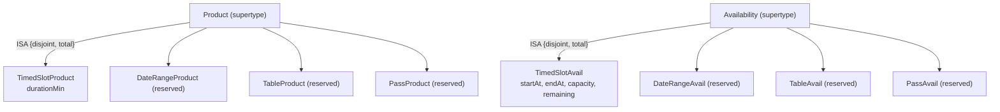

# VisitMyLondon — Agent Task Backlog (Build Runbook)

_A single, ordered, agent-executable backlog for the VML MVP business logic: use case diagram, EER, epics → user stories → tasks → subtasks, the tests for every task, and the git/PR protocol each task follows. It operationalises **VML Business Logic Implementation Plan** (rules, rationale) and sits under the **MVP Implementation Plan** and **Web App Implementation Plan** (architecture, stack)._

**Repo:** `int-vml-core` (`github.com/d4sun/int-vml-core`) · **Integration branch:** `develop` · **Stack:** Next.js 16 (App Router) · React 19 · TypeScript strict · pnpm · Prisma 6 (classic) · Better Auth · Postgres · Stripe Connect · pg-boss · Resend · Vitest · Playwright

---

## 0. How an agent uses this file

1. Read **§1 Task Protocol** once. It applies to every task.
2. Find the **next task**: the first unchecked `[ ]` task in **§8 Execution order** whose dependencies are all `[x]`.
3. Open that task's card in **§9 Backlog** (task ID, deliverables, tests, done-when).
4. Execute the protocol: **branch → implement → write tests → verify → PR to `develop`**.
5. Tick the task's checkbox (in the same PR), record any deviation in **§11 Deviations log**, stop, and report. Do not start the next task unless told to.

Everything an agent needs to decide _what_ to build is in §2–§7 (rules, model, tests). Everything about _how to work_ is in §1 and §10.

**Status legend:** `[ ]` todo · `[~]` in progress / PR open · `[x]` merged to `develop`

---

## 1. Task Protocol (applies to every task, no exceptions)

### 1.1 Branching

- One **task = one branch = one PR**. Never mix tasks.
- Branch name: `feat/<task-id-lowercase>-<slug>`, e.g. `feat/e0-s2-03-password-reset`. Use `fix/`, `chore/`, `test/` prefixes only for non-feature tasks.
- Always branch from an up-to-date `develop`:
  ```bash
  git fetch origin
  git switch develop && git pull --ff-only
  git status --short          # must be clean; if not, STOP and report
  git switch -c feat/<task-id>-<slug>
  ```
- **Stacking:** if the task depends on a task whose PR is not merged yet, branch from that task's branch instead and write `Stacked on #<PR>` in the PR body. The PR still targets `develop`.

### 1.2 Implementation order inside a task

`schema/migration → zod schema → service (all business logic) → route handler / server action → UI → tests`.
Services own logic; UI and routes are thin. Respect cross-cutting rules **CR-1..CR-9** (§3).

### 1.3 Tests are part of the task, not a follow-up

- Every task card lists required tests. Write them **in the same branch**.
- Test layers: **U** unit (pure logic, no DB) · **I** integration (real Postgres) · **E** e2e (Playwright). A task card says which layers apply.
- A task is not done until its listed TC / IT / E2E IDs exist as tests (put the ID in the test title, e.g. `it("TC-E0S2-03: reset token is single-use", …)`).
- Mutation sanity check: for every access/gating rule, confirm the test fails if the rule is removed.

### 1.4 Verify (all must pass before raising the PR)

```bash
pnpm install --frozen-lockfile
pnpm exec prisma generate
pnpm exec prisma migrate status           # when the task touches the schema: run `prisma migrate dev` first, confirm no drift
pnpm exec tsc --noEmit
pnpm exec eslint .
pnpm exec prettier --check <changed files>   # repo-wide check is not green yet (see §11)
pnpm test:unit                               # no external services
TEST_DATABASE_URL=postgresql://…/vml_test pnpm test:integration
pnpm test:e2e                                # only if the task card lists E2E
pnpm build                                   # `next build`
```

Also: no secrets committed; `.env.example` updated if a new env var was added; no `console.log` left; no change to unrelated files.

CI runs the same gates (`.github/workflows/ci.yml`) against a Postgres 17 service, so a task that passes locally should pass there. `TEST_DATABASE_URL` must be a **direct/session** connection whose database name contains `test`; the transaction-mode pooler cannot serve migrations or pg-boss.

### 1.5 Commit, push, PR

- **Commit message:** Conventional Commits, one commit per task (squash locally if needed):
  `feat(<scope>): <summary> (<TASK-ID>)` — e.g. `feat(auth): password reset flow (E0-S2-03)`.
  **Do not append `Co-Authored-By`, `Claude-Session` or any attribution trailer** to commits or PR bodies (owner's instruction).
- Push and open the PR against `develop`:
  ```bash
  git add -A && git commit -m "feat(auth): password reset flow (E0-S2-03)"
  git push -u origin HEAD
  gh pr create --base develop --title "feat(auth): password reset flow (E0-S2-03)" --body-file <(cat <<'EOF'
  <PR template from §1.6>
  EOF
  )
  ```
- If `gh` or push fails (auth, protected branch), stop and report the exact error; do not work around it.

### 1.6 PR template

```markdown
## Task

<TASK-ID> — <title> (Story <story id>, Epic <epic id>)

## What changed

- …

## Tests

- Added: <TC/IT/E2E IDs>
- Results: unit <n>/<n>, integration <n>/<n>, e2e <n>/<n>

## Verification

- [ ] tsc · [ ] eslint · [ ] prettier · [ ] tests · [ ] build · [ ] migrate status (if schema)

## Notes / deviations

- (also logged in docs backlog §11)

## Follow-ups

- …
```

### 1.7 Definition of Done (task)

Branch from fresh `develop` · task deliverables complete · listed tests written and green · all §1.4 checks green · backlog checkbox ticked · deviations logged · PR raised to `develop`.

---

## 2. Use Case Diagram (UCD)

Actors: **Guest** (unauthenticated), **Tourist** (specialises Guest), **Vendor** (Owner/Staff), **Admin**; external systems **Stripe**, **Email provider (Resend)**, **Scheduler (pg-boss)**.


**Use case → story map:** UC-01→E0-S1 · UC-02→E0-S2 · UC-07/08/09→E1-S1 · UC-30→E1-S2 · UC-10→E2-S1 · UC-11→E2-S2/S3 · UC-12→E3-S1 · UC-13→E3-S2 · UC-32→E3-S3 · UC-14→E4-S1 · UC-19→E4-S2 · UC-15→E5-S1 · UC-16→E5-S2 · UC-17→E6-S1 · UC-18→E6-S2 · UC-27→E7-S1 · UC-20→E8-S1 · UC-21→E9-S1 · UC-22→E9-S2 · UC-33→E9-S3 · UC-23→E10-S1 · UC-24/25/26→E10-S2.

---

## 3. Cross-cutting rules (CR-n) — every task inherits these

- **CR-1 Authorization is server-side.** Every service entrypoint calls `requireUser` / `requireRole` / `requireVendorMember`. UI hiding is never a control.
- **CR-2 Vendor data is caller-scoped.** Derive `vendorId` from the caller's `VendorMember`; never trust a client-supplied `vendorId`.
- **CR-3 Inventory mutations are transactional and row-locked** (`SELECT … FOR UPDATE`/advisory lock) for hold, hold→commit, restock.
- **CR-4 Webhooks are authoritative** for booking/payment/transfer/refund state; the browser redirect only shows "processing".
- **CR-5 Money is integer pence**; commission resolves **vendor override → category default → platform default**.
- **CR-6 Time is UTC in storage, Europe/London in rendering**; availability cutoffs computed in UTC.
- **CR-7 Every state transition that needs an email enqueues exactly one** retriable job.
- **CR-8 Rate-limit auth and booking endpoints** (Postgres-backed).
- **CR-9 No account enumeration** on register/reset/sign-in.

---

## 4. EER model

### 4.1 Core diagram (entities, keys, key attributes)


### 4.2 Specialisation hierarchies (the booking spine)

`Product` and `Availability` are **disjoint, total** supertypes discriminated by `Category.type`/`Product.kind`. **Only `TIMED_SLOT` is implemented in the MVP**; the rest are reserved seams.



Booking/checkout/webhook/refund code depends only on the `AvailabilityModule` interface (`check`, `hold`, `commit`, `release`, `restock`). Each subtype implements it. Never branch on `kind` in checkout.

### 4.3 Entity classification

| Entity                                                                                           | Kind                                                                       | Identified by                        |
| ------------------------------------------------------------------------------------------------ | -------------------------------------------------------------------------- | ------------------------------------ |
| User, Vendor, Category, Listing, Product, Booking, Review, Trip, WebhookEvent, AuditLog, Dispute | strong                                                                     | `id` (WebhookEvent: `stripeEventId`) |
| VendorMember                                                                                     | associative (User × Vendor)                                                | (`userId`,`vendorId`)                |
| ListingImage, Availability, Hold, BookingItem, Payment, Transfer, Refund, TripItem               | weak                                                                       | owner + discriminator                |
| Session, Account, Verification, RateLimit; `User.name` NOT NULL                                  | **E0-S1-02** (`20261121120000_better_auth_identity`, backfills null names) |
| Category                                                                                         | recursive                                                                  | `parentId`                           |

### 4.4 Derived attributes (each needs a test)

| Derived                        | Formula                                                                 |
| ------------------------------ | ----------------------------------------------------------------------- |
| `Availability.remaining`       | `capacity − Σ confirmed qty − Σ active hold qty` (inside row-locked TX) |
| `BookingItem.subtotal`         | `unitPrice × quantity`                                                  |
| `BookingItem.commissionAmount` | `round(subtotal × resolvedBps / 10000)`                                 |
| `Booking.total`                | `Σ BookingItem.subtotal`                                                |
| `Payment.applicationFeeAmount` | `Σ commissionAmount` (single-vendor destination charge)                 |
| partial-refund commission      | `commissionAmount × (refundAmount / subtotal)`, rounded                 |

### 4.5 Cross-entity constraints (service-enforced; each has an IT-)

1. `BookingItem.vendorId` = product→listing→vendor, set server-side only.
2. `Transfer` only if vendor `APPROVED && stripeOnboardingComplete`.
3. `Listing → PUBLISHED` only if vendor `APPROVED`; bookable only if also onboarded.
4. `Review` only for a `FULFILLED` item, one per item.
5. `remaining >= 0` always (row-locked decrement).
6. Money = non-negative integer pence; currency `GBP`.
7. No `WebhookEvent.stripeEventId` processed twice; Stripe writes carry idempotency keys.

### 4.6 Schema change ledger (which task introduces what)

| Entity/change                                                            | Introduced by                                                                                  |
| ------------------------------------------------------------------------ | ---------------------------------------------------------------------------------------------- |
| Session, Account, Verification, RateLimit; `User.name` NOT NULL          | **E0-S1-02** (not yet written; migration `20261115040000_better_auth_identity` does not exist) |
| `pgboss` schema (pg-boss v46)                                            | **E0-S0-01** (`20261115120000_pg_boss`)                                                        |
| `AuditLog`                                                               | E8-S1-01 (`20261121180000_audit_log`)                                                          |
| `Vendor.stripeRequirementsDue`, `stripeDisabledReason`, `stripeStatusAt` | **E4-S2-04** (`20261123120000_vendor_stripe_requirements`)                                     |
| `ListingImage`; drops `Listing.images String[]`                          | **E5-S1-02** (`20261125120000_listing_images`)                                                 |
| `Availability.closed`; unique `(productId, startAt)`                     | **E5-S2-03** (`20261126120000_availability_closed_unique`)                                     |
| `Dispute`                                                                | E10-S2-03                                                                                      |
| FTS `tsvector` + GIN index on Listing                                    | E1-S1-01                                                                                       |
| Everything else                                                          | already in `20261108044754_init`                                                               |

---

## 5. Testing conventions

| Aspect      | Convention                                                                                                                                                                                                                                                                                                                                          |
| ----------- | --------------------------------------------------------------------------------------------------------------------------------------------------------------------------------------------------------------------------------------------------------------------------------------------------------------------------------------------------- |
| Runner      | Vitest 5, projects `unit` and `integration`; Playwright for e2e                                                                                                                                                                                                                                                                                     |
| Layout      | `tests/unit/*.test.ts`, `tests/integration/*.test.ts`, `tests/e2e/*.spec.ts`, helpers in `tests/helpers`, `tests/e2e/support.ts`                                                                                                                                                                                                                    |
| Naming      | test titles start with their ID: `TC-E0S2-03: …`, `IT-08: …`, `E2E-01: …`                                                                                                                                                                                                                                                                           |
| DB          | `TEST_DATABASE_URL` required; the DB name **must contain `test`** (helper refuses otherwise). `tests/helpers/global-setup.ts` runs `prisma migrate deploy` once per integration run; `truncatePublicSchema()` cleans between files, and the `pgboss` schema is deliberately left intact.                                                            |
| Auth/email  | `tests/helpers/email-queue-contract.ts` runs one contract against `InProcessEmailQueue` (unit) and `PgBossEmailQueue` (integration); `RecordingEmailSender` records/fails on demand; e2e reads mail from `EMAIL_OUTBOX_DIR` via `FileEmailSender` (dev/test only, refused in production). The auth harness (`makeHarness()`) arrives with E0-S1-02. |
| Rate limits | each test uses its own `x-forwarded-for` IP (`freshIp()` / `uniqueIp()`) so tests don't throttle each other                                                                                                                                                                                                                                         |
| Time        | use fake timers / injectable clock; never `sleep` for expiry                                                                                                                                                                                                                                                                                        |
| Stripe      | an `StripeAdapter` interface with a **fake** (unit/integration) and **real test-mode** implementation (smoke + e2e). Webhook tests feed signed fixture payloads.                                                                                                                                                                                    |
| Money       | assert exact integer pence; add a property-style test where rounding exists                                                                                                                                                                                                                                                                         |
| Gates       | every authorization/state-gate has a negative test (and is mutation-checked)                                                                                                                                                                                                                                                                        |
| Coverage    | `@vitest/coverage-v8`; target ≥ 85 % on `lib/**/service*` and money code, not enforced on UI                                                                                                                                                                                                                                                        |
| Scripts     | `pnpm test`, `test:unit`, `test:integration`, `test:e2e`                                                                                                                                                                                                                                                                                            |

---

## 6. Epic index

| Epic   | Name                                        | User type | Stories | Depends on                  |
| ------ | ------------------------------------------- | --------- | ------- | --------------------------- |
| BL-E0  | Identity, Auth, RBAC & platform foundations | shared    | S0–S3   | —                           |
| BL-E8  | Vendor governance                           | Admin     | S1      | E0                          |
| BL-E4  | Vendor onboarding & payout readiness        | Vendor    | S1–S2   | E0, E8-S1                   |
| BL-E9  | Moderation & taxonomy                       | Admin     | S1–S3   | E5 (S2 first), E3-S3 for S3 |
| BL-E5  | Catalog, products & availability            | Vendor    | S1–S2   | E4, E9-S2                   |
| BL-E1  | Discovery & trip planning                   | Tourist   | S1–S2   | E5, E9-S1                   |
| BL-E2  | Cart, checkout & payment (flagship)         | Tourist   | S1–S3   | E4, E5                      |
| BL-E6  | Vendor booking ops & payouts                | Vendor    | S1–S2   | E2                          |
| BL-E10 | Financial oversight, refunds & disputes     | Admin     | S1–S2   | E2                          |
| BL-E3  | Bookings, cancellation & reviews            | Tourist   | S1–S3   | E2, E6-S1, E10-S1 (for S2)  |
| BL-E7  | Vendor team (Could)                         | Vendor    | S1      | E0                          |

**Critical path:** E0 → E8-S1 → E4 → E9-S2 → E5 → E2 → E10-S1 → E3-S2.

---

## 7. Integration & E2E test catalogue (referenced by task cards)

### 7.1 Integration tests (real Postgres; Stripe fake or test mode)

| ID    | Scenario                                 | Pass condition                                                |
| ----- | ---------------------------------------- | ------------------------------------------------------------- |
| IT-01 | Two concurrent holds on last unit        | exactly one succeeds; `remaining=0`, never negative           |
| IT-02 | Hold TTL elapses                         | capacity returns; booking can't confirm on it                 |
| IT-03 | Hold→commit TX                           | atomic permanent decrement, no double-count                   |
| IT-04 | Booking+items TX, item insert fails      | full rollback, no orphans                                     |
| IT-05 | Commission resolution                    | override / category / platform chosen correctly               |
| IT-06 | Single-vendor charge confirm             | destination charge, `fee = Σ commission`                      |
| IT-07 | Multi-vendor settle                      | one Payment, one Transfer per vendor, `subtotal − commission` |
| IT-08 | Same `stripeEventId` twice               | processed once                                                |
| IT-09 | `succeeded` before redirect              | state correct regardless                                      |
| IT-10 | PENDING past TTL                         | cancelled, holds released                                     |
| IT-11 | Full refund + reversal webhook           | Refund row, item REFUNDED, reversal recorded, restocked       |
| IT-12 | 50 % partial refund                      | proportional refund/reversal/commission                       |
| IT-13 | One of two transfers fails               | booking paid; failure flagged; reconciliation retries         |
| IT-14 | Publish by non-onboarded vendor          | rejected at service                                           |
| IT-15 | Transfer to non-onboarded vendor         | no transfer created                                           |
| IT-16 | Review on non-fulfilled item / duplicate | rejected; unique per item                                     |
| IT-17 | Suspended vendor / unpublished listing   | excluded from search                                          |
| IT-18 | Vendor A reads vendor B data             | denied                                                        |
| IT-19 | `BookingItem.vendorId` vs product owner  | always equal; client value ignored                            |
| IT-20 | Any amount path                          | integer pence; no float drift                                 |

### 7.2 E2E journeys (Playwright)

| ID     | Journey                                                                                   | Assert                                                              |
| ------ | ----------------------------------------------------------------------------------------- | ------------------------------------------------------------------- |
| E2E-01 | Tourist happy path: register → verify → search → add slot → checkout → pay → confirmation | booking CONFIRMED, email queued, appears in "my bookings"           |
| E2E-02 | Multi-vendor checkout _(flagship)_                                                        | one payment; both vendors have a transfer; fee retained             |
| E2E-03 | Vendor onboarding → publish                                                               | PUBLISHED only after admin approval; publish blocked pre-onboarding |
| E2E-04 | Admin governance: approve vendor → moderate listing → partial refund                      | ledger shows refund + reversal                                      |
| E2E-05 | Cancellation within policy                                                                | refund path runs; capacity restored                                 |
| E2E-06 | Review after fulfilment                                                                   | visible only after admin approval                                   |
| E2E-07 | RBAC negative: tourist opens `/vendor`, `/admin`                                          | redirected/denied; no data                                          |
| E2E-08 | Two tourists race the last slot                                                           | one confirms, other sees "just sold out"                            |
| E2E-09 | Webhook-authoritative confirm (drop redirect)                                             | booking confirms via webhook                                        |

The e2e suite lives in `tests/e2e/` (Playwright, `pnpm test:e2e`, CI job `e2e`). E0-S1-07 added the auth journeys and E2E-07; the other numbered journeys above are built up as their stories land (see task cards), and **X-01** closes any that remain.

---

## 8. Execution order

Pick the first unchecked story whose dependencies are `[x]`; work its tasks top-to-bottom (§9).

| #   | Story  | Name                                         | Status |
| --- | ------ | -------------------------------------------- | ------ |
| 1   | E0-S0  | Platform foundations (jobs, CI, errors)      | [x]    |
| 2   | E0-S1  | Register & verify email                      | [x]    |
| 3   | E0-S2  | Sign in, reset password, profile             | [x]    |
| 4   | E0-S3  | RBAC guards & route protection               | [x]    |
| 5   | E8-S1  | Approve / reject / suspend vendors           | [x]    |
| 6   | E4-S1  | Apply to become a vendor                     | [x]    |
| 7   | E4-S2  | Stripe Connect Express onboarding            | [x]    |
| 8   | E9-S2  | Manage categories / taxonomy                 | [x]    |
| 9   | E5-S1  | Manage listings & images                     | [x]    |
| 10  | E5-S2  | Manage products & timed-slot availability    | [~]    |
| 11  | E9-S1  | Moderate listings                            | [x]    |
| 12  | E1-S1  | Search, filter & map                         | [x]    |
| 13  | E2-S1  | Add to cart with soft hold                   | [x]    |
| 14  | E2-S2  | Checkout, booking & Stripe charge            | [x]    |
| 15  | E2-S3  | Webhook confirmation & lifecycle             | [x]    |
| 16  | E1-S2  | Save to trip & itinerary                     | [x]    |
| 17  | E6-S1  | Manage incoming bookings                     | [x]    |
| 18  | E3-S1  | View my bookings                             | [x]    |
| 19  | E10-S1 | Refund + transfer reversal                   | [ ]    |
| 20  | E3-S2  | Cancel within policy                         | [ ]    |
| 21  | E6-S2  | Earnings & payout status                     | [ ]    |
| 22  | E3-S3  | Leave a review                               | [ ]    |
| 23  | E9-S3  | Moderate reviews                             | [ ]    |
| 24  | E10-S2 | Oversight, reconciliation, disputes, metrics | [ ]    |
| 25  | E7-S1  | Vendor team (Could)                          | [ ]    |
| 26  | X      | Remaining e2e journeys & hardening           | [ ]    |

---

## 9. Backlog (epics → stories → tasks)

> Card format: **Task ID** · deliverables · tests · _done-when_. Branch = `feat/<id>-<slug>` (§1.1). Every card implicitly includes the full §1 protocol.

---

### BL-E0 — Identity, Auth, RBAC & platform foundations

#### E0-S0 — Platform foundations _(enabler)_

_As the team, we want shared infrastructure so every later story is built on durable jobs, consistent errors and CI._

| Task                                    | Deliverables                                                                                                                                                                                                                | Tests                                                                                                                           | Done-when                                                              | State              |
| --------------------------------------- | --------------------------------------------------------------------------------------------------------------------------------------------------------------------------------------------------------------------------- | ------------------------------------------------------------------------------------------------------------------------------- | ---------------------------------------------------------------------- | ------------------ |
| **E0-S0-01** pg-boss job infrastructure | `lib/jobs/{boss,config,queues,register,email-queue,logger}.ts`; `scripts/jobs-worker.ts` (`pnpm worker`); pg-boss schema committed as a Prisma migration; `EmailQueue` contract + pg-boss implementation, retries + backoff | U: queue contract tests run against both impls. I: enqueued email job is delivered once, retried on failure, survives a restart | email sends are durable; `InProcessEmailQueue` only used in unit tests | [x] PR #3 (merged) |
| **E0-S0-02** Service conventions        | `lib/errors.ts` (`AppError`, `NotFound`, `Forbidden`, `Conflict`, `ValidationError`), `lib/result.ts`, action wrapper mapping errors → HTTP/UI                                                                              | U: mapping table                                                                                                                | all services throw typed errors                                        | [x] PR #5 (merged) |
| **E0-S0-03** CI workflow                | `.github/workflows/ci.yml`: install, prisma generate, tsc, eslint, prettier, Postgres service, unit+integration, build; e2e job (Playwright) on PR                                                                          | CI run green on a trivial PR                                                                                                    | PRs show required checks                                               | [x] PR #4 (merged) |

> **Order deviation:** E0-S0-03 was implemented before E0-S0-02 so the integration tests merged in PR #3 would run for the first time against a real Postgres. See §11.
> **E0-S0-01 deltas vs. this card:** `lib/email/*` did not exist on `develop` (E0-S1-03 was never merged), so this task defined the `EmailQueue`/`EmailSender` contracts and a minimal Vitest harness itself. Open the E0-S1-03 card with that context.

#### E0-S1 — Register & verify email _(UC-01)_ — **in progress (re-baselined 2026-11-15)**

> **Re-baseline:** this story was marked `[~]` ("implemented") in the first version of this document, but no E0-S1 code, migration or test exists anywhere in the repository history (`git log --all`). The work described below has to be built from scratch; the states are reset to `[ ]`. See §11.

_As a Guest, I want to create an account and confirm my email so that I can book and the platform can trust my identity._

**Acceptance:** valid registration creates `User(TOURIST, emailVerified=false)` + verification token and enqueues one email · valid token verifies + signs in · weak password rejected server-side · duplicate email → generic response, no second row (CR-9) · register/resend rate-limited (CR-8).

| Task                                   | Deliverables                                                                                                                                                                                                                                                                                      | Tests | State               |
| -------------------------------------- | ------------------------------------------------------------------------------------------------------------------------------------------------------------------------------------------------------------------------------------------------------------------------------------------------- | ----- | ------------------- |
| E0-S1-01 Shared validation             | `lib/validation/auth.ts` (`registerSchema`, password policy min 8/max 128, ≥1 letter, ≥1 digit)                                                                                                                                                                                                   | U     | [x] PR #10 (merged) |
| E0-S1-02 Better Auth + Prisma identity | `lib/auth/config.ts`, `lib/auth.ts`, `lib/auth-client.ts`, route `app/api/auth/[...all]`, migration `20261121120000_better_auth_identity`                                                                                                                                                         | I     | [x] PR #12 (merged) |
| E0-S1-03 Email layer                   | `lib/email/templates/*`, **Brevo** + File senders behind the **existing** `EmailSender` contract, transport selection in `lib/email/factory.ts`, `lib/env.ts`; keep the `EmailQueue` interface from E0-S0-01 and drop the `EMAIL_OUTBOX_DIR` requirement from the worker when Brevo is configured | U     | [x] PR #11          |
| E0-S1-04 Verification flow             | verify callback `/verify-email/complete`, resend verification, expiry (1h)                                                                                                                                                                                                                        | I     | [x] PR #13          |
| E0-S1-05 UI                            | `/register`, `/verify-email/complete`, `components/auth/*`                                                                                                                                                                                                                                        | E     | [x] PR #14          |
| E0-S1-06 Rate limits                   | `/sign-up/email` 5/min, `/send-verification-email` 3/min (Postgres-backed)                                                                                                                                                                                                                        | I     | [x] PR #15          |
| E0-S1-07 Tests                         | 77 Vitest (45 unit + 32 integration) + 8 Playwright; **plus** `playwright.config.ts` and `pnpm test:e2e`, which activates the guarded `e2e` CI job                                                                                                                                                | all   | [x] PR #24          |

> **E0-S1-03 complete:** the transport shipped in PR #8 — `BrevoEmailSender` + `createEmailSender()` factory, worker wiring, `BREVO_API_KEY`/`EMAIL_FROM`/`EMAIL_FROM_NAME`. This card now also has `lib/email/templates/*`, typed `lib/env.ts` validation and `createAuthEmailSenders()`; the senders are passed to Better Auth in E0-S1-02.

Test cases: TC-E0S1-01 valid registration (unverified user, email enqueued) · -02 duplicate email (generic, no 2nd user) · -03 weak password rejected server-side · -04 valid token → verified + session · -05 expired/invalid token rejected, resend offered · -06 6 registrations/min from one IP → throttled. Also cover: unverified sign-in 403, `platformRole` not client-settable, input normalisation, provider outage, resend enumeration-safety.

> **Known constraint (see §11):** Better Auth's email-verification token is a stateless JWT, so resending will **not** invalidate the earlier link; it expires after 1 h. If that is unacceptable, relax the AC wording — do not invent stateful tokens.
> **Start here:** branch `feat/e0-s1-register-verify` from `develop`, implement 01→07 in order, run the full gate (§1.4). E0-S0-01/02/03 are the only platform pieces already in place.

#### E0-S2 — Sign in, reset password, manage profile _(UC-02)_

_As any user, I want to sign in, reset my password and edit my profile so that I control my account._
**Acceptance:** correct credentials → rotating session cookie · wrong credentials → generic failure + throttled (CR-9/CR-8) · reset link single-use + expiring · profile update re-validates and never changes `platformRole` or another user's data (CR-1).

| Task                                  | Deliverables                                                                                                                                       | Tests                                                       | Done-when                       | State      |
| ------------------------------------- | -------------------------------------------------------------------------------------------------------------------------------------------------- | ----------------------------------------------------------- | ------------------------------- | ---------- |
| **E0-S2-01** Auth schemas             | `loginSchema`, `forgotPasswordSchema`, `resetPasswordSchema`, `profileSchema` in `lib/validation/auth.ts`                                          | U                                                           | schemas shared client/server    | [x] PR #16 |
| **E0-S2-02** Sign-in + session policy | enable email/password sign-in in config; session expiry/rotation; per-IP + per-account throttling rule for `/sign-in/email`                        | I: TC-E0S2-01, -02                                          | sign-in works; generic failures | [x] PR #17 |
| **E0-S2-03** Forgot/reset password    | `sendResetPassword` via email queue (new `passwordResetEmail` template), single-use token, enumeration-safe `/forgot-password`                     | U (template), I: TC-E0S2-03                                 | reused token rejected           | [x] PR #18 |
| **E0-S2-04** Profile service          | `lib/services/profile.ts` (`getProfile`, `updateProfile`) calling `requireUser`; `platformRole` impossible to set via input                        | I: TC-E0S2-04, -05                                          | cross-user edit denied          | [x] PR #19 |
| **E0-S2-05** UI                       | `/sign-in`, `/forgot-password`, `/reset-password`, `/account/profile`; fix links used in already-registered email (`/sign-in`, `/forgot-password`) | E: sign-in → profile edit → sign-out; reset flow via outbox | links from S1 email resolve     | [x] PR #20 |

Test cases: TC-E0S2-01 correct login → session issued & rotates · -02 wrong password ×N → generic error, throttled · -03 reset token reused → rejected after first use · -04 user A edits user B profile → denied · -05 client sends `platformRole=ADMIN` on profile save → ignored/denied.

#### E0-S3 — RBAC guard & route protection

_As the platform, I want server-side role gates so privileges can't be forged._
**Acceptance:** `requireRole('VENDOR'|'ADMIN')` protects the respective layouts; services re-check (route guard is coarse, service check is real); unauthenticated/mis-role access → 403/redirect, never data.

| Task                           | Deliverables                                                                                                                                       | Tests                                            | Done-when                            | State      |
| ------------------------------ | -------------------------------------------------------------------------------------------------------------------------------------------------- | ------------------------------------------------ | ------------------------------------ | ---------- |
| **E0-S3-01** Guard library     | `lib/auth/guards.ts`: `requireUser`, `requireRole`, `requireVendorMember(vendorId, roles?)`, `requireAdmin`; returns typed `Actor`                 | U (guards with fake session), I: TC-E0S3-02, -03 | single import point for all services | [x] PR #21 |
| **E0-S3-02** Layout protection | `app/(vendor)/layout.tsx`, `app/(admin)/layout.tsx` (or route-group equivalents) redirect on role mismatch; proxy/middleware only coarse           | E: TC-E0S3-01, E2E-07                            | no privileged data rendered          | [x] PR #22 |
| **E0-S3-03** Seed users        | `prisma/seed.ts` (idempotent): admin, approved vendor owner + staff, tourist; documented in README; **test-only credentials, never in production** | I: seed idempotent                               | `pnpm prisma db seed` works          | [x] PR #23 |

Test cases: TC-E0S3-01 tourist hits `/vendor` → denied/redirected · -02 vendor calls admin service action → denied · -03 staff of vendor X reads vendor Y bookings → denied (CR-2).

---

### BL-E8 — Vendor governance (Admin)

#### E8-S1 — Approve / reject / suspend vendors _(UC-20)_

_As an Admin, I want to govern vendor status so that only trusted supply is live._
**Acceptance:** queue of `PENDING` vendors · transitions `PENDING→APPROVED|REJECTED`, `APPROVED→SUSPENDED`, `SUSPENDED→APPROVED` (others illegal) · suspending hides listings from discovery immediately and blocks new bookings · actions audit-logged.

| Task                                  | Deliverables                                                                                                                                                                     | Tests                                                                       | Done-when                             | State      |
| ------------------------------------- | -------------------------------------------------------------------------------------------------------------------------------------------------------------------------------- | --------------------------------------------------------------------------- | ------------------------------------- | ---------- |
| **E8-S1-01** AuditLog + state machine | migration adding `AuditLog`; `lib/services/vendor-governance.ts` with explicit transition table; `audit.record()` helper                                                         | U: transition table (all legal + illegal); I: audit rows written in same TX | illegal transitions throw `Conflict`  | [x] PR #26 |
| **E8-S1-02** Visibility predicate     | `lib/catalog/visibility.ts`: `publiclyVisibleListingWhere()` (PUBLISHED ∧ vendor APPROVED) reused by search/pages; `assertVendorCanSell(vendorId)` helper (APPROVED ∧ onboarded) | I: IT-17 (partial), IT-14 stub                                              | single source of truth for visibility | [x] PR #27 |
| **E8-S1-03** Admin UI                 | `/admin/vendors` queue + detail, approve/reject (reason)/suspend/reinstate actions                                                                                               | E: approve & suspend path                                                   | actions reflect immediately           | [x] PR #28 |
| **E8-S1-04** Email                    | vendor-approved / rejected / suspended templates (CR-7, exactly one each)                                                                                                        | U templates; I enqueue-once                                                 | emails fire once per transition       | [x] PR #29 |

Test cases: TC-E8S1-01 approve pending → APPROVED, onboarding unlockable · -02 suspend → listings drop from discovery, no new bookings · -03 reinstate → APPROVED · -04 non-admin calls approve → denied.

---

### BL-E4 — Vendor onboarding & payout readiness

#### E4-S1 — Apply to become a vendor _(UC-14)_

_As a user, I want to apply with business details so that I can be approved to sell._
**Acceptance:** creates `Vendor(PENDING)` + `VendorMember(OWNER)` for the caller · cannot publish or be paid while PENDING · one open application per owner.

| Task                             | Deliverables                                                                                                                                                                         | Tests                                                          | Done-when                           | State      |
| -------------------------------- | ------------------------------------------------------------------------------------------------------------------------------------------------------------------------------------ | -------------------------------------------------------------- | ----------------------------------- | ---------- |
| **E4-S1-01** Application service | `vendorApplicationSchema`; `lib/services/vendor-application.ts#applyAsVendor` (TX: Vendor + Owner member; sets caller's `platformRole` to VENDOR **only on approval**, not on apply) | U schema; I: one open application per owner, second → Conflict | no privilege change before approval | [x] PR #30 |
| **E4-S1-02** UI                  | `/vendor/apply` (react-hook-form), status page showing PENDING/REJECTED                                                                                                              | E: apply → pending shown                                       | applicant sees status               | [x] PR #31 |
| **E4-S1-03** Admin notification  | enqueue admin email on new application; surfaces in E8-S1 queue                                                                                                                      | I                                                              | queue shows new vendor              | [x] PR #32 |

Test cases: TC-E4S1-01 apply → Vendor PENDING + OWNER member · -02 second application while one open → rejected · -03 PENDING vendor cannot publish (service) · -04 roles unchanged until approval.

#### E4-S2 — Stripe Connect Express onboarding _(UC-19)_

_As a Vendor Owner, I want to complete KYC and bank setup so that I can receive payouts._
**Acceptance:** after approval, owner starts Connect Express (account + hosted link) · `account.updated` sets `stripeOnboardingComplete=true` only when `charges_enabled && payouts_enabled` · publish and payout **hard-gated** server-side on `APPROVED && stripeOnboardingComplete` · incomplete KYC shows "action needed" deep link.

| Task                                   | Deliverables                                                                                                                                                                                                    | Tests                                                | Done-when                         | State      |
| -------------------------------------- | --------------------------------------------------------------------------------------------------------------------------------------------------------------------------------------------------------------- | ---------------------------------------------------- | --------------------------------- | ---------- |
| **E4-S2-01** Stripe adapter            | `lib/stripe/adapter.ts` interface (accounts, account links, later: PaymentIntents, transfers, refunds, reversals), `lib/stripe/real.ts`, `lib/stripe/fake.ts`; env `STRIPE_SECRET_KEY`, `STRIPE_WEBHOOK_SECRET` | U: fake behaves per contract                         | all Stripe access through adapter | [x] PR #33 |
| **E4-S2-02** Start onboarding          | `startOnboarding(vendorId)` (OWNER only, vendor APPROVED) creates/reuses account, returns link; idempotency key                                                                                                 | I: owner ok, staff denied, PENDING vendor denied     | link returned                     | [x] PR #34 |
| **E4-S2-03** Webhook endpoint          | `app/api/webhooks/stripe/route.ts`: raw-body signature verification, `WebhookEvent` dedupe (insert-first unique `stripeEventId`), dispatch table                                                                | I: TC-E2S3-06 (bad signature), IT-08 (dedupe)        | shared with E2/E10                | [x] PR #35 |
| **E4-S2-04** `account.updated` handler | sets/clears `stripeOnboardingComplete`; updates requirement summary                                                                                                                                             | I: TC-E4S2-03                                        | flag follows Stripe               | [x] PR #36 |
| **E4-S2-05** Gate                      | `assertVendorCanSell()` used by publish and payout paths                                                                                                                                                        | I: TC-E4S2-01/-02/-04, IT-14                         | gates enforced in services        | [x] PR #37 |
| **E4-S2-06** UI                        | `/vendor/payouts/setup` status + "continue onboarding"                                                                                                                                                          | E: E2E-03 (onboarding part, test-mode or faked link) | status reflects flag              | [x] PR #38 |

Test cases: TC-E4S2-01 approved + onboarding complete → publish & payout unlocked · -02 approved, onboarding incomplete → publish blocked, "action needed" · -03 `account.updated` charges only, no payouts → flag stays false · -04 publish while vendor PENDING → denied server-side.

---

### BL-E9-S2 — Manage categories / taxonomy _(run before E5)_ _(UC-22)_

_As an Admin, I want to manage categories so the catalog is organised and priced._
**Acceptance:** CRUD with self-referential `parentId`, `type`, `commissionBpsDefault` · cannot delete a category with listings · changing a default affects only new bookings (not settled items).

| Task                          | Deliverables                                                                                      | Tests                                     | Done-when                     | State      |
| ----------------------------- | ------------------------------------------------------------------------------------------------- | ----------------------------------------- | ----------------------------- | ---------- |
| **E9-S2-01** Category service | `lib/services/category.ts` (CRUD, tree read, cycle prevention, delete guard); bps bounds 0..10000 | U: cycle detection, bounds; I: TC-E9S2-01 | no cycles, no orphan listings | [x] PR #39 |
| **E9-S2-02** Seed taxonomy    | seed top-level categories (Tours, Events, …) with defaults                                        | I                                         | seed idempotent               | [x] PR #40 |
| **E9-S2-03** Admin UI         | `/admin/categories` tree editor                                                                   | E                                         | CRUD works                    | [x] PR #41 |

Test cases: TC-E9S2-01 delete category with listings → blocked · -02 change default → applies to new bookings only · -03 parent cycle → rejected.

---

### BL-E5 — Catalog, products & availability (Vendor)

#### E5-S1 — Manage listings & images _(UC-15)_

_As a Vendor, I want to create/edit listings with images and location so tourists can find them._
**Acceptance:** CRUD scoped to caller's vendor (CR-2) · images to S3 as `ListingImage` rows · new listing `DRAFT`; submit → `PENDING_REVIEW`; major edit of a `PUBLISHED` listing → back to `PENDING_REVIEW` · vendor cannot self-publish.

| Task                                         | Deliverables                                                                                            | Tests                                                   | Done-when                | State      |
| -------------------------------------------- | ------------------------------------------------------------------------------------------------------- | ------------------------------------------------------- | ------------------------ | ---------- |
| **E5-S1-01** Listing service + state machine | `listingSchema`; `lib/services/listing.ts` (create/update/submit), transition table, "major field" list | U: transitions, major-edit detection; I: TC-E5S1-01..04 | vendor scoping proven    | [x] PR #42 |
| **E5-S1-02** Image storage                   | S3 adapter (presigned upload, MIME/size limits, `ListingImage` position ordering), local fake           | U: validators; I: ordering/reorder                      | images persisted as rows | [x] PR #43 |
| **E5-S1-03** Vendor listing UI               | `/vendor/listings` list/new/edit, image uploader, submit button                                         | E                                                       | create → submit works    | [x] PR #44 |

Test cases: TC-E5S1-01 create → DRAFT owned by caller vendor · -02 submit → PENDING_REVIEW · -03 edit PUBLISHED core fields → PENDING_REVIEW · -04 edit another vendor's listing → denied.

#### E5-S2 — Manage products & timed-slot availability _(UC-16)_

_As a Vendor, I want to define products and generate capacity so slots are bookable._
**Acceptance:** product CRUD (pence, `policy` within platform bounds D4) · single or recurring slot generation (`remaining=capacity`) · future slots editable/closable · slot with bookings **cannot be deleted, only closed** · past slots read-only · optional per-slot price override · recurrence overlap warns/merges.

| Task                                         | Deliverables                                                                                                                                             | Tests                               | Done-when                         | State      |
| -------------------------------------------- | -------------------------------------------------------------------------------------------------------------------------------------------------------- | ----------------------------------- | --------------------------------- | ---------- |
| **E5-S2-01** Product service + policy bounds | `productSchema`; `lib/services/product.ts`; `policyBounds` validator (platform max refund window etc.)                                                   | U: bounds; I: TC-E5S2-04            | out-of-bounds policy rejected     | [~] PR #45 |
| **E5-S2-02** Timed-slot module               | `lib/availability/module.ts` (`AvailabilityModule` interface) + `lib/availability/timed-slot.ts` generator (single + recurrence, DST-safe via London tz) | U: TC-E5S2-01, DST edge cases       | recurrence correct across BST/GMT | [~] PR #46 |
| **E5-S2-03** Edit/close guard                | `closeSlot`, `deleteSlot` guard, past-slot read-only, price override                                                                                     | I: TC-E5S2-02, -03, -05             | booked slots protected            | [~] PR #47 |
| **E5-S2-04** UI                              | `/vendor/listings/[id]/products`, slot calendar/list, recurrence form                                                                                    | E: create product + recurring slots | slots appear                      | [ ]        |

Test cases: TC-E5S2-01 "every Sat ×8, cap 20" → 8 slots, remaining=20 · -02 delete slot with bookings → blocked, close-only · -03 edit past slot → read-only · -04 policy exceeds platform max → rejected · -05 per-slot price override.

---

### BL-E9-S1 — Moderate listings _(UC-21)_

_As an Admin, I want to approve or reject listings so nothing goes public unvetted._
**Acceptance:** queue of `PENDING_REVIEW`; `→PUBLISHED` or `→REJECTED` (reason, resubmittable) · **no listing is public without admin approval** · publish requires vendor `APPROVED` (and onboarded for bookability).

| Task                            | Deliverables                                                                                               | Tests                    | Done-when              |
| ------------------------------- | ---------------------------------------------------------------------------------------------------------- | ------------------------ | ---------------------- |
| **E9-S1-01** Moderation service | `lib/services/listing-moderation.ts` (`approve`, `reject(reason)`), uses `assertVendorCanSell`, audit-logs | I: TC-E9S1-01/-02, IT-14 | state machine enforced |
| **E9-S1-02** Admin UI + email   | `/admin/listings` queue/detail; approved/rejected emails                                                   | E: E2E-03 final step     | vendor notified        |

Test cases: TC-E9S1-01 approve → PUBLISHED (searchable) · -02 reject with reason → REJECTED, resubmittable · -03 approve when vendor not eligible → blocked.

---

### BL-E1 — Discovery & trip planning (Tourist)

#### E1-S1 — Search, filter & map _(UC-07/08/09)_

_As a Guest/Tourist, I want to search and filter listings and see them on a map so I can find things to book._
**Acceptance:** only `PUBLISHED` listings of `APPROVED` vendors · FTS over title/description · category/area/date/price filters compose (AND) · date filter only surfaces products with a bookable future slot (remaining > 0, before cutoff) · map via lat/lng bounding box · SSR for SEO.

| Task                                        | Deliverables                                                                                                                             | Tests                                           | Done-when                                |
| ------------------------------------------- | ---------------------------------------------------------------------------------------------------------------------------------------- | ----------------------------------------------- | ---------------------------------------- |
| **E1-S1-01** FTS + filter builder           | migration: `tsvector` generated column + GIN index; `lib/search/service.ts` (uses `publiclyVisibleListingWhere`), pagination             | U: filter builder; I: TC-E1S1-01/-02/-04, IT-17 | scoped results only                      |
| **E1-S1-02** Availability-aware date filter | join to future `Availability` (remaining>0, cutoff in UTC)                                                                               | I: TC-E1S1-03                                   | past-cutoff slots ignored                |
| **E1-S1-03** Bounding-box geo               | `bbox` query + haversine ordering helper                                                                                                 | U: haversine; I: TC-E1S1-05                     | only in-viewport listings                |
| **E1-S1-04** SSR pages                      | `/explore`, `/listings/[slug]` (metadata + schema.org JSON-LD), London-time rendering; **retire `lib/mock-data.ts`** — pages read Prisma | E: page renders, meta present                   | indexable; no mock data left in app code |
| **E1-S1-05** Filter UI + map island         | URL-driven filters, map component                                                                                                        | E                                               | filters reflected in URL                 |

Test cases: TC-E1S1-01 draft/pending listing never in results · -02 suspended vendor's listing excluded · -03 all slots past cutoff → not returned for that date · -04 price + category → both applied · -05 map viewport → only inside bbox.

#### E1-S2 — Save to trip & itinerary _(UC-30)_

_As a Tourist, I want to save listings to a trip and order them with optional dates so I can plan before booking._
**Acceptance:** Tourist owns their trips (CR-1) · `TripItem` has `position` and optional `plannedDate` · reorder persists atomically · item can be taken to cart · deleting a trip cascades.

| Task                          | Deliverables                                                 | Tests              | Done-when                |
| ----------------------------- | ------------------------------------------------------------ | ------------------ | ------------------------ |
| **E1-S2-01** Trip service     | create/rename/delete trip, add/remove item, ownership checks | I: TC-E1S2-01, -03 | next-position assignment |
| **E1-S2-02** Reorder          | atomic position update (single TX, no gaps/dupes)            | I: TC-E1S2-02      | stable ordering          |
| **E1-S2-03** UI               | `/trips`, `/trips/[id]`, "save to trip" on listing page      | E                  | plan → saved             |
| **E1-S2-04** Add-to-cart hook | pre-fill product/slot into cart (after E2-S1)                | I: TC-E1S2-04      | cart pre-filled          |

Test cases: TC-E1S2-01 add listing → TripItem at next position · -02 reorder → atomic · -03 user A edits user B's trip → denied · -04 add-to-cart from trip item → pre-filled.

---

### BL-E2 — Cart, checkout & payment _(flagship; governed by CR-3/4/5)_

#### E2-S1 — Add to cart with soft hold _(UC-10)_

_As a Tourist, I want adding an item to reserve capacity briefly so it isn't sold while I check out._
**Acceptance:** `add(product, availability, qty)` in a row-locked TX: if `remaining ≥ qty` write `Hold(TTL≈10 min)` + schedule expiry; else "not enough left" · cart groups by vendor with per-item price and total · expired holds release capacity.

| Task                              | Deliverables                                                                                                                                  | Tests                                                        | Done-when              |
| --------------------------------- | --------------------------------------------------------------------------------------------------------------------------------------------- | ------------------------------------------------------------ | ---------------------- |
| **E2-S1-01** Commission resolver  | `lib/money/commission.ts`: `resolveBps(vendor, category, platform)`, `commissionAmount()` (integer rounding, banker-safe), `money.ts` helpers | U: TC-E2S1-04/-05 + rounding property tests; I: IT-05, IT-20 | no float arithmetic    |
| **E2-S1-02** Hold on availability | `TimedSlotModule.hold()` with `FOR UPDATE`; `remaining` derivation                                                                            | I: IT-01 (concurrent), TC-E2S1-01/-02                        | never negative         |
| **E2-S1-03** Hold expiry job      | pg-boss `hold.expire` scheduled at hold creation; idempotent release                                                                          | I: IT-02, TC-E2S1-03 (fake timers)                           | capacity returns       |
| **E2-S1-04** Cart service         | `cartSchema`; `lib/services/cart.ts` (add/update/remove/get, group by vendor, per-user cart = active holds); rate limited (CR-8)              | I: TC-E2S1-06                                                | server-computed totals |
| **E2-S1-05** Cart UI              | cart island/page, countdown to hold expiry                                                                                                    | E: add → cart shows grouped totals                           | UX shows expiry        |

Test cases: TC-E2S1-01 qty ≤ remaining → hold created · -02 qty > remaining → rejected, no hold · -03 TTL elapses → expiry job releases · -04 vendor override wins · -05 no override → category, else platform default · -06 two vendors → grouped per vendor.

#### E2-S2 — Checkout, booking creation & Stripe charge _(UC-11)_

_As a Tourist, I want to pay once for a cart that may span vendors so each vendor is paid their share minus commission._
**Acceptance:** at checkout re-validate every hold; compute commission per item; create `Booking(PENDING)` + `BookingItem`s (`vendorId`, `unitPrice`, `commissionAmount`) in one TX · single-vendor → destination charge + `application_fee_amount` · multi-vendor → platform charge, transfers on confirmation · all Stripe writes carry idempotency keys · no card data touches VML · non-payout-ready vendor's item is blocked · client totals ignored.

| Task                                          | Deliverables                                                                                                                           | Tests                                 | Done-when                     |
| --------------------------------------------- | -------------------------------------------------------------------------------------------------------------------------------------- | ------------------------------------- | ----------------------------- |
| **E2-S2-01** Checkout validation + booking TX | `lib/services/checkout.ts`: revalidate holds, recompute prices server-side, `vendorId` from product, create booking + items atomically | I: IT-04, IT-19, TC-E2S2-03/-04/-06   | tampered totals ignored       |
| **E2-S2-02** Stripe charges                   | adapter: destination charge (single vendor), platform PaymentIntent (multi-vendor)                                                     | I (fake): IT-06 setup, TC-E2S2-01/-02 | correct fee & transfer plan   |
| **E2-S2-03** Idempotency strategy             | deterministic keys (`checkout:<bookingId>:<attempt>`), duplicate-submit guard                                                          | I: TC-E2S2-05                         | one PaymentIntent per booking |
| **E2-S2-04** Checkout action + redirect       | Stripe Checkout/Payment Element redirect, success/cancel URLs                                                                          | E: reach Stripe test page             | session created               |
| **E2-S2-05** Processing page                  | `/checkout/processing` polls booking status (optimistic only; CR-4)                                                                    | E: E2E-09 (part)                      | never marks confirmed itself  |

Test cases: TC-E2S2-01 single-vendor → destination charge, fee = Σ commission · -02 two-vendor → one PaymentIntent, two transfers planned · -03 vendor not onboarded → item blocked · -04 hold expired before pay → re-hold; if gone "just sold out" · -05 duplicate submit → one PaymentIntent · -06 tampered client total → server recomputes.

#### E2-S3 — Webhook confirmation & lifecycle _(UC-11 cont.)_

_As the platform, I want payment webhooks to drive booking state so confirmation is correct even if the browser never returns._
**Acceptance:** verified + deduped handler · on `payment_intent.succeeded`: Payment=succeeded, Booking=CONFIRMED, holds→permanent decrement (TX), create `Transfer` rows + Stripe transfers (multi-vendor), enqueue tourist + vendor emails · PENDING past TTL cancelled with holds released · delayed/duplicate/out-of-order never double-process · partial transfer failure leaves booking paid and flags the transfer.

| Task                             | Deliverables                                                                                             | Tests                              | Done-when                            |
| -------------------------------- | -------------------------------------------------------------------------------------------------------- | ---------------------------------- | ------------------------------------ |
| **E2-S3-01** `succeeded` handler | confirm booking, set Payment, commit holds in TX (`TimedSlotModule.commit`)                              | I: IT-03, IT-09, TC-E2S3-01/-03    | exactly-once effect                  |
| **E2-S3-02** Transfers           | create `Transfer` rows + Stripe transfers (guarded by `assertVendorCanSell`), per-transfer error capture | I: IT-07, IT-13, IT-15, TC-E2S3-05 | failures flagged, booking stays paid |
| **E2-S3-03** Emails              | booking-confirmed (tourist) + new-booking (vendor) templates, once each                                  | U, I: enqueue-once                 | CR-7 met                             |
| **E2-S3-04** Pending cleanup job | pg-boss cron: cancel unpaid bookings past TTL, release holds                                             | I: IT-10, TC-E2S3-04               | no stuck capacity                    |
| **E2-S3-05** Replay safety       | out-of-order/duplicate event matrix (failed→succeeded, succeeded twice)                                  | I: IT-08, TC-E2S3-02               | idempotent                           |
| **E2-S3-06** E2E journeys        | E2E-01, E2E-02, E2E-08, E2E-09 against Stripe test mode/CLI                                              | E                                  | flagship loop green                  |

Test cases: TC-E2S3-01 first `succeeded` → confirmed, decrement committed · -02 same event twice → no-op · -03 webhook after redirect timeout → still confirms · -04 PENDING past TTL → cancelled, holds released · -05 one of two transfers fails → booking paid, flagged · -06 bad signature → rejected.

---

### BL-E6 — Vendor booking ops & payouts

#### E6-S1 — Manage incoming bookings _(UC-17)_

_As a Vendor, I want to see and progress my bookings so I can fulfil them._
**Acceptance:** lists only items settled to caller's vendor (CR-2) · transitions `CONFIRMED → FULFILLED | NO_SHOW`; fulfil sets `fulfilledAt` · cannot fulfil refunded/cancelled items.

| Task                                 | Deliverables                                                                            | Tests                                    | Done-when        |
| ------------------------------------ | --------------------------------------------------------------------------------------- | ---------------------------------------- | ---------------- |
| **E6-S1-01** Vendor bookings service | list/filter by date; `markFulfilled`, `markNoShow` with transition table; STAFF allowed | U: transitions; I: TC-E6S1-01/-02, IT-18 | scoped to vendor |
| **E6-S1-02** UI + e2e                | `/vendor/bookings` list/detail, action buttons                                          | E: fulfil flow (feeds E2E-06)            | status updates   |

Test cases: TC-E6S1-01 fulfil confirmed → FULFILLED, `fulfilledAt` set · -02 fulfil refunded item → blocked · -03 vendor A sees vendor B booking → denied.

#### E6-S2 — View earnings & payout status _(UC-18)_

_As a Vendor, I want to see earnings, fees and payout status so I trust I'm paid._
**Acceptance:** read-only mirror of `Transfer`/`Refund` for caller's vendor; amounts as gross, commission, net.

| Task                          | Deliverables                                              | Tests                            | Done-when              |
| ----------------------------- | --------------------------------------------------------- | -------------------------------- | ---------------------- |
| **E6-S2-01** Earnings service | aggregate by period; `net = gross − commission − refunds` | U: arithmetic; I: TC-E6S2-01/-02 | integer pence          |
| **E6-S2-02** UI               | `/vendor/earnings`                                        | E                                | numbers match fixtures |

Test cases: TC-E6S2-01 payout view net = gross − commission − refunds · -02 vendor sees another vendor's payouts → denied.

---

### BL-E3 — Bookings, cancellation & reviews (Tourist)

#### E3-S1 — View my bookings _(UC-12)_

**Acceptance:** lists only caller's bookings with per-item status and London-rendered slot time; never another user's (CR-1).

| Task                      | Deliverables                                                | Tests                                                                   | Done-when        |
| ------------------------- | ----------------------------------------------------------- | ----------------------------------------------------------------------- | ---------------- |
| **E3-S1-01** Service + UI | `lib/services/my-bookings.ts`; `/account/bookings` + detail | I: TC-E3S1-01 (only own), TC-E3S1-02 (London rendering); E: E2E-01 tail | scoped to caller |

#### E3-S2 — Cancel within policy _(UC-13)_

_As a Tourist, I want to cancel within the allowed window so I can get the appropriate refund._
**Acceptance:** allowed only if `now < slotStart − cancelWindow` and item not fulfilled · triggers the refund path (E10-S1) per product policy within platform bounds (D4) · inventory restocked (CR-3).

| Task                             | Deliverables                                                                           | Tests                            | Done-when                  |
| -------------------------------- | -------------------------------------------------------------------------------------- | -------------------------------- | -------------------------- |
| **E3-S2-01** Policy evaluator    | `lib/policy/cancellation.ts` (pure: window, refundable %, edge at exact cutoff in UTC) | U: boundary cases, DST           | pure & exhaustive          |
| **E3-S2-02** Cancel service + UI | calls refund service, restocks; button on booking detail                               | I: TC-E3S2-01/-02/-03; E: E2E-05 | refund + capacity restored |

Test cases: TC-E3S2-01 cancel inside window, refundable → refund + reversal + restock · -02 cancel outside window → blocked (or non-refundable per policy) · -03 cancel fulfilled item → blocked.

#### E3-S3 — Leave a review (verified purchase) _(UC-32)_

**Acceptance:** only for a `FULFILLED` item owned by caller, one per item · rating 1–5 + text · created `PENDING` · displayed only once approved.

| Task                        | Deliverables                                                                          | Tests                                      | Done-when             |
| --------------------------- | ------------------------------------------------------------------------------------- | ------------------------------------------ | --------------------- |
| **E3-S3-01** Review service | `reviewSchema`; create with gates; unique per item                                    | U: rating bounds; I: TC-E3S3-01..04, IT-16 | gate enforced         |
| **E3-S3-02** UI + display   | review form on booking detail; approved reviews on listing page with aggregate rating | E: E2E-06 (tourist part)                   | hidden until approved |

Test cases: TC-E3S3-01 review fulfilled item → PENDING · -02 review non-purchased listing → denied · -03 second review on same item → denied · -04 rating outside 1–5 → rejected.

---

### BL-E10 — Financial oversight, refunds & disputes (Admin)

#### E10-S1 — Refund + transfer reversal _(UC-23)_

_As an Admin, I want to refund a tourist and claw back the vendor's share so money settles correctly._
**Acceptance:** full/partial refund on a `BookingItem` · Stripe refund (idempotent) **and** transfer reversal · on refund/reversal webhooks write `Refund` (+ `transferReversalId`), set item `REFUNDED`, booking `PARTIALLY_REFUNDED|REFUNDED`, restock (CR-3) · partial refund recomputes commission proportionally · insufficient vendor balance → negative-balance path + admin flag.

| Task                                    | Deliverables                                                                                   | Tests                                    | Done-when                   |
| --------------------------------------- | ---------------------------------------------------------------------------------------------- | ---------------------------------------- | --------------------------- |
| **E10-S1-01** Refund service            | `refundSchema` (full/partial, reason, amount ≤ remaining refundable); `lib/services/refund.ts` | U: amount bounds; I: TC-E10S1-01/-03/-04 | cannot over-refund          |
| **E10-S1-02** Stripe refund + reversal  | adapter methods, idempotency keys                                                              | I (fake): IT-11 setup                    | both calls issued once      |
| **E10-S1-03** Webhook handlers          | `charge.refunded`/`refund.*`, `transfer.reversed` → state updates                              | I: IT-11, TC-E10S1-05                    | deduped                     |
| **E10-S1-04** Proportional commission   | `commissionAmount × refund/subtotal` rounding rules                                            | U: property tests; I: IT-12, TC-E10S1-02 | sums reconcile to the penny |
| **E10-S1-05** Restock                   | `TimedSlotModule.restock` in TX                                                                | I: IT-03-style                           | capacity returned once      |
| **E10-S1-06** Emails                    | refund-issued (tourist), refund-reversal (vendor)                                              | I enqueue-once                           | CR-7                        |
| **E10-S1-07** Admin UI + e2e            | refund dialog on booking detail; E2E-04                                                        | E                                        | ledger reflects refund      |
| **E10-S1-08** Insufficient balance path | flag + admin surface                                                                           | I: TC-E10S1-06                           | no silent failure           |

Test cases: TC-E10S1-01 full refund → refund + full reversal, item REFUNDED, restock · -02 50 % partial → proportional refund/reversal/commission · -03 all items refunded → booking REFUNDED · -04 one of three → PARTIALLY_REFUNDED · -05 duplicate refund webhook → single Refund row · -06 vendor balance insufficient → negative-balance path, admin flagged.

#### E10-S2 — Oversight, reconciliation, disputes & metrics _(UC-24/25/26)_

_As an Admin, I want ledger oversight and reconciliation so VML's books match Stripe._

| Task                             | Deliverables                                                                   | Tests                         | Done-when                     |
| -------------------------------- | ------------------------------------------------------------------------------ | ----------------------------- | ----------------------------- |
| **E10-S2-01** Ledger views       | `/admin/ledger` read-only unified list of Payment/Transfer/Refund with filters | I: totals; E                  | single reconciliation surface |
| **E10-S2-02** Reconciliation job | pg-boss job retries failed transfers (bounded), flags unresolved               | I: TC-E10S2-01                | flagged items visible         |
| **E10-S2-03** Disputes           | migration `Dispute`; webhook `charge.dispute.*` recorder; admin list           | I: TC-E10S2-03                | disputes recorded             |
| **E10-S2-04** Metrics            | GMV, fee revenue, counts by range                                              | U: arithmetic; I: TC-E10S2-02 | equals Σ confirmed totals     |

Test cases: TC-E10S2-01 failed transfer → retried; flagged if still failing · -02 GMV = Σ confirmed booking totals in range · -03 dispute webhook → recorded and surfaced.

---

### BL-E9-S3 — Moderate reviews _(UC-33; after E3-S3)_

**Acceptance:** PENDING reviews hidden until approved · reject/hide removes from listing · only verified-purchase reviews exist.

| Task                           | Deliverables                                                                    | Tests             | Done-when              |
| ------------------------------ | ------------------------------------------------------------------------------- | ----------------- | ---------------------- |
| **E9-S3-01** Review moderation | service (`approve`, `reject`, `hide`), audit-logged, aggregate rating recompute | I: TC-E9S3-01..03 | only approved counted  |
| **E9-S3-02** Admin UI          | `/admin/reviews` queue; completes E2E-06                                        | E                 | visible after approval |

Test cases: TC-E9S3-01 approve → visible, rating aggregate updated · -02 reject → never visible · -03 non-admin → denied.

---

### BL-E7 — Vendor team _(Could)_

#### E7-S1 — Manage team members _(UC-27)_

**Acceptance:** only OWNER manages members · STAFF may manage listings/availability/bookings but not team, payout config or onboarding · invite links an existing user as `VendorMember(STAFF)`.

| Task                      | Deliverables                                                                        | Tests                            | Done-when                  |
| ------------------------- | ----------------------------------------------------------------------------------- | -------------------------------- | -------------------------- |
| **E7-S1-01** Team service | add/remove staff, permission matrix in one table (`lib/auth/vendor-permissions.ts`) | U: matrix; I: TC-E7S1-01/-02/-03 | matrix enforced at service |
| **E7-S1-02** UI           | `/vendor/team`                                                                      | E                                | owner-only                 |

Test cases: TC-E7S1-01 owner adds staff → `VendorMember(STAFF)` · -02 staff adds member → denied · -03 staff edits availability → allowed.

---

### X — Remaining e2e journeys & hardening

| Task                              | Deliverables                                                                                                                    | Tests              | Done-when                |
| --------------------------------- | ------------------------------------------------------------------------------------------------------------------------------- | ------------------ | ------------------------ |
| **X-01** Close journey gaps       | implement any of E2E-01..09 not yet covered by their stories                                                                    | E                  | all nine pass in CI      |
| **X-02** Security pass            | review CR-1/2/8/9 across routes; check rate-limit header handling behind proxy (Coolify/Traefik `x-forwarded-for`); CSP/headers | I/E negative tests | findings fixed or logged |
| **X-03** Observability & ops docs | structured logging, Sentry hook, runbook for webhook replay and reconciliation                                                  | —                  | docs merged              |

---

## 10. Environment & operational notes for the agent

- **Env vars** (see `.env.example`): `DATABASE_URL`, `DIRECT_URL`, `JOBS_DATABASE_URL` (optional, defaults to `DIRECT_URL`), `BETTER_AUTH_SECRET`, `BETTER_AUTH_URL`, `BREVO_API_KEY`, `EMAIL_FROM`, `EMAIL_FROM_NAME`, `EMAIL_OUTBOX_DIR` (dev/test only), `TEST_DATABASE_URL`; added by later tasks: `STRIPE_SECRET_KEY`, `STRIPE_WEBHOOK_SECRET`, S3 settings. Update `.env.example` in the task that introduces them. Never commit real secrets.
- **Connection modes matter.** `DATABASE_URL` may be a transaction-mode pooler for the app, but migrations, `TEST_DATABASE_URL` and `JOBS_DATABASE_URL` must be **direct/session** connections: pg-boss needs advisory locks, `LISTEN/NOTIFY` and session state, none of which survive a transaction pooler. `TEST_DATABASE_URL` must also name a database containing `test` (the harness refuses otherwise).
- **Prisma:** classic generator; `lib/prisma.ts` is the single client — don't modify casually. Schema changes → `prisma migrate dev --name <slug>`, commit the generated migration, and confirm `prisma migrate status` is clean. The pg-boss schema is committed as `prisma/migrations/*_pg_boss` and applied by `migrate deploy`; runtime uses `migrate: false`, so the DB role needs no `CREATE` privilege.
- **Background jobs:** `pnpm worker` runs the pg-boss worker (`scripts/jobs-worker.ts`); `pnpm jobs:plans` prints the pg-boss schema SQL for regeneration after a pg-boss bump. Delivery is **at-least-once** — handlers must be idempotent; "exactly one email" is enforced at enqueue time.
- **Toolchain:** Node 26, pnpm 12.16.1 (pinned in CI, not via `packageManager` — that injects pnpm self-management entries into the lockfile), Postgres 17 in CI, Next.js 16 (App Router). Node is not on `PATH` in some sandboxes; `nvm use` first.
- **Next.js 16:** read `node_modules/next/dist/docs/` (per `AGENTS.md`) before using route handlers/server actions; `searchParams` is async.
- **Money & time:** integer pence, UTC storage, London rendering (CR-5/6). No floats in money paths.
- **Role-restricted pages:** a layout guard is only the coarse gate, because Next.js renders a layout and its page in parallel (a redirected visitor still receives the page's output). Every page under `/admin` and `/vendor/(portal)` must call `enforceSurface()` (`lib/auth/enforce-surface.ts`), and every service must re-check with `requireRole` / `requireVendorMember` (CR-1, CR-2). Layouts call it without a path (the proxy supplies the real request path for the sign-in return); pages pass their own.
- **Catalog visibility:** every public listing query (search, pages, map, sitemap) must build its `where` from `publiclyVisibleListingWhere()` (`lib/catalog/visibility.ts`), and every publish, bookability or payout path must call `assertVendorCanSell()`, so suspending a vendor takes effect everywhere at once.
- **Sell gate:** any module that publishes a listing (a `listing.update/create/upsert` writing `"PUBLISHED"`) or pays a vendor (`transfer.create`, `createTransfer`, `transfers.create`) must call `assertVendorCanSell` (inside the same transaction where there is one). `tests/unit/sell-gate-usage.test.ts` scans `lib`, `app` and `components` and fails the build if one does not: a tripwire, not a proof, so the story that adds the path still needs its own test (IT-14, IT-15).
- **Don't expand scope:** `DATE_RANGE | TABLE | PASS` modules stay unimplemented; PostGIS deferred.
- **Blocked?** If a dependency task isn't merged, stack (§1.1) or stop and report. If auth to GitHub fails, stop and report the exact error.

---

## 11. Deviations log (append as you go)

| Date       | Task          | Deviation                                                                                                                                                                                                                                                                                                                                                                                                                                                                                                                                                                                                                                                                                                                                                                                                                                                                                                                                                                                                                                                                                                                                                                                                                                                                                                                                                             | Reason                                                                                                                                                                       | Follow-up                                                                                                                                                                                                                                                                                                       |
| ---------- | ------------- | --------------------------------------------------------------------------------------------------------------------------------------------------------------------------------------------------------------------------------------------------------------------------------------------------------------------------------------------------------------------------------------------------------------------------------------------------------------------------------------------------------------------------------------------------------------------------------------------------------------------------------------------------------------------------------------------------------------------------------------------------------------------------------------------------------------------------------------------------------------------------------------------------------------------------------------------------------------------------------------------------------------------------------------------------------------------------------------------------------------------------------------------------------------------------------------------------------------------------------------------------------------------------------------------------------------------------------------------------------------------- | ---------------------------------------------------------------------------------------------------------------------------------------------------------------------------- | --------------------------------------------------------------------------------------------------------------------------------------------------------------------------------------------------------------------------------------------------------------------------------------------------------------- |
| 2026-11-15 | E0-S1         | Story re-baselined from `[~]` to `[ ]`; earlier §11 rows for E0-S1 kept for history but describe work that never landed                                                                                                                                                                                                                                                                                                                                                                                                                                                                                                                                                                                                                                                                                                                                                                                                                                                                                                                                                                                                                                                                                                                                                                                                                                               | No E0-S1 code, migration or test exists in any branch or commit (`git log --all`)                                                                                            | implement E0-S1-01..07 from scratch                                                                                                                                                                                                                                                                             |
| 2026-11-15 | E0-S1         | ~~Resending a verification email does not invalidate earlier links~~ (design constraint, not yet implemented)                                                                                                                                                                                                                                                                                                                                                                                                                                                                                                                                                                                                                                                                                                                                                                                                                                                                                                                                                                                                                                                                                                                                                                                                                                                         | Better Auth tokens are stateless JWTs; expiry 1 h                                                                                                                            | relax AC wording or accept                                                                                                                                                                                                                                                                                      |
| 2026-11-15 | E0-S1         | ~~Interim in-process email queue (non-durable)~~                                                                                                                                                                                                                                                                                                                                                                                                                                                                                                                                                                                                                                                                                                                                                                                                                                                                                                                                                                                                                                                                                                                                                                                                                                                                                                                      | superseded: E0-S0-01 shipped the durable queue                                                                                                                               | none                                                                                                                                                                                                                                                                                                            |
| 2026-11-15 | E0-S0-01      | `EmailQueue`/`EmailSender` contracts defined in this task, although the card assigns `lib/email/*` to E0-S1-03                                                                                                                                                                                                                                                                                                                                                                                                                                                                                                                                                                                                                                                                                                                                                                                                                                                                                                                                                                                                                                                                                                                                                                                                                                                        | E0-S1-03 was not on `develop`; the card could not be implemented against a missing interface                                                                                 | E0-S1-03 consumes these contracts instead of adding a second one                                                                                                                                                                                                                                                |
| 2026-11-15 | E0-S0-01      | Minimal Vitest harness (`vitest.config.ts`, unit+integration projects, helpers) bootstrapped inside this task                                                                                                                                                                                                                                                                                                                                                                                                                                                                                                                                                                                                                                                                                                                                                                                                                                                                                                                                                                                                                                                                                                                                                                                                                                                         | The card requires U + I tests and no test runner existed                                                                                                                     | E0-S0-03 wires it into CI; coverage thresholds still owned by E0-S1-07                                                                                                                                                                                                                                          |
| 2026-11-15 | E0-S0-01      | pg-boss schema committed as a Prisma migration instead of being installed at runtime                                                                                                                                                                                                                                                                                                                                                                                                                                                                                                                                                                                                                                                                                                                                                                                                                                                                                                                                                                                                                                                                                                                                                                                                                                                                                  | DDL in `prisma migrate deploy` keeps environments reproducible; runtime role needs no `CREATE`                                                                               | regenerate with `pnpm jobs:plans` on a pg-boss bump                                                                                                                                                                                                                                                             |
| 2026-11-15 | E0-S0-01      | Jobs connect via `JOBS_DATABASE_URL ?? DIRECT_URL ?? DATABASE_URL`                                                                                                                                                                                                                                                                                                                                                                                                                                                                                                                                                                                                                                                                                                                                                                                                                                                                                                                                                                                                                                                                                                                                                                                                                                                                                                    | pg-boss cannot use a transaction-mode pooler                                                                                                                                 | keep the direct URL in every environment                                                                                                                                                                                                                                                                        |
| 2026-11-15 | E0-S0-01      | Delivery is **at-least-once**, so CR-7 "exactly one email" is enforced at enqueue, not delivery                                                                                                                                                                                                                                                                                                                                                                                                                                                                                                                                                                                                                                                                                                                                                                                                                                                                                                                                                                                                                                                                                                                                                                                                                                                                       | pg-boss semantics; no dedupe table in scope                                                                                                                                  | handlers idempotent; revisit if a duplicate send is observed                                                                                                                                                                                                                                                    |
| 2026-11-15 | E0-S0-01      | PR #3 merged before `IT-E0S0-01..06` had ever executed (no reachable Postgres; migration and retry/restart semantics verified against embedded PGlite only)                                                                                                                                                                                                                                                                                                                                                                                                                                                                                                                                                                                                                                                                                                                                                                                                                                                                                                                                                                                                                                                                                                                                                                                                           | sandbox had no Postgres and the configured Supabase host does not resolve                                                                                                    | **resolved:** all 6 ITs passed in CI on PR #4 (2026-11-15)                                                                                                                                                                                                                                                      |
| 2026-11-15 | E0-S0-03      | Executed before E0-S0-02                                                                                                                                                                                                                                                                                                                                                                                                                                                                                                                                                                                                                                                                                                                                                                                                                                                                                                                                                                                                                                                                                                                                                                                                                                                                                                                                              | Its CI run is the first real execution of PR #3's integration tests                                                                                                          | none                                                                                                                                                                                                                                                                                                            |
| 2026-11-15 | E0-S0-03      | Prettier gate checks **only files changed in the PR**                                                                                                                                                                                                                                                                                                                                                                                                                                                                                                                                                                                                                                                                                                                                                                                                                                                                                                                                                                                                                                                                                                                                                                                                                                                                                                                 | 34 pre-existing files (components, docs, configs, seed) fail `prettier --check .`                                                                                            | one-time repo-wide `prettier --write .` PR, then switch the gate to the whole repo                                                                                                                                                                                                                              |
| 2026-11-15 | E0-S0-03      | pnpm pinned in `pnpm/action-setup` rather than a `packageManager` field                                                                                                                                                                                                                                                                                                                                                                                                                                                                                                                                                                                                                                                                                                                                                                                                                                                                                                                                                                                                                                                                                                                                                                                                                                                                                               | `packageManager` made pnpm 12 inject ~158 lockfile lines of its own dependencies                                                                                             | revisit when pnpm stops doing that                                                                                                                                                                                                                                                                              |
| 2026-11-15 | E0-S0-03      | e2e job is conditional on a `playwright.config.*` existing                                                                                                                                                                                                                                                                                                                                                                                                                                                                                                                                                                                                                                                                                                                                                                                                                                                                                                                                                                                                                                                                                                                                                                                                                                                                                                            | no Playwright setup exists; a permanent red required check would block every PR                                                                                              | E0-S1-07 adds the config and activates the job                                                                                                                                                                                                                                                                  |
| 2026-11-15 | E1-S1         | `lib/mock-data.ts` still backs `/[category]` and `/listing/[slug]`                                                                                                                                                                                                                                                                                                                                                                                                                                                                                                                                                                                                                                                                                                                                                                                                                                                                                                                                                                                                                                                                                                                                                                                                                                                                                                    | pre-backend placeholder UI                                                                                                                                                   | E1-S1-04 replaces it with Prisma queries and deletes the file                                                                                                                                                                                                                                                   |
| 2026-11-15 | E0-S1-03      | Transactional email sends through **Brevo** instead of Resend for now (`lib/email/brevo-sender.ts`, `lib/email/factory.ts`); `EmailSender` stays provider-agnostic                                                                                                                                                                                                                                                                                                                                                                                                                                                                                                                                                                                                                                                                                                                                                                                                                                                                                                                                                                                                                                                                                                                                                                                                    | Brevo account available now; Resend has no key/verified domain yet                                                                                                           | add a `ResendEmailSender` and switch the factory if the provider changes; templates still pending                                                                                                                                                                                                               |
| 2026-11-15 | All           | Repo-wide Prettier debt: `lib/mock-data.ts`, `lib/prisma.ts`, `README.md`, `CONTRIBUTING.md`, `docs/*`, `components/ui/*`, `eslint.config.mjs`, `tsconfig.json`, `prisma/seed.ts` and others are unformatted                                                                                                                                                                                                                                                                                                                                                                                                                                                                                                                                                                                                                                                                                                                                                                                                                                                                                                                                                                                                                                                                                                                                                          | formatting them in feature PRs would bury real diffs                                                                                                                         | one standalone `chore(format): apply prettier repo-wide` PR                                                                                                                                                                                                                                                     |
| 2026-11-21 | E0-S1-03      | `lib/env.ts` validates the current surface; `BETTER_AUTH_SECRET` stays optional until E0-S1-02 tightens it, and the "production requires Brevo" rule stays in `createEmailSender()`                                                                                                                                                                                                                                                                                                                                                                                                                                                                                                                                                                                                                                                                                                                                                                                                                                                                                                                                                                                                                                                                                                                                                                                   | `next build` runs with `NODE_ENV=production`; enforcing the transport in the env schema would fail CI builds that have no provider key                                       | split build-time and runtime env validation if the rule needs to move                                                                                                                                                                                                                                           |
| 2026-11-21 | E0-S1-03      | Auth email senders ship as `createAuthEmailSenders(queue)` factories; the `betterAuth()` wiring lands with E0-S1-02                                                                                                                                                                                                                                                                                                                                                                                                                                                                                                                                                                                                                                                                                                                                                                                                                                                                                                                                                                                                                                                                                                                                                                                                                                                   | The callbacks live in the auth config, which is E0-S1-02; factories keep this card independently testable                                                                    | pass them to `emailVerification.sendVerificationEmail` and `emailAndPassword.sendResetPassword` in E0-S1-02                                                                                                                                                                                                     |
| 2026-11-21 | E0-S1-03      | Password-reset template ships here; its `sendResetPassword` wiring completes in E0-S2-03                                                                                                                                                                                                                                                                                                                                                                                                                                                                                                                                                                                                                                                                                                                                                                                                                                                                                                                                                                                                                                                                                                                                                                                                                                                                              | The card asks for the template; the reset flow is a separate story                                                                                                           | wire the sender in E0-S2-03                                                                                                                                                                                                                                                                                     |
| 2026-11-21 | E0-S1-02      | Migration is `20261121120000_better_auth_identity`, not `20261115040000_…`; it backfills `User.name` from the email local part before `SET NOT NULL`                                                                                                                                                                                                                                                                                                                                                                                                                                                                                                                                                                                                                                                                                                                                                                                                                                                                                                                                                                                                                                                                                                                                                                                                                  | A 20261115040000 timestamp would sort before the already-applied `20261115120000_pg_boss` migration and break ordering; the column was nullable, so existing rows could fail | none                                                                                                                                                                                                                                                                                                            |
| 2026-11-21 | E0-S1-02      | `createAuth()` takes a Better Auth `database` adapter (`prismaAuthDatabase(prisma)` in production) instead of a Prisma client; `lib/auth.ts` exposes lazy `getAuth()` rather than a top-level `auth`                                                                                                                                                                                                                                                                                                                                                                                                                                                                                                                                                                                                                                                                                                                                                                                                                                                                                                                                                                                                                                                                                                                                                                  | Lets the 12 flow tests run on Better Auth's memory adapter, and keeps `next build` free of auth secrets and a DB                                                             | E0-S3 guards call `getAuth()`                                                                                                                                                                                                                                                                                   |
| 2026-11-21 | E0-S1-02      | `BETTER_AUTH_SECRET` (>= 32 chars) is enforced in `createAuth()` via `requireAuthSecret()`, not in `lib/env.ts`                                                                                                                                                                                                                                                                                                                                                                                                                                                                                                                                                                                                                                                                                                                                                                                                                                                                                                                                                                                                                                                                                                                                                                                                                                                       | Closes the E0-S1-03 follow-up without failing builds/tooling that never touch auth                                                                                           | none                                                                                                                                                                                                                                                                                                            |
| 2026-11-21 | E0-S1-02      | `tests/integration/auth-identity.test.ts` (TC-E0S1-12..16) was written but **not executed locally**                                                                                                                                                                                                                                                                                                                                                                                                                                                                                                                                                                                                                                                                                                                                                                                                                                                                                                                                                                                                                                                                                                                                                                                                                                                                   | Sandbox had no Postgres, no Docker access and no npm registry TLS access for an embedded one; the same flows pass on the memory adapter (`tests/unit/auth-config.test.ts`)   | confirm green in CI on this PR                                                                                                                                                                                                                                                                                  |
| 2026-11-21 | E0-S1-02      | Rate limiting is not configured here (the `RateLimit` table exists); `onExistingUserSignUp` is unset (no already-registered template)                                                                                                                                                                                                                                                                                                                                                                                                                                                                                                                                                                                                                                                                                                                                                                                                                                                                                                                                                                                                                                                                                                                                                                                                                                 | Owned by E0-S1-06 and E0-S2 respectively                                                                                                                                     | E0-S1-06; E0-S2-05                                                                                                                                                                                                                                                                                              |
| 2026-11-21 | E0-S1-04      | The auth hook forces `callbackURL=/verify-email/complete` on `/sign-up/email`, `/send-verification-email` and `/verify-email`, ignoring client or link values                                                                                                                                                                                                                                                                                                                                                                                                                                                                                                                                                                                                                                                                                                                                                                                                                                                                                                                                                                                                                                                                                                                                                                                                         | Better Auth defaults the callback to `/` and only origin-checks it; a single enforced landing page is what the UI has to interpret                                           | none                                                                                                                                                                                                                                                                                                            |
| 2026-11-21 | E0-S1-04      | The `/verify-email/complete` page itself ships in E0-S1-05; until then the redirect lands on a 404. `describeVerificationOutcome()` is the contract the page must use                                                                                                                                                                                                                                                                                                                                                                                                                                                                                                                                                                                                                                                                                                                                                                                                                                                                                                                                                                                                                                                                                                                                                                                                 | The card's UI is E0-S1-05; this task owns the server behaviour                                                                                                               | E0-S1-05 builds the page and must not treat "no `error` param" as success on its own                                                                                                                                                                                                                            |
| 2026-11-21 | E0-S1-04      | Sign-up during an email-queue outage returns 200 with the account created but **no email** (Better Auth runs that send as a background task and only logs failures); resend recovers it. Resend awaits the send, so an outage there returns 5xx for unverified accounts only                                                                                                                                                                                                                                                                                                                                                                                                                                                                                                                                                                                                                                                                                                                                                                                                                                                                                                                                                                                                                                                                                          | Better Auth behaviour, covered by TC-E0S1-27; making sign-up fail would need a transactional enqueue                                                                         | revisit if pg-boss and the app DB can fail independently; resend outage requires a pg-boss outage, so it is not attacker-triggerable                                                                                                                                                                            |
| 2026-11-21 | E0-S1-04      | `tests/integration/auth-identity.test.ts` additions (TC-E0S1-29, -30) were not executed locally                                                                                                                                                                                                                                                                                                                                                                                                                                                                                                                                                                                                                                                                                                                                                                                                                                                                                                                                                                                                                                                                                                                                                                                                                                                                       | No Postgres in the sandbox; the same flows pass on the memory adapter                                                                                                        | confirm green in CI                                                                                                                                                                                                                                                                                             |
| 2026-11-21 | E0-S1-05      | Forms use the shared zod schemas plus `lib/validation/form.ts#fieldErrors()` instead of react-hook-form + `@hookform/resolvers`                                                                                                                                                                                                                                                                                                                                                                                                                                                                                                                                                                                                                                                                                                                                                                                                                                                                                                                                                                                                                                                                                                                                                                                                                                       | The npm registry is unreachable from the sandbox (TLS `UnknownIssuer`), so no new dependency could be installed                                                              | adopt react-hook-form later if wanted; the schemas are unchanged either way                                                                                                                                                                                                                                     |
| 2026-11-21 | E0-S1-05      | No Playwright spec for the card's `E` layer; the UI was checked by hand in the browser (validation errors, server-failure message, expired / invalid / no-param verify states). The "verified" screen and the post-sign-up panel were **not** exercised (they need a database and a session)                                                                                                                                                                                                                                                                                                                                                                                                                                                                                                                                                                                                                                                                                                                                                                                                                                                                                                                                                                                                                                                                          | Playwright is not installable here (see E0-S1-07) and there is no Postgres in the sandbox                                                                                    | E0-S1-07 adds Playwright; its e2e journeys cover both screens                                                                                                                                                                                                                                                   |
| 2026-11-21 | E0-S1-05      | `/register` links to `/sign-in`, which 404s until E0-S2-05                                                                                                                                                                                                                                                                                                                                                                                                                                                                                                                                                                                                                                                                                                                                                                                                                                                                                                                                                                                                                                                                                                                                                                                                                                                                                                            | Sign-in UI belongs to E0-S2                                                                                                                                                  | E0-S2-05                                                                                                                                                                                                                                                                                                        |
| 2026-11-21 | E0-S1-06      | Limits are per client IP and per path. Resend is not limited per email address, so one address can still be mailed up to 3 times a minute from each of many IPs. In production, a request with no trusted client-IP header falls into one shared per-path bucket (a global limit)                                                                                                                                                                                                                                                                                                                                                                                                                                                                                                                                                                                                                                                                                                                                                                                                                                                                                                                                                                                                                                                                                     | Matches the card (per-IP, Postgres-backed); Better Auth's key is IP + path                                                                                                   | X-02: confirm Coolify/Traefik forwards `x-forwarded-for`, set `advanced.ipAddress` trust settings, consider a per-email limit                                                                                                                                                                                   |
| 2026-11-21 | E0-S1-06      | The explicit `/sign-up/email` rule (5 / 60 s) replaces Better Auth's built-in 3 / 10 s rule, so short bursts are now allowed up to 5                                                                                                                                                                                                                                                                                                                                                                                                                                                                                                                                                                                                                                                                                                                                                                                                                                                                                                                                                                                                                                                                                                                                                                                                                                  | The card specifies 5/min                                                                                                                                                     | none                                                                                                                                                                                                                                                                                                            |
| 2026-11-21 | E0-S1-06      | `tests/integration/auth-rate-limit.test.ts` (TC-E0S1-42..44, including the concurrent-request case) was not executed locally                                                                                                                                                                                                                                                                                                                                                                                                                                                                                                                                                                                                                                                                                                                                                                                                                                                                                                                                                                                                                                                                                                                                                                                                                                          | No Postgres in the sandbox; the sequential behaviour passes on the memory adapter (`tests/unit/auth-rate-limit.test.ts`)                                                     | confirm green in CI                                                                                                                                                                                                                                                                                             |
| 2026-11-21 | E0-S1-07      | **Blocked, not started (resolved: see the next E0-S1-07 row).** `@playwright/test` (and its browsers) cannot be installed: the npm registry is unreachable from the sandbox (TLS `UnknownIssuer`). Adding the dependency to `package.json` without a matching lockfile would break CI's `--frozen-lockfile` install. The task's Playwright config, `pnpm test:e2e`, the 8 e2e specs and the e2e CI job activation are all pending                                                                                                                                                                                                                                                                                                                                                                                                                                                                                                                                                                                                                                                                                                                                                                                                                                                                                                                                     | Environment limitation, not a design choice; no Playwright-free substitute meets the card                                                                                    | Run this task where the registry is reachable. Every later task's `E` layer (E0-S2-05, E0-S3-02, E2E-07) waits on it                                                                                                                                                                                            |
| 2026-11-21 | E0-S2 / E0-S3 | Added a `State` column to the E0-S2 and E0-S3 task tables                                                                                                                                                                                                                                                                                                                                                                                                                                                                                                                                                                                                                                                                                                                                                                                                                                                                                                                                                                                                                                                                                                                                                                                                                                                                                                             | These tables had no per-task state, unlike E0-S0 and E0-S1, so PR progress could not be recorded                                                                             | none                                                                                                                                                                                                                                                                                                            |
| 2026-11-21 | E0-S2-02      | Throttle values were not specified, so these are **defaults to confirm**: `/sign-in/email` 10 per minute per IP (replacing Better Auth's built-in 3 per 10 s), and 10 attempts per 15 minutes per account (any IP), reset by a successful sign-in                                                                                                                                                                                                                                                                                                                                                                                                                                                                                                                                                                                                                                                                                                                                                                                                                                                                                                                                                                                                                                                                                                                     | The card asks for "per-IP + per-account throttling" without numbers                                                                                                          | confirm or adjust `AUTH_RATE_LIMITS.signIn` and `SIGN_IN_ACCOUNT_LIMIT`                                                                                                                                                                                                                                         |
| 2026-11-21 | E0-S2-02      | Per-account attempts are stored as short-lived `Verification` rows (hashed email in `identifier`), not in `RateLimit`                                                                                                                                                                                                                                                                                                                                                                                                                                                                                                                                                                                                                                                                                                                                                                                                                                                                                                                                                                                                                                                                                                                                                                                                                                                 | Better Auth prunes `RateLimit` rows by its own, shorter windows, which would cut a 15 minute window to about a minute                                                        | none                                                                                                                                                                                                                                                                                                            |
| 2026-11-21 | E0-S2-02      | A per-account lockout lets anyone who knows an email address lock that account out for up to 15 minutes (even the right password is refused). The per-IP limit bounds how fast one source can do this                                                                                                                                                                                                                                                                                                                                                                                                                                                                                                                                                                                                                                                                                                                                                                                                                                                                                                                                                                                                                                                                                                                                                                 | Inherent to account throttling; the alternative (IP-only) leaves distributed guessing unthrottled                                                                            | revisit with CAPTCHA or step-up if abuse is seen (X-02)                                                                                                                                                                                                                                                         |
| 2026-11-21 | E0-S2-02      | "Rotating session cookie" is implemented as a new session token on every sign-in plus a sliding 7 day expiry refreshed at most daily. Better Auth does not re-issue the token mid-session                                                                                                                                                                                                                                                                                                                                                                                                                                                                                                                                                                                                                                                                                                                                                                                                                                                                                                                                                                                                                                                                                                                                                                             | Better Auth behaviour; password reset revokes all sessions                                                                                                                   | none                                                                                                                                                                                                                                                                                                            |
| 2026-11-21 | E0-S2-02      | `tests/integration/auth-sign-in.test.ts` (TC-E0S2-25..27, including 15 concurrent guesses) was not executed locally                                                                                                                                                                                                                                                                                                                                                                                                                                                                                                                                                                                                                                                                                                                                                                                                                                                                                                                                                                                                                                                                                                                                                                                                                                                   | No Postgres in the sandbox; the same logic passes on the memory adapter (`tests/unit/auth-sign-in.test.ts`)                                                                  | confirm green in CI                                                                                                                                                                                                                                                                                             |
| 2026-11-21 | E0-S2-03      | The `passwordResetEmail` template and the `sendResetPassword` wiring were already delivered by E0-S1-03 and E0-S1-02, so this task adds the flow's guarantees and tests rather than new senders                                                                                                                                                                                                                                                                                                                                                                                                                                                                                                                                                                                                                                                                                                                                                                                                                                                                                                                                                                                                                                                                                                                                                                       | Those cards pre-shipped them (see their rows above)                                                                                                                          | none                                                                                                                                                                                                                                                                                                            |
| 2026-11-21 | E0-S2-03      | Added hardening beyond the card: using one reset link retires every other outstanding link for the account (Better Auth only consumes the one used), and a reset clears the account's sign-in lockout so a locked-out user can use the new password immediately                                                                                                                                                                                                                                                                                                                                                                                                                                                                                                                                                                                                                                                                                                                                                                                                                                                                                                                                                                                                                                                                                                       | Without the first, an older email could be replayed; without the second, E0-S2-02's lockout would block the user right after a successful reset                              | none                                                                                                                                                                                                                                                                                                            |
| 2026-11-21 | E0-S2-03      | Better Auth reports an expired and an unknown reset token identically (`INVALID_TOKEN`), so the reset page can only say "invalid or expired"; a successful reset does not sign the user in                                                                                                                                                                                                                                                                                                                                                                                                                                                                                                                                                                                                                                                                                                                                                                                                                                                                                                                                                                                                                                                                                                                                                                            | Better Auth behaviour                                                                                                                                                        | E0-S2-05 copy; the reset page must also send `Referrer-Policy: no-referrer` because the token is in its URL                                                                                                                                                                                                     |
| 2026-11-21 | E0-S2-03      | Reset requests are limited per IP only (3 per minute), not per email address, so one address can still be mailed from many IPs                                                                                                                                                                                                                                                                                                                                                                                                                                                                                                                                                                                                                                                                                                                                                                                                                                                                                                                                                                                                                                                                                                                                                                                                                                        | Same trade-off as resend verification                                                                                                                                        | X-02                                                                                                                                                                                                                                                                                                            |
| 2026-11-21 | E0-S2-03      | `tests/integration/auth-password-reset.test.ts` (TC-E0S2-43..45, including the concurrent single-use race) was not executed locally                                                                                                                                                                                                                                                                                                                                                                                                                                                                                                                                                                                                                                                                                                                                                                                                                                                                                                                                                                                                                                                                                                                                                                                                                                   | No Postgres in the sandbox; the same logic passes on the memory adapter (`tests/unit/auth-password-reset.test.ts`)                                                           | confirm green in CI                                                                                                                                                                                                                                                                                             |
| 2026-11-21 | E0-S2-04      | `requireUser` and the `Actor` type were pulled forward from E0-S3-01 into `lib/auth/guards.ts`, with a new `UnauthenticatedError` (code `UNAUTHENTICATED`, 401) in `lib/errors.ts`. E0-S3-01 extends this file (`requireRole`, `requireVendorMember`, `requireAdmin`) instead of creating it                                                                                                                                                                                                                                                                                                                                                                                                                                                                                                                                                                                                                                                                                                                                                                                                                                                                                                                                                                                                                                                                          | The card says the profile service calls `requireUser`, but the guard library is scheduled after E0-S2                                                                        | E0-S3-01                                                                                                                                                                                                                                                                                                        |
| 2026-11-21 | E0-S2-04      | A client-supplied `platformRole` (or `id`, `email`, `emailVerified`) is **rejected** with a `ValidationError` rather than silently ignored                                                                                                                                                                                                                                                                                                                                                                                                                                                                                                                                                                                                                                                                                                                                                                                                                                                                                                                                                                                                                                                                                                                                                                                                                            | The card allows "ignored/denied"; denying makes tampering visible and keeps the input from ever reaching a write                                                             | none                                                                                                                                                                                                                                                                                                            |
| 2026-11-21 | E0-S2-04      | Profile editing covers the name only. Changing the email address is out of scope because it needs re-verification; `image` is not editable yet                                                                                                                                                                                                                                                                                                                                                                                                                                                                                                                                                                                                                                                                                                                                                                                                                                                                                                                                                                                                                                                                                                                                                                                                                        | Keeps the service surface minimal                                                                                                                                            | revisit with the account UI if needed                                                                                                                                                                                                                                                                           |
| 2026-11-21 | E0-S2-04      | `getProfile` / `updateProfile` take optional `{ session, store }` dependencies; production resolves the session from the request and the store from Prisma                                                                                                                                                                                                                                                                                                                                                                                                                                                                                                                                                                                                                                                                                                                                                                                                                                                                                                                                                                                                                                                                                                                                                                                                            | Lets unit tests use a fake session and store while integration tests use real sessions                                                                                       | none                                                                                                                                                                                                                                                                                                            |
| 2026-11-21 | E0-S2-04      | `tests/integration/profile-service.test.ts` (TC-E0S2-54..57) was not executed locally                                                                                                                                                                                                                                                                                                                                                                                                                                                                                                                                                                                                                                                                                                                                                                                                                                                                                                                                                                                                                                                                                                                                                                                                                                                                                 | No Postgres in the sandbox; the same rules pass against an in-memory store (`tests/unit/profile-service.test.ts`)                                                            | confirm green in CI                                                                                                                                                                                                                                                                                             |
| 2026-11-21 | E0-S2-05      | No Playwright spec for the card's `E` layer (sign-in → profile edit → sign-out; reset flow via outbox). The pages were checked by hand in the browser: sign-in validation and the generic failure message, the unauthenticated `/account/profile` redirect with `next`, the reset page's ready / invalid / missing states, the confirmation-mismatch error, and the no-referrer and noindex meta tags. **Not exercised:** a successful sign-in and redirect, the profile form and its success state, sign-out, and the forgot-password confirmation (they need a database and a session)                                                                                                                                                                                                                                                                                                                                                                                                                                                                                                                                                                                                                                                                                                                                                                              | Playwright is not installable here (see E0-S1-07) and there is no Postgres in the sandbox                                                                                    | E0-S1-07 adds Playwright; its journeys must cover these                                                                                                                                                                                                                                                         |
| 2026-11-21 | E0-S2-05      | The "fix links used in already-registered email" part has nothing to fix: that email was never built (no template, `onExistingUserSignUp` unset). `/sign-in` and `/forgot-password` now exist, so those links will resolve when it is added                                                                                                                                                                                                                                                                                                                                                                                                                                                                                                                                                                                                                                                                                                                                                                                                                                                                                                                                                                                                                                                                                                                           | The email is out of scope for E0-S1/E0-S2 as written                                                                                                                         | add the already-registered email in a later task                                                                                                                                                                                                                                                                |
| 2026-11-21 | E0-S2-05      | `/account/profile` is guarded in the page itself (redirect to `/sign-in?next=…`); layout-level protection arrives with E0-S3-02. The site header has no sign-in or account link yet, so these pages are reachable only by URL                                                                                                                                                                                                                                                                                                                                                                                                                                                                                                                                                                                                                                                                                                                                                                                                                                                                                                                                                                                                                                                                                                                                         | Header chrome is outside this card                                                                                                                                           | add the header entry points with the layout work                                                                                                                                                                                                                                                                |
| 2026-11-21 | E0-S2-05      | Sign-in, forgot and reset use the Better Auth client directly; only the profile edit is a server action (it goes through the profile service)                                                                                                                                                                                                                                                                                                                                                                                                                                                                                                                                                                                                                                                                                                                                                                                                                                                                                                                                                                                                                                                                                                                                                                                                                         | Auth flows are Better Auth endpoints; the plan's server-action rule applies to our own services                                                                              | none                                                                                                                                                                                                                                                                                                            |
| 2026-11-21 | E0-S2-05      | Fixed a build-time bug in E0-S1-05's `/verify-email/complete` page and the new session source: `getAuth()` ran before `headers()`, so a missing auth secret threw before Next saw a dynamic API and tried to prerender the page. `headers()` is now called first                                                                                                                                                                                                                                                                                                                                                                                                                                                                                                                                                                                                                                                                                                                                                                                                                                                                                                                                                                                                                                                                                                      | Found by `next build` while adding `/account/profile`                                                                                                                        | none                                                                                                                                                                                                                                                                                                            |
| 2026-11-21 | E0-S3-01      | `requireUser`, `Actor` and `UnauthenticatedError` already existed (pulled forward by E0-S2-04); this task adds `requireRole`, `requireAdmin` and `requireVendorMember` to the same file. Signature is `requireVendorMember(vendorId, roles?, { session?, memberships? })`; omitting `roles` means any member                                                                                                                                                                                                                                                                                                                                                                                                                                                                                                                                                                                                                                                                                                                                                                                                                                                                                                                                                                                                                                                          | Matches the card's `requireVendorMember(vendorId, roles?)`, with injectable dependencies for tests                                                                           | none                                                                                                                                                                                                                                                                                                            |
| 2026-11-21 | E0-S3-01      | `requireVendorMember` proves **membership only**. It does not check vendor status (APPROVED) or Stripe onboarding, and does not require `platformRole = VENDOR` (an applicant is an OWNER member while still PENDING). A platform ADMIN who is not a member is denied; `requireRole` matches roles exactly, so ADMIN does not satisfy VENDOR                                                                                                                                                                                                                                                                                                                                                                                                                                                                                                                                                                                                                                                                                                                                                                                                                                                                                                                                                                                                                          | Status gates belong where publishing and payouts happen; admin access to vendor data should go through admin services                                                        | E8-S1-02 `assertVendorCanSell`; every vendor-scoped service must use both rules                                                                                                                                                                                                                                 |
| 2026-11-21 | E0-S3-01      | The card's TC-E0S3-02 ("vendor calls admin service action") and TC-E0S3-03 ("staff of vendor X reads vendor Y bookings") are tested against the guards with real sessions and `VendorMember` rows, because no admin action or bookings service exists yet                                                                                                                                                                                                                                                                                                                                                                                                                                                                                                                                                                                                                                                                                                                                                                                                                                                                                                                                                                                                                                                                                                             | Those services arrive in later epics                                                                                                                                         | re-assert at the service level when E6-S1 and E8-S1 land                                                                                                                                                                                                                                                        |
| 2026-11-21 | E0-S3-01      | `tests/integration/guards.test.ts` (TC-E0S3-17..22) was not executed locally                                                                                                                                                                                                                                                                                                                                                                                                                                                                                                                                                                                                                                                                                                                                                                                                                                                                                                                                                                                                                                                                                                                                                                                                                                                                                          | No Postgres in the sandbox; the same rules pass against a fake session and membership store (`tests/unit/guards.test.ts`)                                                    | confirm green in CI                                                                                                                                                                                                                                                                                             |
| 2026-11-21 | E0-S3-02      | **Finding:** a layout-only guard is not enough. Next.js renders a layout and its page in parallel, so a visitor who is about to be redirected still received the page's rendered content in the response body (verified with `curl`). Every page in `/admin` and `/vendor` must therefore call `enforceSurface()` itself, and services re-check as before. With the page-level call the body contains no page content                                                                                                                                                                                                                                                                                                                                                                                                                                                                                                                                                                                                                                                                                                                                                                                                                                                                                                                                                 | Next.js rendering model; found while verifying "no privileged data rendered"                                                                                                 | Convention recorded in §10; every future page under these areas must follow it (E4-S2-06, E6, E8, E9, E10 UIs)                                                                                                                                                                                                  |
| 2026-11-21 | E0-S3-02      | Routes are `/admin` (`app/admin`) and `/vendor` (`app/vendor/(portal)`), not `app/(admin)` / `app/(vendor)` route groups, which would not create those URL segments. The `(portal)` group keeps `/vendor/apply` (E4-S1) outside the VENDOR-only layout, since applicants are not VENDOR until approved. `/admin` and `/vendor` are minimal placeholder dashboards                                                                                                                                                                                                                                                                                                                                                                                                                                                                                                                                                                                                                                                                                                                                                                                                                                                                                                                                                                                                     | Matches the implementation plan's `vendor/` and `admin/` surfaces                                                                                                            | E4-S1 adds `/vendor/apply` beside `(portal)`                                                                                                                                                                                                                                                                    |
| 2026-11-21 | E0-S3-02      | Signed-out visitors are redirected to `/sign-in?next=<surface root>`; a signed-in user with the wrong role gets a **404** (no data, no hint that the area exists), not a 403, because `forbidden()` is experimental and needs `experimental.authInterrupts`. The return path is the surface root, not the deep link                                                                                                                                                                                                                                                                                                                                                                                                                                                                                                                                                                                                                                                                                                                                                                                                                                                                                                                                                                                                                                                   | Stable APIs only                                                                                                                                                             | switch to `forbidden()` if that flag is adopted                                                                                                                                                                                                                                                                 |
| 2026-11-21 | E0-S3-02      | No `proxy.ts` (middleware) was added; the card says it should be coarse only, and a cookie-presence redirect would add no protection beyond the layout and page checks                                                                                                                                                                                                                                                                                                                                                                                                                                                                                                                                                                                                                                                                                                                                                                                                                                                                                                                                                                                                                                                                                                                                                                                                | Avoids a second, weaker gate to keep in sync                                                                                                                                 | none                                                                                                                                                                                                                                                                                                            |
| 2026-11-21 | E0-S3-02      | No Playwright spec (TC-E0S3-01 end to end, E2E-07). Checked by hand with `curl` and the browser: signed-out `/admin` and `/vendor` redirect to sign-in with `next`; forged or malformed session cookies are treated as signed out; unknown nested paths 404; no page copy in the redirect body. **Not exercised:** a signed-in tourist being denied and a signed-in vendor or admin being admitted (needs a database and real sessions); the decision logic itself is covered by unit tests                                                                                                                                                                                                                                                                                                                                                                                                                                                                                                                                                                                                                                                                                                                                                                                                                                                                           | Playwright is not installable here (see E0-S1-07) and there is no Postgres                                                                                                   | E0-S1-07; E2E-07 must cover both signed-in cases                                                                                                                                                                                                                                                                |
| 2026-11-21 | E0-S3-03      | The existing seed was **not idempotent**: `product.create` and `availability.create` ran unconditionally, so every re-run added a duplicate product and slot. Fixed: the product is looked up first, and a new slot is added only when no future slot exists. The logic moved to `prisma/seed-core.ts` (`seedDatabase(prisma, options)`) so it can be tested; `prisma/seed.ts` is a thin CLI                                                                                                                                                                                                                                                                                                                                                                                                                                                                                                                                                                                                                                                                                                                                                                                                                                                                                                                                                                          | The card requires an idempotent seed                                                                                                                                         | none                                                                                                                                                                                                                                                                                                            |
| 2026-11-21 | E0-S3-03      | The seed has a **publicly known password** (`Seed-password-1`, documented in the README; `SEED_PASSWORD` overrides it) on privileged accounts (admin, vendor owner and staff). Safeguards: addresses are on the reserved `.test` TLD; the CLI refuses when `NODE_ENV=production` (checked by running the real command in a test); the README warns never to seed a shared database. The production check cannot know which database `DATABASE_URL` points at                                                                                                                                                                                                                                                                                                                                                                                                                                                                                                                                                                                                                                                                                                                                                                                                                                                                                                          | The card requires documented test-only credentials                                                                                                                           | none                                                                                                                                                                                                                                                                                                            |
| 2026-11-21 | E0-S3-03      | Re-seeding re-asserts the seeded roles and the vendor's `APPROVED` status, and rewrites a credential hash only when the password no longer matches it (so re-runs with the same password leave hashes unchanged)                                                                                                                                                                                                                                                                                                                                                                                                                                                                                                                                                                                                                                                                                                                                                                                                                                                                                                                                                                                                                                                                                                                                                      | Keeps the seeded state predictable for tests and local work                                                                                                                  | none                                                                                                                                                                                                                                                                                                            |
| 2026-11-21 | E0-S3-03      | The README's status paragraph ("Authentication, vendor/admin surfaces … are not wired up yet") is out of date across this epic; it was left alone because most of the work is still in unmerged PRs                                                                                                                                                                                                                                                                                                                                                                                                                                                                                                                                                                                                                                                                                                                                                                                                                                                                                                                                                                                                                                                                                                                                                                   | Avoids a stale claim being replaced by another before the PRs land                                                                                                           | refresh the README status once E0 is merged                                                                                                                                                                                                                                                                     |
| 2026-11-21 | E0-S3-03      | `tests/integration/seed.test.ts` (TC-E0S3-37..42) was not executed locally                                                                                                                                                                                                                                                                                                                                                                                                                                                                                                                                                                                                                                                                                                                                                                                                                                                                                                                                                                                                                                                                                                                                                                                                                                                                                            | No Postgres in the sandbox; the safety rules are covered by unit tests, including the real CLI                                                                               | confirm green in CI                                                                                                                                                                                                                                                                                             |
| 2026-11-21 | E0-S1-07      | **Unblocked and done.** The npm registry became reachable, so `@playwright/test` 1.65 was added (lockfile updated), with `playwright.config.ts`, `pnpm test:e2e` and 11 tests in 8 spec files under `tests/e2e/` (E2E-S1-01..03, E2E-S2-01..05, and three E2E-07 tests). The "77 Vitest + 8 Playwright" figures on the card are superseded: there are now 165 unit and 33 integration tests plus these 11                                                                                                                                                                                                                                                                                                                                                                                                                                                                                                                                                                                                                                                                                                                                                                                                                                                                                                                                                             | Replaces the "Blocked, not started" row above                                                                                                                                | none                                                                                                                                                                                                                                                                                                            |
| 2026-11-21 | E0-S1-07      | The earlier "not exercised" notes for E0-S1-05, E0-S2-05 and E0-S3-02 are resolved by the e2e suite: the verified page, the post-sign-up confirmation, the profile form and its success state, sign-out, the forgot-password confirmation, a successful sign-in with `next`, a signed-in tourist being denied `/vendor` and `/admin`, and the seeded owner and admin each being admitted to their own area only. The role check was mutation-tested end to end (removing it from the admin layout and page fails all three E2E-07 tests)                                                                                                                                                                                                                                                                                                                                                                                                                                                                                                                                                                                                                                                                                                                                                                                                                              | Covered by the new Playwright specs                                                                                                                                          | none                                                                                                                                                                                                                                                                                                            |
| 2026-11-21 | E0-S1-07      | The `e2e` CI job is now real: its own Postgres 17 service (`vml_e2e`), Prisma client generation, `playwright install --with-deps chromium`, and a failure-only artifact of the report and traces. Playwright's global setup migrates and seeds the database and starts the pg-boss worker, which writes email to a file outbox; in CI the app is built and served in production mode. Specs run serially (`workers: 1`) against one shared outbox, and each test uses its own client IP (via `x-forwarded-for`, also on API calls) so rate limits never couple tests. They do not exercise the Brevo transport                                                                                                                                                                                                                                                                                                                                                                                                                                                                                                                                                                                                                                                                                                                                                        | Keeps the suite deterministic and independent of any email provider                                                                                                          | none                                                                                                                                                                                                                                                                                                            |
| 2026-11-21 | E0-S1-07      | The "coverage thresholds still owned by E0-S1-07" note from E0-S0-01 is **not** done. Unit-only coverage of `lib/services` is 68% (the production session and Prisma paths are covered by the integration tests), so an 85% threshold would fail for the wrong reason, and a combined threshold needs a database inside the coverage run                                                                                                                                                                                                                                                                                                                                                                                                                                                                                                                                                                                                                                                                                                                                                                                                                                                                                                                                                                                                                              | A threshold that cannot be justified is worse than none                                                                                                                      | add one when the money code exists and a combined coverage run is practical                                                                                                                                                                                                                                     |
| 2026-11-21 | E0-S1-07      | The integration tests from E0-S1-02 to E0-S3-03 were first run locally against an embedded Postgres (PGlite) with a single Prisma connection, and 33 of 33 passed; CI on each PR also ran them on Postgres 17 and was green. The local run serialises database operations, so the true concurrency races (atomic rate limits, single-use reset token, per-account budget) are proven by CI, not by the local run                                                                                                                                                                                                                                                                                                                                                                                                                                                                                                                                                                                                                                                                                                                                                                                                                                                                                                                                                      | PGlite shares one session across connections                                                                                                                                 | none                                                                                                                                                                                                                                                                                                            |
| 2026-11-21 | All           | **Dependency advisory:** `pnpm audit` reports moderate advisories on `next` 16.4.4 (information disclosure and cache leaks involving `use cache` / `unstable_cache`; patched in 16.4.5). The app does not use `use cache` or `unstable_cache`. When run from an agent session, local `next dev` and `next build` intermittently exit 1 with a security notice; GitHub CI is unaffected and green. No upgrade was made                                                                                                                                                                                                                                                                                                                                                                                                                                                                                                                                                                                                                                                                                                                                                                                                                                                                                                                                                 | A dependency bump is outside this task and is the owner's call                                                                                                               | bump `next` to >= 16.4.5 in its own PR                                                                                                                                                                                                                                                                          |
| 2026-11-21 | E8-S1-01      | `AuditLog.actorId` is optional and `ON DELETE SET NULL` (the ERD shows a plain FK); the log is append-only and indexed by `(entityType, entityId, at)`, `actorId` and `at`                                                                                                                                                                                                                                                                                                                                                                                                                                                                                                                                                                                                                                                                                                                                                                                                                                                                                                                                                                                                                                                                                                                                                                                            | Deleting a user must never delete the record of what they did; a cascade would erase the trail                                                                               | none                                                                                                                                                                                                                                                                                                            |
| 2026-11-21 | E8-S1-01      | A reason is **required to reject and to suspend** (and optional for approve and reinstate), max 500 characters, stored in the audit row's `meta` with `from` and `to`. The card only says "reject (reason)"                                                                                                                                                                                                                                                                                                                                                                                                                                                                                                                                                                                                                                                                                                                                                                                                                                                                                                                                                                                                                                                                                                                                                           | A suspension is as consequential as a rejection and should be explained                                                                                                      | confirm; the UI (E8-S1-03) shows the reason field accordingly                                                                                                                                                                                                                                                   |
| 2026-11-21 | E8-S1-01      | `REJECTED` is a final state: nothing may leave it (the card lists no transition from it). A rejected applicant applies again as a new vendor                                                                                                                                                                                                                                                                                                                                                                                                                                                                                                                                                                                                                                                                                                                                                                                                                                                                                                                                                                                                                                                                                                                                                                                                                          | Keeps the machine to exactly the four legal moves on the card                                                                                                                | E4-S1 must allow a fresh application after a rejection ("one open application per owner")                                                                                                                                                                                                                       |
| 2026-11-21 | E8-S1-01      | `approvedByAdminId` is set on approve and kept on reinstate, so it records who first approved the vendor. The audit log records every later actor                                                                                                                                                                                                                                                                                                                                                                                                                                                                                                                                                                                                                                                                                                                                                                                                                                                                                                                                                                                                                                                                                                                                                                                                                     | Avoids overwriting the original approver                                                                                                                                     | none                                                                                                                                                                                                                                                                                                            |
| 2026-11-21 | E8-S1-01      | The caller names an action, never a target status: the input schema is strict and rejects `status`, `approvedByAdminId` or an `id`. The admin check runs before validation, so a non-admin learns nothing about the input                                                                                                                                                                                                                                                                                                                                                                                                                                                                                                                                                                                                                                                                                                                                                                                                                                                                                                                                                                                                                                                                                                                                             | Same pattern as the profile service                                                                                                                                          | none                                                                                                                                                                                                                                                                                                            |
| 2026-11-21 | E8-S1-01      | The change is a status-guarded `updateMany` plus the audit insert in one transaction, so two admins acting at once cannot both succeed (the loser gets a Conflict and no audit row). The integration run here used one database connection (embedded Postgres), so the concurrent case was exercised serially; the real race is proven by CI on Postgres 17                                                                                                                                                                                                                                                                                                                                                                                                                                                                                                                                                                                                                                                                                                                                                                                                                                                                                                                                                                                                           | PGlite shares one session across connections                                                                                                                                 | confirm green in CI                                                                                                                                                                                                                                                                                             |
| 2026-11-21 | E8-S1-01      | Added a `State` column to the E8-S1 task table, and ticked the E0 stories in the §8 summary table, which had been left unticked after BL-E0 merged                                                                                                                                                                                                                                                                                                                                                                                                                                                                                                                                                                                                                                                                                                                                                                                                                                                                                                                                                                                                                                                                                                                                                                                                                    | Documentation only                                                                                                                                                           | other tables get a `State` column when their story starts                                                                                                                                                                                                                                                       |
| 2026-11-21 | E8-S1-02      | `publiclyVisibleListingWhere(extra?)` takes an optional filter and combines it with the rule using `AND` (it is never spread over it), so a caller cannot override `status` or `vendor`, even by asking for drafts or a suspended vendor (proved on Postgres). Every call returns a fresh object. ARCHIVED, REJECTED, DRAFT and PENDING_REVIEW listings are all non-public                                                                                                                                                                                                                                                                                                                                                                                                                                                                                                                                                                                                                                                                                                                                                                                                                                                                                                                                                                                            | The card gives the no-argument form; the optional filter is what search (E1-S1) needs, and AND-composition keeps the rule from being weakened                                | none                                                                                                                                                                                                                                                                                                            |
| 2026-11-21 | E8-S1-02      | **Nothing consumes the predicate yet.** The public pages and search still read `lib/mock-data.ts` (E1-S1-04 retires it), so no existing query was changed, and nothing but the tests currently forces E1-S1 to use it. A convention was added to §10: public listing queries must build their `where` from `publiclyVisibleListingWhere()`, and publish, bookability and payout paths must call `assertVendorCanSell()`                                                                                                                                                                                                                                                                                                                                                                                                                                                                                                                                                                                                                                                                                                                                                                                                                                                                                                                                               | The card describes the predicate as the single source of truth                                                                                                               | E1-S1-01 and E5/E9 must follow the convention                                                                                                                                                                                                                                                                   |
| 2026-11-21 | E8-S1-02      | `assertVendorCanSell(vendorId, db?)` throws `NotFoundError` for an unknown vendor and `ForbiddenError` for one that may not sell, with `details.reason` of `NOT_APPROVED` or `NOT_ONBOARDED` (approval is reported first); the pure `sellBlockReason()` / `vendorCanSell()` hold the rule, and a transaction client can be passed so the check and the write it guards see the same row. Bookability (visible **and** onboarded) has no predicate of its own yet                                                                                                                                                                                                                                                                                                                                                                                                                                                                                                                                                                                                                                                                                                                                                                                                                                                                                                      | The UI needs the reason ("action needed", E4-S2); the booking path is E2's to define                                                                                         | decide the bookable-listing query in E1-S1/E2                                                                                                                                                                                                                                                                   |
| 2026-11-21 | E8-S1-02      | IT-14 is a stub as the card says: "publish by a non-onboarded vendor is rejected at the service" cannot be tested until a publish service exists (E5-S1, E9-S1), so the stub covers the assertion that service will call. TC-E8S1-02 (suspend hides listings) is covered end to end with the real `transitionVendor` from E8-S1-01                                                                                                                                                                                                                                                                                                                                                                                                                                                                                                                                                                                                                                                                                                                                                                                                                                                                                                                                                                                                                                    | The publish service does not exist yet                                                                                                                                       | re-assert at the service level in E9-S1-01                                                                                                                                                                                                                                                                      |
| 2026-11-21 | E8-S1-02      | The integration run here used one database connection (embedded Postgres); CI runs the same tests on Postgres 17                                                                                                                                                                                                                                                                                                                                                                                                                                                                                                                                                                                                                                                                                                                                                                                                                                                                                                                                                                                                                                                                                                                                                                                                                                                      | PGlite shares one session across connections                                                                                                                                 | confirm green in CI                                                                                                                                                                                                                                                                                             |
| 2026-11-21 | E8-S1-03      | Scope as built: `/admin/vendors` (queue: Pending by default, status tabs with counts, oldest first, capped at 100 with a notice, no search or pagination yet; the applicant is the OWNER member, or "—" when there is none) and `/admin/vendors/[id]` (details, team, history from the audit log with actors and reasons, and only the legal actions with a reason box). Actions go through `transitionVendor` as a server action, which revalidates both pages. The admin home gains a Vendors card (no counts)                                                                                                                                                                                                                                                                                                                                                                                                                                                                                                                                                                                                                                                                                                                                                                                                                                                      | Matches the card; the cap and the lack of search keep it small                                                                                                               | add search and pagination when the queue outgrows 100                                                                                                                                                                                                                                                           |
| 2026-11-21 | E8-S1-03      | **Approving, rejecting and suspending currently send no email.** The vendor is not told until E8-S1-04 lands, so these actions are silent for now                                                                                                                                                                                                                                                                                                                                                                                                                                                                                                                                                                                                                                                                                                                                                                                                                                                                                                                                                                                                                                                                                                                                                                                                                     | The emails are their own task                                                                                                                                                | E8-S1-04                                                                                                                                                                                                                                                                                                        |
| 2026-11-21 | E8-S1-03      | **A `proxy.ts` was added**, superseding the E0-S3-02 note that there is none and that the return path is the surface root. It sets `x-vml-request-path` (always overwritten, never trusted from the client) on `/admin/*` and `/vendor/*`, and layouts read it, so a signed-out visitor is sent to sign-in with their real deep link (query string included) as a proper 307 before anything streams. The e2e tests found the problem: the layout's redirect to the surface root beat the page's more precise one. Making the layout stop redirecting avoided that but turned the 307 into a client-side redirect with a 200, so the proxy was used instead. It is not an access check; layouts, pages and services still authorise                                                                                                                                                                                                                                                                                                                                                                                                                                                                                                                                                                                                                                   | Deep links matter for an admin working a queue                                                                                                                               | none                                                                                                                                                                                                                                                                                                            |
| 2026-11-21 | E8-S1-03      | Six e2e tests (E2E-S8-01..06) cover the card's approve and suspend path, reject with a reason and its finality, the access matrix (signed out, tourist and vendor owner get a redirect or a 404 with no vendor data), the deep link with a query string, and a spoofed header being ignored. They create vendors directly through Prisma in the test process (`tests/e2e/db.ts`), so e2e needs `DATABASE_URL` in the test environment as well as the app's; CI already sets it. The suite is now 17 tests                                                                                                                                                                                                                                                                                                                                                                                                                                                                                                                                                                                                                                                                                                                                                                                                                                                             | Seed data has only one approved vendor and no pending one                                                                                                                    | none                                                                                                                                                                                                                                                                                                            |
| 2026-11-21 | E8-S1-03      | Checked by hand in the browser: signing in lands on the deep link, the queue and detail render in the brand style with correct counts, and at phone width the page has no horizontal overflow while the table scrolls inside its own container                                                                                                                                                                                                                                                                                                                                                                                                                                                                                                                                                                                                                                                                                                                                                                                                                                                                                                                                                                                                                                                                                                                        | Visual and responsive check                                                                                                                                                  | none                                                                                                                                                                                                                                                                                                            |
| 2026-11-21 | E8-S1-03      | The integration run here used one database connection (embedded Postgres); CI runs the same tests on Postgres 17                                                                                                                                                                                                                                                                                                                                                                                                                                                                                                                                                                                                                                                                                                                                                                                                                                                                                                                                                                                                                                                                                                                                                                                                                                                      | PGlite shares one session across connections                                                                                                                                 | confirm green in CI                                                                                                                                                                                                                                                                                             |
| 2026-11-22 | E8-S1-04      | The email job is inserted **in the same database transaction** as the status change and its audit row: pg-boss accepts a `db` option on `send`, and a small adapter (`lib/jobs/prisma-db.ts`) runs its SQL through the Prisma transaction (the app tables and the `pgboss` schema are one database). The job id is deterministic (derived from the audit row id and the recipient), so replaying the same notification inserts nothing. So a transition cannot be saved without its email, nor email a change that was rolled back, and "exactly one" holds per transition and recipient. **Consequence:** if the email cannot be queued, the whole transition fails (the admin sees an error and can retry); there is no silent approval that nobody was told about                                                                                                                                                                                                                                                                                                                                                                                                                                                                                                                                                                                                  | CR-7 asks for exactly one retriable job per transition; an after-commit enqueue could lose the email on a crash                                                              | none                                                                                                                                                                                                                                                                                                            |
| 2026-11-22 | E8-S1-04      | Four templates, not three: a **reinstated** email was added, because reinstating is also a transition the vendor should hear about. The shared email layout's button is now optional, since a rejection and a suspension have nothing to click                                                                                                                                                                                                                                                                                                                                                                                                                                                                                                                                                                                                                                                                                                                                                                                                                                                                                                                                                                                                                                                                                                                        | The card lists approved, rejected and suspended                                                                                                                              | confirm the wording of all four with the product owner                                                                                                                                                                                                                                                          |
| 2026-11-22 | E8-S1-04      | Recipients are the vendor's **OWNER** members, at their account email; staff are not notified. A vendor with no owner falls back to its contact email if that is valid; with neither, nothing is sent and an error is logged, but the decision still stands                                                                                                                                                                                                                                                                                                                                                                                                                                                                                                                                                                                                                                                                                                                                                                                                                                                                                                                                                                                                                                                                                                           | Governance decisions concern the account holder                                                                                                                              | none                                                                                                                                                                                                                                                                                                            |
| 2026-11-22 | E8-S1-04      | Email copy is a first draft and has two gaps: the rejection and suspension emails carry no link (there is no apply page and no support address yet), and the suspension email promises that listings are hidden and new bookings paused, which becomes fully true only once the booking path uses `assertVendorCanSell` (E2). The approval email links to `/vendor` and mentions payout setup (E4-S2)                                                                                                                                                                                                                                                                                                                                                                                                                                                                                                                                                                                                                                                                                                                                                                                                                                                                                                                                                                 | Those pages and rules arrive in later epics                                                                                                                                  | add a support address and an apply link when they exist                                                                                                                                                                                                                                                         |
| 2026-11-22 | E8-S1-04      | `audit.record()` now returns the new row's id (the job id is derived from it), and the existing integration tests that call `transitionVendor` inject a recording queue (`tests/helpers/recording-transactional-queue.ts`). `getTransactionalEmailQueue()` starts pg-boss in the web process on the first governance action, as the auth emails already do                                                                                                                                                                                                                                                                                                                                                                                                                                                                                                                                                                                                                                                                                                                                                                                                                                                                                                                                                                                                            | Needed for the transactional enqueue                                                                                                                                         | none                                                                                                                                                                                                                                                                                                            |
| 2026-11-22 | E8-S1-04      | Tests: 14 unit (templates incl. escaping, recipients, ids, the notification flow), 5 unit for the transactional queue wiring (these prove the job goes through the given transaction and carries the id without needing a database), 9 integration against a real pg-boss (one job per transition and kind, nothing on an illegal move or a refused non-admin, a rollback leaving no job, an unqueueable email leaving the status unchanged, replay-safe ids, a two-admin race giving one email, and real worker delivery), and e2e assertions that the owner receives exactly one email per action and none when an action is refused. The local integration run used one database connection (embedded Postgres), so the real transaction coupling is also proven by CI on Postgres 17                                                                                                                                                                                                                                                                                                                                                                                                                                                                                                                                                                              | PGlite shares one session across connections                                                                                                                                 | confirm green in CI                                                                                                                                                                                                                                                                                             |
| 2026-11-22 | E4-S1-01      | `applyAsVendor` creates a PENDING vendor with the caller as its OWNER and writes a `vendor.applied` audit row (shown as "Applied" in the vendor's history). It never changes the caller's platform role. **Approval does:** `transitionVendor` now promotes the vendor's OWNER members from TOURIST to VENDOR in the same transaction, never touches an admin, never demotes anyone (suspend, reinstate and reject change no role), and records who was promoted in the audit row (`promotedUserIds`). Access follows at once: the role is read fresh on every request, so the vendor area opens without a re-login                                                                                                                                                                                                                                                                                                                                                                                                                                                                                                                                                                                                                                                                                                                                                   | The card says the role changes only on approval, which needed the approval half too                                                                                          | none                                                                                                                                                                                                                                                                                                            |
| 2026-11-22 | E4-S1-01      | "One open application per owner" is: at most one PENDING vendor owned by the applicant. Concurrent requests are serialised by locking the applicant's user row (`FOR UPDATE`) before the check, so a double click cannot create two. A rejected applicant may apply again, as a new vendor. The lock is guarded by a unit test of its SQL and its position before the check; the real race is proven by CI on Postgres 17, since the embedded Postgres used locally serialises everything                                                                                                                                                                                                                                                                                                                                                                                                                                                                                                                                                                                                                                                                                                                                                                                                                                                                             | Matches the acceptance criteria; a partial unique index cannot span the vendor and member tables                                                                             | none                                                                                                                                                                                                                                                                                                            |
| 2026-11-22 | E4-S1-01      | **Open product decision (D6):** whether someone who already owns an APPROVED or SUSPENDED vendor may apply for another is not specified. Only a PENDING vendor blocks an application today, so they may (an admin still reviews it). A suspended owner starting a fresh vendor is the obvious way around a suspension                                                                                                                                                                                                                                                                                                                                                                                                                                                                                                                                                                                                                                                                                                                                                                                                                                                                                                                                                                                                                                                 | The card only limits open applications                                                                                                                                       | decide before launch; it may need "one vendor per owner" or a block while a vendor is suspended                                                                                                                                                                                                                 |
| 2026-11-22 | E4-S1-01      | Administrators cannot apply (ForbiddenError): approval promotes only tourists, so an admin owner would be a vendor in name only. The contact email defaults to the account email; business names are not unique (the slug carries a random six-character suffix, retried on a collision); description and contact email are optional, and there are no website or phone fields because the model has none                                                                                                                                                                                                                                                                                                                                                                                                                                                                                                                                                                                                                                                                                                                                                                                                                                                                                                                                                             | Keeps the first version small                                                                                                                                                | none                                                                                                                                                                                                                                                                                                            |
| 2026-11-22 | E4-S1-01      | **Not in this PR:** the `/vendor/apply` page (E4-S1-02) and the admin notification email (E4-S1-03). Until they land nobody can apply from the UI, and admins are not told of an application (they see it in the review queue). The applicant is not emailed on applying (the card only asks for the admin notification)                                                                                                                                                                                                                                                                                                                                                                                                                                                                                                                                                                                                                                                                                                                                                                                                                                                                                                                                                                                                                                              | Separate tasks                                                                                                                                                               | E4-S1-02, E4-S1-03                                                                                                                                                                                                                                                                                              |
| 2026-11-22 | E4-S1-01      | Applying is not rate-limited beyond the one-open-application rule and the verified-email requirement                                                                                                                                                                                                                                                                                                                                                                                                                                                                                                                                                                                                                                                                                                                                                                                                                                                                                                                                                                                                                                                                                                                                                                                                                                                                  | CR-8 names auth and booking endpoints                                                                                                                                        | add a limit if abuse appears (X-02)                                                                                                                                                                                                                                                                             |
| 2026-11-22 | E4-S1-01      | Tests: 13 unit (schema, slugs, guard order, the lock's SQL and position), 15 integration on Postgres (TC-E4S1-01, 02, 03 and 04 and more: roles across the whole lifecycle, the double submit, slug collisions, atomicity, access following approval, the admin queue), and mutation checks including promoting on apply or promoting admins. The local integration run used one database connection                                                                                                                                                                                                                                                                                                                                                                                                                                                                                                                                                                                                                                                                                                                                                                                                                                                                                                                                                                  | PGlite shares one session across connections                                                                                                                                 | confirm green in CI                                                                                                                                                                                                                                                                                             |
| 2026-11-22 | E4-S1-02      | `/vendor/apply` (outside the VENDOR-only `(portal)` group, so applicants can reach it) shows the caller's own application status: signed out → sign-in with the return path kept; none → the form; **PENDING** → "under review" with the name, status and applied date and no form; **REJECTED** → the admin's reason plus the form to apply again; **APPROVED** → a link to the vendor dashboard; **SUSPENDED** → a notice and the reason; an administrator → "can't apply". It is linked from `/account/profile` only; there is no header or navigation link yet. If someone owns several vendors, an open application is shown first, otherwise the most recent                                                                                                                                                                                                                                                                                                                                                                                                                                                                                                                                                                                                                                                                                                    | Matches the card ("status page showing PENDING/REJECTED") and the states the service already has                                                                             | add a header entry point                                                                                                                                                                                                                                                                                        |
| 2026-11-22 | E4-S1-02      | The form uses a server action, `useActionState` and the server-side zod schema, not react-hook-form (as for the other forms). It is controlled so a rejected submission keeps what was typed, and has `noValidate` so the app's own messages show instead of the browser's native bubble (the e2e test found the bubble blocking the submit)                                                                                                                                                                                                                                                                                                                                                                                                                                                                                                                                                                                                                                                                                                                                                                                                                                                                                                                                                                                                                          | Same pattern as the auth forms; keeps one validation source                                                                                                                  | none                                                                                                                                                                                                                                                                                                            |
| 2026-11-22 | E4-S1-02      | **The rejection and suspension reasons an admin writes are shown to the applicant** on this page (and are emailed to them already). Admins should write them with that in mind                                                                                                                                                                                                                                                                                                                                                                                                                                                                                                                                                                                                                                                                                                                                                                                                                                                                                                                                                                                                                                                                                                                                                                                        | The applicant needs to know what to fix                                                                                                                                      | add guidance text to the admin reason box if wanted                                                                                                                                                                                                                                                             |
| 2026-11-22 | E4-S1-02      | An approved owner sees only the dashboard link here, not a second form, although the service would still accept another application (open decision D6 above)                                                                                                                                                                                                                                                                                                                                                                                                                                                                                                                                                                                                                                                                                                                                                                                                                                                                                                                                                                                                                                                                                                                                                                                                          | Avoids encouraging a second vendor before the product rule is decided                                                                                                        | revisit with D6                                                                                                                                                                                                                                                                                                 |
| 2026-11-22 | E4-S1-02      | Applying still sends no email to the applicant or to admins; the admin notification is E4-S1-03                                                                                                                                                                                                                                                                                                                                                                                                                                                                                                                                                                                                                                                                                                                                                                                                                                                                                                                                                                                                                                                                                                                                                                                                                                                                       | Separate task                                                                                                                                                                | E4-S1-03                                                                                                                                                                                                                                                                                                        |
| 2026-11-22 | E4-S1-02      | Tests: 9 unit (which vendor the page shows, the ownership filter, the reason lookup, all with a recording fake database) and 7 integration on Postgres (status across the whole lifecycle, the latest suspension's reason, only your own vendors, staff membership is not an application, administrators). Playwright adds E2E-S4-01 to 05 (apply from the profile and see it pending, approval gives the dashboard and one email, rejection shows the reason and allows reapplying, the signed-out return path and the admin notice, and a rejected submission keeping what was typed); the suite is now 22 tests. Checked by hand in the browser at desktop and phone width (no horizontal overflow). The local integration run used one database connection                                                                                                                                                                                                                                                                                                                                                                                                                                                                                                                                                                                                        | CI re-runs it all on Postgres 17                                                                                                                                             | confirm green in CI                                                                                                                                                                                                                                                                                             |
| 2026-11-22 | E4-S1-03      | Every administrator (every user whose platform role is ADMIN) gets exactly one email when someone applies: "New vendor application: <name>", with who applied (name and account email), what they say they offer (cut at about 300 characters at a word boundary), and a link to `/admin/vendors/<id>`. The decision is made on that page, never from the email. All text the applicant wrote is escaped. The application already appears in the E8-S1 review queue, and its history shows "Applied"                                                                                                                                                                                                                                                                                                                                                                                                                                                                                                                                                                                                                                                                                                                                                                                                                                                                  | Matches the card                                                                                                                                                             | none                                                                                                                                                                                                                                                                                                            |
| 2026-11-22 | E4-S1-03      | Same delivery design as E8-S1-04: the jobs are inserted **in the applicant's own transaction**, with a deterministic job id from the application and the admin, so an application cannot be saved without its notification, a rolled-back one announces nothing, and a replay inserts nothing. **If the email cannot be queued the application itself fails** and nothing is created, so a queue problem blocks applications until it clears. A double submit still gives one application and one set of emails                                                                                                                                                                                                                                                                                                                                                                                                                                                                                                                                                                                                                                                                                                                                                                                                                                                       | Consistency with the status emails and CR-7                                                                                                                                  | none                                                                                                                                                                                                                                                                                                            |
| 2026-11-22 | E4-S1-03      | With **no administrator** the application still succeeds (it shows in the queue) and an error is logged, rather than failing                                                                                                                                                                                                                                                                                                                                                                                                                                                                                                                                                                                                                                                                                                                                                                                                                                                                                                                                                                                                                                                                                                                                                                                                                                          | An empty admin list is a setup problem, not the applicant's                                                                                                                  | alert on that log line in X-03                                                                                                                                                                                                                                                                                  |
| 2026-11-22 | E4-S1-03      | The applicant is **not** emailed a confirmation when applying (the card asks only for the admin notification); they see the "under review" page and are emailed the decision. Admin emails are not batched or rate-limited, which is fine for a handful of admins                                                                                                                                                                                                                                                                                                                                                                                                                                                                                                                                                                                                                                                                                                                                                                                                                                                                                                                                                                                                                                                                                                     | Keeps to the card                                                                                                                                                            | add a confirmation email if wanted                                                                                                                                                                                                                                                                              |
| 2026-11-22 | E4-S1-03      | Tests: 10 unit (template, escaping, truncation, the notification flow, and `applyAsVendor` with a faked transaction proving the order and that a failing queue fails the application), 9 integration against a real pg-boss on Postgres (only admins are emailed, one per admin, a refused second application sends nothing, a rollback after the insert leaves nothing, an unqueueable email creates no application, no admin still succeeds, double submit, reapplying emails again, and real worker delivery) and two Playwright journeys (the admin receives exactly one email, and its link opens the application ready to decide). The suite is now 23 tests. The local integration run used one database connection                                                                                                                                                                                                                                                                                                                                                                                                                                                                                                                                                                                                                                            | PGlite shares one session across connections                                                                                                                                 | confirm green in CI                                                                                                                                                                                                                                                                                             |
| 2026-11-22 | E4-S1         | **E4-S1 is complete** (tasks 01 to 03, PRs #30, #31 and this one). Remaining product decision: D6, whether an owner of an approved or suspended vendor may apply for another                                                                                                                                                                                                                                                                                                                                                                                                                                                                                                                                                                                                                                                                                                                                                                                                                                                                                                                                                                                                                                                                                                                                                                                          | All three cards are built                                                                                                                                                    | decide D6 before launch                                                                                                                                                                                                                                                                                         |
| 2026-11-22 | E4-S2-01      | `lib/stripe/adapter.ts` defines the interface (`createConnectAccount`, `retrieveConnectAccount`, `createAccountLink`, `constructWebhookEvent`) in the app's own types, so no SDK type leaks into services. **Payment intents, transfers, refunds and reversals are not in it yet:** the card lists them as "later", and each is added with the checkout and refund story that first uses it, so no method exists without a caller and a test.                                                                                                                                                                                                                                                                                                                                                                                                                                                                                                                                                                                                                                                                                                                                                                                                                                                                                                                         |
| 2026-11-22 | E4-S2-01      | `lib/stripe/index.ts` picks the adapter like the email transport does: `STRIPE_SECRET_KEY` (with `STRIPE_WEBHOOK_SECRET`) → the real SDK; no key in **production** → startup error, never the fake; no key elsewhere → the in-memory fake. Env validation rejects a key without a webhook secret and values that look swapped (`sk_`/`rk_` vs `whsec_`), without echoing them. The fake is a per-process singleton, so a dev-server restart forgets its accounts.                                                                                                                                                                                                                                                                                                                                                                                                                                                                                                                                                                                                                                                                                                                                                                                                                                                                                                     |
| 2026-11-22 | E4-S2-01      | New dependency: `stripe` 23.2.0 (pinned API version `2026-11-18`). The real adapter has **never been run against Stripe**: no test keys were available, so its calls are proven only against a stubbed client (exact parameters, mapping, error translation), and its webhook verification against the SDK's own signer, offline. A smoke test with a test-mode key is still owed before E4-S2-02 is trusted in production.                                                                                                                                                                                                                                                                                                                                                                                                                                                                                                                                                                                                                                                                                                                                                                                                                                                                                                                                           |
| 2026-11-22 | E4-S2-01      | Express accounts are created for country **GB** with `card_payments` and `transfers` requested, the vendor id in metadata, and `account_onboarding` links. Country is fixed because the platform is UK-only; revisit if vendors outside the UK are allowed.                                                                                                                                                                                                                                                                                                                                                                                                                                                                                                                                                                                                                                                                                                                                                                                                                                                                                                                                                                                                                                                                                                           |
| 2026-11-22 | E4-S2-01      | The fake enforces idempotency (same key replays, same key with different parameters is an error), five-minute webhook tolerance either way, and Stripe's signature scheme; `signedAccountUpdated` builds events later tasks post to the webhook route. Webhook errors never carry the SDK's message.                                                                                                                                                                                                                                                                                                                                                                                                                                                                                                                                                                                                                                                                                                                                                                                                                                                                                                                                                                                                                                                                  |
| 2026-11-22 | E4-S2-01      | Tests: 52 unit across `stripe-fake`, `stripe-real`, `stripe-factory` and `env` (TC-E4S2-01, TC-E4S2-03 and TC-E2S3-06 at adapter level). Mutation-checked: tolerance, signature check, production fallback, idempotency conflict, capability mapping (charges and payouts independently) and error masking each make a test fail.                                                                                                                                                                                                                                                                                                                                                                                                                                                                                                                                                                                                                                                                                                                                                                                                                                                                                                                                                                                                                                     |
| 2026-11-22 | E4-S2-02      | `startOnboarding({ vendorId })` (`lib/services/vendor-onboarding.ts`): signed out → 401; strict input; then the caller must be an **OWNER** member of that vendor (staff, other vendors' owners, admins who are not members, and unknown vendor ids all get the same ForbiddenError); then the vendor must be **APPROVED** (else ForbiddenError with reason `NOT_APPROVED`), so a pending, rejected or suspended vendor never gets a Stripe account. A vendor whose onboarding is already complete gets `{ status: "complete" }` and no link.                                                                                                                                                                                                                                                                                                                                                                                                                                                                                                                                                                                                                                                                                                                                                                                                                         |
| 2026-11-22 | E4-S2-02      | The Stripe account is created once. The create call carries the idempotency key `vendor-onboarding-account:<vendorId>` (Stripe replays the same account for a repeat or a concurrent request) and the id is saved with `WHERE stripeAccountId IS NULL`; if another request saved first, its account is used and never overwritten. No database transaction is held open while Stripe is called. Stripe keeps idempotency keys for about 24 hours, so a save that failed and is retried a day later could create a second account; the guard still keeps only one, and the orphan would show in the Stripe dashboard.                                                                                                                                                                                                                                                                                                                                                                                                                                                                                                                                                                                                                                                                                                                                                  |
| 2026-11-22 | E4-S2-02      | **Each start returns a fresh link and the link call has no idempotency key**: Stripe links are single use and short lived, so replaying a stored one would hand the owner a dead page. The account email is the vendor's contact email, else the owner's account email. Return and refresh URLs are built from `BETTER_AUTH_URL` and point at `/vendor/payouts/setup?stripe=return` and `?stripe=refresh`, a page that arrives with E4-S2-06; they are never taken from the client.                                                                                                                                                                                                                                                                                                                                                                                                                                                                                                                                                                                                                                                                                                                                                                                                                                                                                   |
| 2026-11-22 | E4-S2-02      | No server action or route calls this yet (the setup page, E4-S2-06, does), and no audit row is written for starting onboarding (it is the owner's own action, not a privileged one). With the in-memory fake, a dev-server restart forgets accounts while the database keeps their ids, so a vendor started before a restart cannot get a new link until the dev database is reset. The real adapter does not have this problem.                                                                                                                                                                                                                                                                                                                                                                                                                                                                                                                                                                                                                                                                                                                                                                                                                                                                                                                                      |
| 2026-11-22 | E4-S2-02      | Tests: 18 unit (access order, every refused case, the exact Stripe calls and their idempotency key, reuse, the lost race, a Stripe failure) and 13 integration on Postgres (TC-E4S2-04 and -05 plus cross-vendor, simultaneous starts, a lost race and a Stripe failure). The simultaneous-start test cannot prove a real race on the local single-session database; CI on Postgres 17 does. Mutation-checked: removing the OWNER restriction, the APPROVED check, the `IS NULL` guard, the idempotency key, the complete short-circuit or the reuse of a saved account each fails a test (two survivors were found and fixed: the unit fake ignored the `WHERE` clause, and the key was only asserted in one layer). `FakeStripe.calls` now records the request options as well.                                                                                                                                                                                                                                                                                                                                                                                                                                                                                                                                                                                     |
| 2026-11-22 | E4-S2-03      | `POST /api/webhooks/stripe` (`app/api/webhooks/stripe/route.ts`) holds no logic: `lib/webhooks/stripe-request.ts` reads the **raw** body (`request.text()`, as the Next.js docs show) and the `Stripe-Signature` header, and `lib/webhooks/stripe.ts#handleStripeWebhook` does the work. Verified on a running Next 16 dev server: no signature → 400, a valid signature over a body with odd whitespace → 200, a one-character change → 400, GET → 405. Bodies carry only a short code (`invalid_signature`, `invalid_payload`, `processing_failed`, `payload_too_large`) and responses are `no-store`. Bodies over 1 MB are refused (413) before and after reading.                                                                                                                                                                                                                                                                                                                                                                                                                                                                                                                                                                                                                                                                                                 |
| 2026-11-22 | E4-S2-03      | **Dedupe is insert-first and atomic with the handler.** The event id is inserted (`createMany … skipDuplicates`, i.e. `ON CONFLICT DO NOTHING`, unique on `stripeEventId`) in the **same transaction** as the handler: a repeat finds the row and answers 200 `duplicate` without running anything, and two deliveries at once serialise on the unique index. If the handler throws, the transaction rolls back **including the event row and the handler's writes**, the response is a 500 and Stripe's retry is processed afresh, so an event is never lost or half applied. Handlers therefore must write only through the `tx` they are given and make no network calls.                                                                                                                                                                                                                                                                                                                                                                                                                                                                                                                                                                                                                                                                                          |
| 2026-11-22 | E4-S2-03      | Dispatch table: `lib/webhooks/handlers.ts#stripeHandlers`, **empty for now**; E4-S2-04 registers `account.updated` and the payment and refund stories add theirs, so the endpoint never changes. Event types with no handler are answered 200 `ignored` and **not stored** (so Stripe does not retry them and the table does not fill with events nobody handles); the lookup uses `Object.hasOwn`, so a type named `constructor` or `__proto__` cannot reach the prototype. Until E4-S2-04 lands every real event is ignored.                                                                                                                                                                                                                                                                                                                                                                                                                                                                                                                                                                                                                                                                                                                                                                                                                                        |
| 2026-11-22 | E4-S2-03      | Not done here: the endpoint is not rate limited (a request must carry a valid HMAC to reach the database, and verification is cheap), and no Stripe endpoint is registered in the Stripe dashboard yet because there are no keys. With no `STRIPE_WEBHOOK_SECRET` outside production the **fake's public secret** is accepted, so the dev endpoint trusts anyone who knows it; production refuses to start without a real secret.                                                                                                                                                                                                                                                                                                                                                                                                                                                                                                                                                                                                                                                                                                                                                                                                                                                                                                                                     |
| 2026-11-22 | E4-S2-03      | Tests: 20 unit (signature failures and tampering, malformed and incomplete payloads, order of insert and handler, dedupe, prototype-named types, the 500 path and its logging, raw-byte verification, size limits) and 8 integration on Postgres (IT-08 repeat and simultaneous deliveries, TC-E2S3-06, atomic rollback when a handler writes then fails, then a successful retry, the HTTP layer). The simultaneous-delivery test cannot prove a true race on the local single-session database; CI on Postgres 17 does. Mutation-checked: removing the duplicate check, `skipDuplicates`, the `await` on the handler, the transaction's rollback behaviour, the unhandled-type guard, the prototype guard, the signature mapping or either size check each fails a test.                                                                                                                                                                                                                                                                                                                                                                                                                                                                                                                                                                                            |
| 2026-11-23 | E4-S2-04      | **Schema change (not in the original ledger, now added to §4.6):** three nullable or defaulted columns on `Vendor` (`stripeRequirementsDue text[]`, `stripeDisabledReason`, `stripeStatusAt`), migration `20261123120000_vendor_stripe_requirements`. The card asks the handler to "update the requirement summary" but nothing stored one; keeping it on the vendor lets the payout setup page (E4-S2-06) show what Stripe needs without calling Stripe on every view. The migration applies cleanly and `prisma migrate diff` reports no drift.                                                                                                                                                                                                                                                                                                                                                                                                                                                                                                                                                                                                                                                                                                                                                                                                                     |
| 2026-11-23 | E4-S2-04      | `handleAccountUpdated` (`lib/webhooks/account-updated.ts`, registered for `account.updated` in the dispatch table): `stripeOnboardingComplete` = `charges_enabled && payouts_enabled`, both, never `details_submitted`; the flag follows Stripe in **both** directions, so a vendor restricted later stops being able to sell. The summary is `currently_due` plus `past_due`, merged and deduplicated, capped at 100 entries of 200 characters, with Stripe's `disabled_reason`. An unreadable payload throws (500, logged, retried) rather than being guessed at.                                                                                                                                                                                                                                                                                                                                                                                                                                                                                                                                                                                                                                                                                                                                                                                                   |
| 2026-11-23 | E4-S2-04      | **Ordering:** Stripe does not promise delivery order, so the vendor row is locked (`SELECT … FOR UPDATE` on the Stripe account id) and an event older than the last one applied (by Stripe's event timestamp, kept in `stripeStatusAt`) is ignored; an event in the same second is applied. Without this a late old event could switch a ready vendor off, or the reverse. An account no vendor owns (including one whose id we have not saved yet) is acknowledged and ignored; the next event carries the full state, so nothing is lost for good.                                                                                                                                                                                                                                                                                                                                                                                                                                                                                                                                                                                                                                                                                                                                                                                                                  |
| 2026-11-23 | E4-S2-04      | A change in readiness writes an audit row in the same transaction (`vendor.payouts_enabled` or `vendor.payouts_disabled`, no actor, with the Stripe event id and, when disabled, what is due), shown in the vendor's history as "Payouts enabled" and "Payouts disabled". No row is written when readiness did not change. **No email is sent** to the owner when payouts are enabled or disabled (not on the card); that would be a small follow-up on the E8-S1-04 design. The flag does not depend on the vendor's status: a suspended vendor with a ready account keeps the flag but cannot sell, because the sell gate checks both.                                                                                                                                                                                                                                                                                                                                                                                                                                                                                                                                                                                                                                                                                                                              |
| 2026-11-23 | E4-S2-04      | **Open risk to verify with Stripe test keys:** Stripe sends events about connected accounts (`account.updated` for the vendors' Express accounts) to a **Connect** webhook endpoint, which has its own signing secret, separate from an endpoint for the platform's own events (payments). The app has one `STRIPE_WEBHOOK_SECRET` and one URL. If Stripe requires two endpoints, the adapter needs to accept a second secret (for example `STRIPE_CONNECT_WEBHOOK_SECRET`); the handler code would not change. The fake cannot show this.                                                                                                                                                                                                                                                                                                                                                                                                                                                                                                                                                                                                                                                                                                                                                                                                                            |
| 2026-11-23 | E4-S2-04      | Tests: 22 unit (the readiness rule for each capability combination, summary merging and caps, rejected payloads, the lock before the write, stale and same-second events, audit on and off) and 11 integration on Postgres (TC-E4S2-01, -02 and -03 through the real webhook path, a later restriction, a late old event, a repeat delivery, other vendors untouched, an unknown account, a suspended vendor, two events at once, and a journey from `startOnboarding` through Stripe completing to `assertVendorCanSell`). Mutation-checked: `&&` to `                                                                                                                                                                                                                                                                                                                                                                                                                                                                                                                                                                                                                                                                                                                                                                                                               |                                                                                                                                                                              | `, one capability only, the stale check, the lock, always-true flag, dropped `WHERE`, and the audit condition each fail a test. The two-events-at-once test cannot prove the lock on the local single-session database; CI on Postgres 17 does. `FakeStripe.signedAccountUpdated` takes an optional event time. |
| 2026-11-23 | E4-S2-05      | **There is no publish or payout service yet** (they arrive with E5-S1, E9-S1 and E2-S3), so this task cannot wire `assertVendorCanSell` into them. It delivers what can be proven now: (1) lifecycle tests of the gate through the real services, (2) a **tripwire** (`tests/unit/sell-gate-usage.test.ts`, with `tests/helpers/sell-gate-scan.ts`) that fails if any module under `lib`, `app` or `components` writes a listing as PUBLISHED or creates a transfer without mentioning `assertVendorCanSell`, and (3) a convention in §10. The tripwire is textual: it catches a forgotten gate, not a wrong one. IT-14 (publish by a non-onboarded vendor) and IT-15 (transfer to a non-onboarded vendor) stay stubs until those services exist; the stories that add them must test the real call.                                                                                                                                                                                                                                                                                                                                                                                                                                                                                                                                                                  |
| 2026-11-23 | E4-S2-05      | The gate itself (`lib/catalog/visibility.ts`, from E8-S1-02) is unchanged: APPROVED **and** onboarded, the reason says which is missing, and a ready Stripe flag never lets an unapproved vendor through. Lifecycle tests: apply → blocked (TC-E4S2-04); approve → still blocked, `NOT_ONBOARDED`; start onboarding and Stripe reports charges only → still blocked (TC-E4S2-02); Stripe reports both → unlocked (TC-E4S2-01); suspend → blocked; reinstate → unlocked; a later Stripe restriction → blocked. Mutation-checked: dropping either condition, or narrowing the status check to PENDING only, fails a test; adding an ungated publish or payout module fails the tripwire (both verified). The gate does not lock the vendor row, so a suspension racing a publish is decided by the order they commit; a listing of a suspended vendor is hidden by `publiclyVisibleListingWhere` either way, and a transfer to a restricted account fails at Stripe.                                                                                                                                                                                                                                                                                                                                                                                                    |
| 2026-11-23 | E4-S2-05      | **Test ID corrections.** Earlier E4-S2 tests used `TC-E4S2-04` and `TC-E4S2-05` for onboarding behaviour and `TC-E4S2-01` and `-03` for adapter and env checks, but the backlog defines TC-E4S2-01 to -04 as publish and payout gating, the `account.updated` rule and the pending-vendor case (there is no -05). Those tests are renamed `E4-S2-01:` and `E4-S2-02:` after their tasks; the TC IDs now appear only on tests that exercise the behaviour they name (the handler tests and these lifecycle tests). The descriptions and commits of #33 and #34 still use the old IDs; the rename lands with this PR because those branches are stacked beneath it.                                                                                                                                                                                                                                                                                                                                                                                                                                                                                                                                                                                                                                                                                                     |
| 2026-11-23 | E4-S2-06      | `/vendor/payouts/setup` (inside the VENDOR-only portal, calling `enforceSurface` itself) shows the caller's own vendor's payout state, from `getPayoutSetup` (`lib/services/payout-setup.ts`): **NOT_APPROVED** (pending, rejected or suspended: nothing to do yet), **NOT_STARTED** ("Set up payouts"), **ACTION_NEEDED** (what Stripe still needs in plain words, "Continue onboarding") and **READY** (the same flag the sell gate reads). The vendor is found through the caller's memberships, never by an id alone: a vendor id in the URL that is not the caller's is ignored, and the Stripe account id is never sent to the page. Staff see the status and a note that only the owner can set up payouts; only an OWNER of an APPROVED vendor that is not ready gets the button, and the server action re-checks all of that in `startOnboarding`. A link on the vendor dashboard leads here.                                                                                                                                                                                                                                                                                                                                                                                                                                                                |
| 2026-11-23 | E4-S2-06      | The page reads the **database**, not Stripe: READY appears when the webhook has set the flag. When the owner comes back from Stripe before the webhook has arrived, the page says "Action needed" with a note to refresh shortly (`?stripe=return`); an expired or used link lands on `?stripe=refresh` with a "start again" notice. Requirement keys from Stripe are shown as plain lines (`describeRequirement`: bank account, identity verification, personal, company or business details, terms), deduplicated; unknown keys are humanised and capped.                                                                                                                                                                                                                                                                                                                                                                                                                                                                                                                                                                                                                                                                                                                                                                                                           |
| 2026-11-23 | E4-S2-06      | **The "faked link" for e2e is a dev-only stand-in for Stripe's hosted page**: while the in-memory fake is the adapter, `createAccountLink` points at `/api/dev/stripe-fake/onboard` (this app), a small page with three buttons (complete, submit with something outstanding, leave). Pressing one updates the fake account and delivers the signed `account.updated` through the **real webhook handler** (`handleStripeWebhook`), then redirects back. It returns 404 unless the fake is in use (the factory never selects it in production), only redirects to this app's own payout setup page (no open redirect), and escapes everything it prints. It is not a substitute for a test-mode run against real Stripe, which is still owed.                                                                                                                                                                                                                                                                                                                                                                                                                                                                                                                                                                                                                         |
| 2026-11-23 | E4-S2-06      | **Found by the e2e run:** Next.js bundles server code per route, so the same class can exist twice and `instanceof` is unreliable between a route and a singleton another route created. The dev page now finds the fake by the mode recorded when the adapter was chosen (`getFakeStripe`), and the webhook and the dev page recognise `StripeSignatureError` and `StripeAccountNotFoundError` by name (`isStripeSignatureError`, `isStripeAccountNotFoundError`). Before this, a bad signature could have been reported as `invalid_payload` (still a 400, nothing processed); it is now always `invalid_signature`. Unit tests cover an error from another copy of the class.                                                                                                                                                                                                                                                                                                                                                                                                                                                                                                                                                                                                                                                                                      |
| 2026-11-23 | E4-S2-06      | Tests: 39 unit (the state rules for every status, flag and account combination, requirement wording, caller scoping, who can start, the fake page's return-URL and escaping rules), 6 integration on Postgres (the state through the whole onboarding, staff, suspended and pending, CR-2 scoping, no vendor, two vendors) and 7 Playwright (E2E-S4-07 to -12 plus the redirect check): the full journey in a browser to READY, incomplete then continue, leave without finishing and reuse of the account, staff, suspended, non-vendor and signed-out. Mutation-checked: dropping the approval rule, the flag rule, the caller filter, the own-vendor fallback, the owner rule, the READY exclusion, the needs rule, the origin or path checks of the return URL, the escaping and name-based error matching each fails a test. **E2E-03's onboarding part is covered with the fake page, not Stripe's test mode.**                                                                                                                                                                                                                                                                                                                                                                                                                                                 |
| 2026-11-23 | E4-S2         | **E4-S2 is complete** (tasks 01 to 06, PRs #33 to #38). Open items before real use: a test-mode smoke test of the real adapter (never run against Stripe), whether connected-account events need a second Connect webhook endpoint and secret (E4-S2-04 note), and no email to owners when payouts become ready or are restricted. Next on the critical path: E9-S2 (categories), then E5.                                                                                                                                                                                                                                                                                                                                                                                                                                                                                                                                                                                                                                                                                                                                                                                                                                                                                                                                                                            |
| 2026-11-23 | E4-S2-06      | **CI found what local runs missed:** CI runs e2e against a production build (`next start`), where the Stripe factory refuses the in-memory fake, so the payout journey could not start. Local runs used `next dev`, which hid it. Fix: an explicit `STRIPE_ADAPTER=fake` opt-in (env schema accepts only that value, and not together with `STRIPE_SECRET_KEY`). In a production build it additionally requires its own `STRIPE_WEBHOOK_SECRET`, so the public default secret is never accepted there. Only `playwright.config.ts` sets it, with an e2e-only secret; `.env.example` says never to set it in a real deployment. This does add a way to run the fake in production by configuration, which the earlier "never the fake in production" rule did not have; it must stay out of real deployments. The payout specs now also pass locally with `CI=1` (production build).                                                                                                                                                                                                                                                                                                                                                                                                                                                                                   |
| 2026-11-23 | E9-S2-01      | `lib/services/category.ts`: `createCategory`, `updateCategory`, `deleteCategory` (admin only, CR-1: a non-admin gets 403 or 401 before the input is even read) and `getCategoryTree` (admin only, nested, by name, with listing counts). Every write takes a **transaction-wide advisory lock** on the category tree, reads the whole tree (a few dozen rows), validates, writes and records its audit row (`category.created`, `category.updated` with each changed field's old and new value, `category.deleted` with a snapshot; actor = the admin) in the same transaction. A no-op update writes and audits nothing. The lock matters: two moves at once (A under B, B under A) could each pass their own check and make a loop. The simultaneous-move and simultaneous-create tests cannot prove the lock on the local single-session database; CI on Postgres 17 does.                                                                                                                                                                                                                                                                                                                                                                                                                                                                                         |
| 2026-11-23 | E9-S2-01      | Rules: commission is **whole basis points 0 to 10000** (no floats, strings or NaN); **cycles** are refused (self, child, any descendant; TC-E9S2-03) with the message on `parentId`; nesting is limited to **3 levels** (`MAX_CATEGORY_DEPTH`, counting the moved subtree), a limit the card did not give, which also bounds every tree walk and survives corrupt data; a category with **listings** or with **sub-categories** cannot be deleted (TC-E9S2-01; the admin moves or removes them first, so nothing is orphaned or deleted by surprise). Slugs are public URLs, so they are clean words with no random suffix: a duplicate is a Conflict on the `slug` field, and a slug that equals a top-level page of the site (`admin`, `api`, `sign-in`, …) is refused. `tests/unit/category-slug.test.ts` scans `app/` and fails when a new top-level route is not in `RESERVED_CATEGORY_SLUGS`. `events` is deliberately **not** reserved: `/events` is a category (§12.2).                                                                                                                                                                                                                                                                                                                                                                                       |
| 2026-11-23 | E9-S2-01      | **Only `TIMED_SLOT` categories can be created** (the other three types are reserved seams, §12.3) and a category's **type cannot be edited** (it decides which products and availability it can hold). A child may have a different type from its parent; not constrained, since a top-level grouping may later hold mixed types. Commission defaults to 1000 (10%) as in the schema. **TC-E9S2-02** ("changing a default affects only new bookings") is tested as: a confirmed booking's `commissionAmount` is a stored snapshot, and updating the category default leaves it and the subtotal unchanged; the resolver that applies the new default to new bookings is E2-S1-01.                                                                                                                                                                                                                                                                                                                                                                                                                                                                                                                                                                                                                                                                                     |
| 2026-11-23 | E9-S2-01      | Housekeeping in this PR: E4-S2 (PRs #33 to #38, merged) is marked `[x]` in the task tables and §8, and the E9-S2 table gains a State column. Tests: 114 unit (tree rules including depth and corrupt loops, slugs and the route tripwire, validation bounds, the service with a fake database: access order, lock first, every refusal, audit contents) and 13 integration on Postgres (TC-E9S2-01, -02 and -03 against real rows and real listings, depth, simultaneous writes, atomic audit rollback, non-admins). Mutation-checked: removing the lock, either delete guard, the slug check, the parent check, the no-op shortcut, the cycle, self-parent and depth rules, each commission bound, integer-ness and a reserved slug each fails a test. The advisory lock uses `$executeRaw` because `$queryRaw` cannot read the `void` result.                                                                                                                                                                                                                                                                                                                                                                                                                                                                                                                       |
| 2026-11-23 | E9-S2-02      | The seed (`prisma/seed-core.ts`, data in `lib/categories/taxonomy.ts`) now creates seven top-level, timed-slot categories at the default 10% commission: Tours, Events, Attractions, Arts & Culture, Food & Drink, Nightlife and Music. These are the bookable groupings the site already shows from mock data; **Stay, Shopping, Transport, Royal London and Explore are left out** because they are not things a vendor lists a timed slot under, which is a content decision to confirm. All are at 1000 bps because no per-category rate has been decided (D5). The seeded listing still uses Tours.                                                                                                                                                                                                                                                                                                                                                                                                                                                                                                                                                                                                                                                                                                                                                              |
| 2026-11-23 | E9-S2-02      | **Idempotent and non-destructive:** categories are upserted by slug with an empty update, so a re-seed adds only what is missing and never undoes an admin's rename or commission change (a deleted category comes back). Seeding writes no audit rows (it has no actor and is dev and test only; it refuses to run in production, so the taxonomy there is built in the admin editor). Tests: 3 unit (every entry passes the service's own schema, uniqueness) and 2 new integration plus the updated idempotency count (7 categories); mutation-checked by making the upsert overwrite.                                                                                                                                                                                                                                                                                                                                                                                                                                                                                                                                                                                                                                                                                                                                                                             |
| 2026-11-23 | E9-S2-03      | `/admin/categories` (admin only, `enforceSurface` in the layout and the page): the whole tree as an indented list (name, slug, default commission, listing count), a form to add a category (name, optional slug, parent, commission) and an edit panel opened with `?edit=<id>` (save, delete). The page and its three server actions are thin: every rule, including who may do it, is in `lib/services/category.ts`. A link on the admin home leads here. The form is a plain server-action form, not react-hook-form, as for the other forms.                                                                                                                                                                                                                                                                                                                                                                                                                                                                                                                                                                                                                                                                                                                                                                                                                     |
| 2026-11-23 | E9-S2-03      | **Commission is typed as a percentage** and converted to whole basis points (`lib/categories/commission.ts`): at most two decimals, so `12.5` is 1250 and `12.345` is refused with "Enter a number" rather than silently rounded; a unit test proves all 10,001 values from 0.00 to 100.00 convert exactly. The edit panel's parent choices leave out the category itself and everything beneath it (the server still refuses a loop if one is forced). Deleting needs no confirmation dialog: it is a separate button inside the edit panel, and the server refuses a category with listings or sub-categories.                                                                                                                                                                                                                                                                                                                                                                                                                                                                                                                                                                                                                                                                                                                                                      |
| 2026-11-23 | E9-S2-03      | Tests: 24 unit (percentage conversion, flattening, subtree) and 4 Playwright (E2E-S9-01 to -04): add, add a child, edit the commission, delete refused with sub-categories then allowed for the leaf; the seeded Tours with its listing cannot be deleted and the edit form never offers a category's own subtree; bad commission, a reserved slug and a duplicate are explained on the field with nothing created; a visitor goes to sign-in and a non-admin gets a 404. **A first version of the subtree check was vacuous** (it read the option list before the panel had loaded, so it passed even with the filter removed); it now waits, asserts the other categories are present, and fails when the filter is removed (checked).                                                                                                                                                                                                                                                                                                                                                                                                                                                                                                                                                                                                                              |
| 2026-11-23 | E9-S2         | **E9-S2 is complete** (PRs #39, #40 and this one). Not covered: renaming a category does not change its slug automatically, so public URLs stay stable; the public `[category]` route still reads the mock config, not these rows (E1-S1).                                                                                                                                                                                                                                                                                                                                                                                                                                                                                                                                                                                                                                                                                                                                                                                                                                                                                                                                                                                                                                                                                                                            |
| 2026-11-25 | E5-S1-01      | `lib/services/listing.ts`: `createListing`, `updateListing`, `submitListing`, `listVendorListings`, `getVendorListing`. **CR-2:** every call proves membership of the listing's vendor (OWNER or STAFF; the team model is E7); a listing that does not exist and one that belongs to another vendor give the same ForbiddenError, so ids cannot be probed. A new listing is a **DRAFT** with a generated slug (`title-xxxxxx`, fixed after creation so public URLs stay stable). The status, slug, owning vendor and images are **never accepted from the caller** (strict schemas). Only an **APPROVED** vendor can create, edit or submit (a pending or suspended one gets `NOT_APPROVED`); payout setup is **not** required to draft or submit, only to publish (E9-S1, via `assertVendorCanSell`).                                                                                                                                                                                                                                                                                                                                                                                                                                                                                                                                                                |
| 2026-11-25 | E5-S1-01      | State machine (`lib/listings/transitions.ts`): `submit` moves DRAFT or REJECTED to PENDING_REVIEW; a **major edit** of a PUBLISHED listing moves it back to PENDING_REVIEW; **no vendor event from any status reaches PUBLISHED** (tested over every pair). Major fields are title, description, category, address and coordinates, which is every editable field today; images (E5-S1-02) will be the minor ones. A listing **under review is frozen** (Conflict) so the admin approves exactly what they were shown, and an ARCHIVED one is closed; a REJECTED listing can be fixed and stays rejected until resubmitted. A no-op edit writes nothing. Writes are guarded by the status that was read (`updateMany … WHERE status = <read>`), so an admin's decision between the read and the write wins and the vendor gets a Conflict. Two edits at once in the same status are last-write-wins (no version column); acceptable for one vendor's own content.                                                                                                                                                                                                                                                                                                                                                                                                     |
| 2026-11-25 | E5-S1-01      | **Images are not in this task and the card's `ListingImage` rows do not exist in the schema** (it has `Listing.images String[]`, "S3 asset keys"); E5-S1-02 must decide between a new table, which would be a schema change not in the ledger, and the array. No audit rows are written for vendor edits and submissions (the admin's moderation decisions are audited in E9-S1). Coordinates are validated as ranges and as a pair; the platform is London-only but no bounding box is enforced. Description and address cap at 5000 and 200 characters, title 3 to 120 (my choices).                                                                                                                                                                                                                                                                                                                                                                                                                                                                                                                                                                                                                                                                                                                                                                                |
| 2026-11-25 | E5-S1-01      | Housekeeping: E9-S2 (PRs #39 to #41, merged) is marked `[x]`, and the E5-S1 table gains a State column. Tests: 50 unit (transition matrix, field bounds, the service with a fake database: access order, every refusal, status guard, no-op, races) and 12 integration on Postgres (TC-E5S1-01 to -04 against real rows, including that drafts and listings under review are absent from `publiclyVisibleListingWhere`, that a published listing disappears from it after a major edit, staff and admin access, the not-approved vendors, injected fields, frozen and rejected listings, and a decision landing between the read and the write). Mutation-checked: the editable-status rule, the major-edit rule both ways, both status guards, the approval check, the no-op shortcut, the submit target, the pair rule and each coordinate bound each fails a test (one survivor, a missing lower bound, was found and fixed).                                                                                                                                                                                                                                                                                                                                                                                                                                      |
| 2026-11-25 | E5-S1-01      | The sell-gate tripwire (E4-S2-05) flagged the new listing service because it names `"PUBLISHED"` in a comparison. It now looks for an assignment, `status: "PUBLISHED"`, in a module that writes a listing, so a comparison is not a publish path; a unit test covers it and the tripwire still fails on a real ungated publish (checked).                                                                                                                                                                                                                                                                                                                                                                                                                                                                                                                                                                                                                                                                                                                                                                                                                                                                                                                                                                                                                            |
| 2026-11-25 | E5-S1-02      | **Schema change (added to the ledger below):** `ListingImage` (`id`, `listingId` cascade, unique `key`, `position`, `contentType`, `sizeBytes`) and **`Listing.images String[]` is dropped**, so there is one source of truth; nothing read or wrote the array (the card says "rows"). Migration `20261125120000_listing_images`; `prisma migrate diff` shows no drift. Positions are 0-based, contiguous and the first is the cover; they are kept contiguous by a row lock on the listing (`SELECT … FOR UPDATE`) and renumbering, not a unique constraint, so a reorder never trips over itself.                                                                                                                                                                                                                                                                                                                                                                                                                                                                                                                                                                                                                                                                                                                                                                   |
| 2026-11-25 | E5-S1-02      | **Flow (`lib/services/listing-images.ts`):** `requestImageUpload` (checks the caller may edit, the listing has room, the type and declared size are allowed) returns a short-lived presigned PUT for a key the **server** builds (`listings/<listingId>/<uuid>.<ext>`); the browser uploads straight to storage; `confirmImageUpload` then looks at what is **really stored** (`HEAD`: size and type, never the client's word), rejects and deletes anything that is the wrong type, mismatched with the key's extension, empty or over 5 MB, and only then records the picture at the end of the gallery. Confirming twice returns the same picture. `removeImage` renumbers and deletes the object after the commit (a failed delete leaves an unreferenced object, never a broken gallery); `reorderImages` must list exactly the current pictures once each. Limits: JPEG, PNG or WebP, 5 MB, 10 pictures per listing. All of it needs the CR-2 membership proof and an APPROVED vendor, and is frozen while a listing is under review.                                                                                                                                                                                                                                                                                                                           |
| 2026-11-25 | E5-S1-02      | **Review rule decided here:** adding a picture to a PUBLISHED listing is a **major edit** (back to review, out of public view), because pictures are the main thing to moderate; removing and reordering are not (they cannot show anything new). This reverses the E5-S1-01 note that images would be the minor fields. `images` is now in `MAJOR_FIELDS`. Not done: the file's contents are not sniffed (a file declared and stored as `image/png` is trusted as one), pictures are not resized or re-encoded, and an upload that is never confirmed leaves an object in the bucket (a lifecycle rule on `listings/` for unreferenced objects is advisable in production).                                                                                                                                                                                                                                                                                                                                                                                                                                                                                                                                                                                                                                                                                          |
| 2026-11-25 | E5-S1-02      | **No AWS SDK:** the registry was unreachable when this was built, so S3 requests are signed by a small SigV4 implementation (`lib/storage/sigv4.ts`, presigned PUT, HEAD and DELETE, using only `node:crypto`). It reproduces **AWS's own documented example signature exactly** (unit test), which is strong but not complete evidence: **it has never been run against a real bucket**, so a smoke test with real credentials is owed (also: the signed `content-type` header must be sent unchanged, S3 path-style endpoints are supported for S3-compatible services). If the SDK is preferred it can replace `s3.ts` behind the same interface. Size is **not** signed into the upload URL (S3 would enforce it, but that was not verifiable here); it is checked after the upload instead, so an oversize upload costs bandwidth before it is refused and deleted.                                                                                                                                                                                                                                                                                                                                                                                                                                                                                              |
| 2026-11-25 | E5-S1-02      | Configuration mirrors Stripe: `S3_*` settings (all required once a bucket is named) select S3; none in production fails at start; none elsewhere gives the in-memory fake; `STORAGE_ADAPTER=fake` is the only way to run the fake in a production build and `playwright.config.ts` sets it. The fake's dev route `/api/dev/storage/<key>` accepts only JPEG, PNG or WebP under `listings/` and is a 404 with real S3. Tests: 33 unit (SigV4 against AWS's example, key and type rules, schemas, the S3 adapter with a stubbed fetch, the fake, selection, env), 17 integration on Postgres (the whole flow, wrong type, oversize, empty, foreign and malformed keys, idempotent confirm, limit including two uploads racing the last slot, removal renumbering, exact-set reordering, other vendors, review freeze, published listings, suspended vendor, cascade, simultaneous confirmations) and 1 Playwright. Mutation-checked: the key check, type and size checks, extension match, major edit on add, renumbering, listing scoping, the exact-set rule, idempotency, the limit, the review freeze on all three operations and the post-commit delete each fails a test (one equivalent mutant: the duplicate check is implied by length plus coverage; the simultaneous-confirmation test cannot prove the lock on the local single-session database, CI does). |
| 2026-11-26 | E5-S1-03      | `/vendor/listings` (list with status badges and "New listing"), `/vendor/listings/new` and `/vendor/listings/[id]` (edit form, status and what it means, picture uploader, "Submit for review"), all in the VENDOR portal with `enforceSurface` in each page, and a link on the vendor dashboard. The pages and their server actions are thin; access, the status rules and the limits are in the listing and image services. The vendor is found through the caller's memberships (`getVendorContext`, CR-2); someone else's listing id and a missing one are both a 404. A vendor that is not approved sees why and cannot add listings; staff can work on listings; a listing under review is read-only with no save, upload or submit controls.                                                                                                                                                                                                                                                                                                                                                                                                                                                                                                                                                                                                                   |
| 2026-11-26 | E5-S1-03      | The uploader is a client component: the browser asks the server for a signed target, PUTs the file straight to storage, then asks the server to confirm. Its checks (type, 5 MB) only save a round trip; every one is repeated on the server. Order is changed with earlier and later buttons, not drag and drop; the first picture is the cover. The card's react-hook-form is not used (plain server-action forms, as elsewhere). The REJECTED listing page shows no rejection reason because moderation (E9-S1) does not exist yet. Latitude and longitude are plain text fields (no map picker). Any signed-in user can read category names for the picker.                                                                                                                                                                                                                                                                                                                                                                                                                                                                                                                                                                                                                                                                                                       |
| 2026-11-26 | E5-S1-03      | Tests: 6 unit (the status wording, vendor context scoping, category options) and 5 Playwright (E2E-S5-01 to -05): create a draft, edit it, add two pictures, reorder, remove, check the picture is served, submit and see the page become read-only and the list show "Pending review"; field errors with nothing created; a wrong-type file refused and another vendor's listing a 404; staff and a suspended vendor; visitor and non-vendor. A Playwright locator needed scoping because Next's route announcer also has `role="alert"`. **E5-S1 is complete** (PRs #42, #43 and this one). Still open for E5-S1: real S3 has never been run (E5-S1-02), and nothing can publish a listing until E9-S1.                                                                                                                                                                                                                                                                                                                                                                                                                                                                                                                                                                                                                                                             |
| 2026-11-26 | E5-S2-01      | `lib/services/product.ts`: `createProduct`, `updateProduct`, `deleteProduct`, `listListingProducts`. Same access as listings (CR-2): the caller must be owner or staff of the listing's vendor, an approved vendor, and the listing not under review or archived; a missing product and another vendor's give the same refusal. Currency is always GBP and kind TIMED_SLOT, both from the server; the active flag, ids and anything unknown are rejected (strict schemas). Price is integer pence from **30p** (Stripe's smallest GBP charge) to **£10,000**; the name is 2 to 120 characters. These limits are mine.                                                                                                                                                                                                                                                                                                                                                                                                                                                                                                                                                                                                                                                                                                                                                 |
| 2026-11-26 | E5-S2-01      | **Decision D4 is still open; this task proposes values, kept in one file (`lib/products/policy.ts`) and clearly marked.** `Product.policy` is `{ cancelWindowHours, bookingCutoffHours }`, whole hours: cancellation window **0 to 720** (30 days), default **24**; booking cut-off **0 to 168** (7 days), default **2**. Both fields are required together and unknown fields (for example a refundable percentage) are rejected: the schema has none and D4 has not decided one. `parseProductPolicy` is how later code (booking cutoff, cancellation evaluator E3-S2) should read a stored policy: anything missing or out of bounds falls back to the default per field, so a bad row cannot produce a negative window or `NaN`. **Confirmed by the owner on 2026-11-26.**                                                                                                                                                                                                                                                                                                                                                                                                                                                                                                                                                                                        |
| 2026-11-26 | E5-S2-01      | Deleting: an unbooked product is deleted with its slots (they cascade); a booked one is refused with the count and the vendor is told to switch it off (`active: false`), because bookings and refunds refer to it (the foreign key backs this up). Editing products on a PUBLISHED listing does **not** send it back to review and changing a product's name or price on a live listing is not moderated; bookings keep their own price snapshot. That is a product decision to confirm (adding pictures is treated as a major edit, products are not). Products are not yet visible anywhere in the UI (E5-S2-04).                                                                                                                                                                                                                                                                                                                                                                                                                                                                                                                                                                                                                                                                                                                                                  |
| 2026-11-26 | E5-S2-01      | Housekeeping: E5-S1 (PRs #42 to #44, merged) is marked `[x]`, and the E5-S2 table gains a State column. Tests: 10 unit (price and policy bounds at and either side of every limit, rejected extras, reading a stored policy) and 10 integration on Postgres (TC-E5S2-04 against real rows, bounds on update, edit and no-op, listing scoping, another vendor, injected fields, review freeze and suspended vendor, published listings, deleting unbooked versus booked products). Mutation-checked: each policy bound, the minimum price and whole-pence rules, the approval and freeze check, the booked-product guard, the no-op shortcut, the same-refusal rule and the currency each fails a test (three weak tests were found and fixed on the way: a fractional price below the minimum hid the whole-pence rule, a count that was not asserted hid the guard, and a Prettier reflow made one edit silently not apply).                                                                                                                                                                                                                                                                                                                                                                                                                                         |
| 2026-11-26 | E5-S2-02      | `lib/availability/module.ts` (the `AvailabilityModule` interface: `parseRule`, pure `generate`) and `lib/availability/timed-slot.ts`: `generateTimedSlots(rule)` and `getAvailabilityModule(kind)`, which returns the timed-slot module and refuses the reserved kinds (`DATE_RANGE`, `TABLE`, `PASS`). A rule is validated by `lib/validation/slot-rule.ts`: **single** (a date) or **weekly** (a start date, one or more weekdays, and exactly one of _how many slots_ or _an end date_), plus a London start time `HH:mm`, a duration of 5 minutes to 24 hours and a capacity of 1 to 1000. Dates must be real calendar dates (`2026-02-30` is refused). Limits (mine): at most **200 slots** per rule (exactly 200 is allowed, 201 is refused) and an end date within **two years**. Every generated slot starts with `remaining = capacity`.                                                                                                                                                                                                                                                                                                                                                                                                                                                                                                                     |
| 2026-11-26 | E5-S2-02      | **Time (CR-6):** times are **London wall-clock** times converted to UTC date by date (`lib/time/london.ts`, using `Intl`, so the real BST/GMT rules are followed with no table), so "every Saturday at 10:00" is 09:00Z in summer and 10:00Z in winter and never drifts. The two days a year when a wall time is not one-to-one with an instant are fixed rules: **clocks go back** (01:00 to 02:00 happens twice): the **first** occurrence (BST); **clocks go forward** (01:00 to 02:00 does not exist): the time is read as if the clock had moved on (01:30 becomes 02:30 BST). A slot's end is its start plus the duration in **elapsed** time, so a 2 hour slot across a change is still 2 hours. These two choices are mine; a vendor who sets a slot in the missing hour gets the hour after it.                                                                                                                                                                                                                                                                                                                                                                                                                                                                                                                                                              |
| 2026-11-26 | E5-S2-02      | **Not in this task:** saving slots. The card is the pure generator; creating rows, the **overlap warn or merge** rule, and rejecting slots in the past belong with the slot service (E5-S2-03) so that the guards and the writes live together. Until then nothing can create availability from the app. Tests: 32 unit: TC-E5S2-01 ("every Saturday x8, capacity 20": 8 slots, remaining 20, 10:00 London across 25 October), the DST edges (forward and back, the missing and repeated hour, a slot spanning the change, late evening, midnight, a whole year of weeks, leap day, month and year ends), a three-year round trip of London wall times, a property test (strictly increasing, no duplicates), the validation edges and the exact 200 limit. Mutation-checked: the autumn and spring rules, the offset arithmetic and its seconds handling, the hour cycle, converting with a fixed UTC hour, the weekday mapping, the count and end-date boundaries, the 200 limit (both off-by-ones), elapsed-time ends, `remaining`, the span limit and the count-or-until rule each fails a test.                                                                                                                                                                                                                                                                  |
| 2026-11-26 | E5-S2-03      | **Schema change (added to the ledger):** `Availability.closed` (boolean, default false) and a **unique index on `(productId, startAt)`** (replacing the plain index of the same columns), migration `20261126120000_availability_closed_unique`; no drift. The card needed a way to close a slot and the schema had none; the unique index is the database's last line of defence against two slots at one start time, which would double-sell. `closed` takes **no new bookings**; **E2-S1 (holds) and E2-S2 (checkout) must refuse a closed slot and use `priceOverride` when set**, neither exists yet.                                                                                                                                                                                                                                                                                                                                                                                                                                                                                                                                                                                                                                                                                                                                                            |
| 2026-11-26 | E5-S2-03      | `lib/services/slot.ts`: `createSlots`, `updateSlot`, `setSlotClosed`, `deleteSlot`, `listSlots` (owner or staff of the product's vendor, an approved vendor, listing not under review; a missing slot and another vendor's give the same refusal). **Creating:** runs a rule through the availability module (E5-S2-02); slots that start in the past are **skipped** and counted, and a rule made only of past times is refused; a slot at exactly an **existing slot's start time is merged** (the existing slot is kept untouched, so repeating a request changes nothing); a new slot that **overlaps a different existing slot is created and reported** (`overlapping`) rather than refused, because two groups on one product at overlapping times is legitimate. Creates for one product are serialised by a row lock, with the unique index behind it.                                                                                                                                                                                                                                                                                                                                                                                                                                                                                                       |
| 2026-11-26 | E5-S2-03      | **Editing:** only **capacity** and the **price override** (whole pence 30p to £10,000, or `null` to remove). Capacity cannot drop below the places already taken (`capacity - remaining`), and the places left follow it (`remaining = capacity - taken`), under a row lock so a simultaneous booking is not lost. Slot **times are not editable** (delete an unbooked slot and recreate it; a booked one is closed). **Past slots are read-only:** a slot is past from the moment it starts (`startAt <= now`), for edit, close and delete alike. **Deleting:** refused with `HAS_BOOKINGS` if any booking row exists **or** any places are taken, and with `HAS_HOLDS` for a live (unexpired) hold; the vendor closes it instead (TC-E5S2-02). Booked count is read from the places counter, the same inventory model E2 will use.                                                                                                                                                                                                                                                                                                                                                                                                                                                                                                                                  |
| 2026-11-26 | E5-S2-03      | Tests: 19 integration on Postgres (TC-E5S2-01 persisted at 10:00 London across the clock change; merge on repeat; overlap reported; past skipped and refused; two simultaneous identical requests; the database refusing a duplicate start; TC-E5S2-05 price override and bounds; capacity against taken places; TC-E5S2-03 past slots read-only on all four operations including a slot starting exactly now; close and reopen with bookings untouched; TC-E5S2-02 delete refused with bookings, counter-only places or a live hold but allowed with an expired hold; listing; other vendors; review freeze and suspended vendor; injected fields) and 7 unit (schemas). Mutation-checked: the past rule at its boundary, each delete condition separately, the live-hold filter, the capacity floor, the places-left arithmetic, the future filter and the price bounds each fails a test. Several defences are redundant on purpose (merge filter plus `skipDuplicates`; overlap start check plus the same-start filter; no-op shortcuts), so removing one alone changes nothing; the simultaneous-create test cannot prove the lock on the local single-session database, CI does.                                                                                                                                                                                |
| 2026-11-27 | ADMIN-COMMISSION | **Admin sets a vendor's commission.** `Vendor.commissionBpsOverride` (already in the schema, not yet used) is now set from `/admin/vendors/[id]`: a percentage with up to two decimals (blank clears it, so the vendor uses each category's default). `setVendorCommission` (admin only, checked first) stores it in one transaction with an audit row `vendor.commission_changed` (who, old value, new value); setting the same value changes nothing and writes no audit. `effectiveCommissionBps` (`lib/commission/rate.ts`) gives the rate in the fixed order: vendor override, then category default, then the platform default (1000). Category defaults were already editable on `/admin/categories`. | Read this as "per customer" = per **vendor** (the seller whose sales pay the commission). Platform default stays a constant: it is decision D5. | Changing the commission applies to **new sales only**; a booking keeps the commission it was made with (its stored snapshot), as the E9-S2 rule requires. Rounding of commission amounts is still D5 and is not in this change. |
| 2026-11-27 | ADMIN-COMMISSION | Tests: 9 unit (validation: whole basis points, null clears, refuses fractions, negatives, over 100%, NaN, extra fields; the order of rates; admin-only and input checks before any read) and 6 integration on Postgres (set and shown on the admin view, audited with actor and old/new, clear, same value writes nothing, a vendor cannot set its own, unknown vendor). Playwright E2E-S10-01: set 12.5%, refuse 12.345 on the field, clear with a blank box. Mutation-checked: removing the admin check fails the refusal test. |
| 2026-11-27 | E2-S1-02      | **Hold on availability** (`lib/services/hold.ts`, `placeHold`): the signed-in visitor holds 1 to 10 places (`MAX_HOLD_QUANTITY`, a choice made here; the card gave no limit) on one slot for **10 minutes** (`HOLD_TTL_MINUTES`). Inside one transaction the slot row is locked `FOR UPDATE`, checked (product active, not closed, start after the product's booking cutoff, enough places), then `remaining` is decremented and the `Hold` row created. A refused hold leaves nothing behind, and each refusal says why (`CLOSED`, `PAST_CUTOFF`, `NOT_ENOUGH` with the count). Time and price are the server's: the schema is strict. | Migration `20261127140000_hold_limits` adds two CHECK constraints: `Availability.remaining >= 0` and `Hold.quantity > 0`. The service and the database both refuse overselling, so a bug in one cannot oversell. Prisma does not model CHECK constraints, and the drift check shows no change from them. | The card's TimedSlotModule `hold()` is a function here, not a method on the module interface: the module stays pure (no database), as its contract says, so the transactional work lives in the hold service. The hold is not yet linked to a cart or a booking; E2-S1-04 does that. |
| 2026-11-27 | E2-S1-03      | **Hold expiry.** `scheduleHoldExpiry` queues a pg-boss job `hold.expire` to start at the hold's `expiresAt`, with `singletonKey` `hold-expiry:<id>` so scheduling twice queues once. The worker (registered when a `releaseHold` dependency is given) validates its payload and calls `releaseHold`. `releaseHold` (`lib/services/hold-release.ts`) is idempotent and locks the hold and its slot together: it returns the places and deletes the hold in one transaction, only once `expiresAt` has passed. A repeated or late job finds no hold and does nothing. | The queue `hold.expire` has its own retry settings (3 retries, short back-off). | A hold that is not released by its job still stops being counted once a sweep runs; a periodic sweep is not in this task. The job is scheduled by the caller that creates a hold; `placeHold` does not talk to the queue itself, so it stays testable without a job server. |
| 2026-11-27 | E2-S1-03      | Tests: 3 unit (the schedule's time and single-job key, retry settings, payload validation) and 4 integration on Postgres: TC-E2S1-03 (not released before ten minutes), IT-02 (after ten minutes the places return and the hold is gone), releasing twice returns the places once, and a job for a missing hold does nothing. **Mutation-checked:** removing the expiry check fails TC-E2S1-03. This branch is stacked on E2-S1-02 (PR #57). |
| 2026-11-27 | E2-S1-02      | Tests: 4 unit (quantity bounds, strict input, the ten-minute window) and 8 integration on Postgres: TC-E2S1-01 (created, places taken, expires in ten minutes), TC-E2S1-02 (more than left refused with the count and nothing changed), IT-01 (two holds on the last place at the same time, on a pool of five connections: exactly one succeeds, never negative), the database refusing a negative capacity, sold-out, closed and inactive slots, the booking cutoff, and unknown slot or bad quantity. **Mutation-checked:** removing the row lock fails IT-01 (3 of 3 runs, with the CHECK constraint also removed for that run, since the constraint alone would also refuse the second hold). |
| 2026-11-27 | E1-S2-01      | **Trip service** (`lib/services/trip.ts`): create, rename and delete a trip; add a listing to a trip and remove an item. Every call checks the signed-in visitor owns the trip (or the item's trip). A trip that is someone else's is the same "not found" as a missing one, so nothing about another visitor's trips is revealed (CR-1, CR-2). A listing can be added only if it is publicly visible at that moment (`publiclyVisibleListingWhere`). The position of a new item is one more than the last, so the order is stable. Deleting a trip removes its items; listings are untouched. | The planned date is a real `YYYY-MM-DD` date; a note is at most 300 characters; a trip name at most 80. Strict schemas refuse positions and user ids from the caller. | The reorder (E1-S2-02) is a separate task. |
| 2026-11-27 | E1-S2-02      | **Reorder** (`reorderTripItems`): the caller sends every item id of the trip, in the new order. The trip row is locked (`FOR UPDATE`), the set is checked against the trip's current items (a missing, extra or repeated id is a `STALE_ORDER` conflict and nothing moves), and positions are rewritten 0..n-1 in one transaction. Another visitor's trip is not found. | Input rejects repeated ids and empty lists. | The conflict message asks the visitor to refresh, since a stale list is the usual cause (a visitor added or removed an item in another tab). |
| 2026-11-27 | E1-S2-03      | **Trip UI.** `/trips` (create a trip; list with item counts) and `/trips/[id]` (the places in order, Up/Down to reorder, Remove, Delete trip). A **Save to trip** control on the listing page chooses one of the visitor's trips (and says "Create a trip" when they have none). Signed-out visitors are sent to sign in on the trip pages, and the listing page offers a sign-in link instead. Each button is a server action that calls the trip service; moving an item swaps it with its neighbour and saves the whole order through the atomic reorder. | Forms work without JavaScript where the action is a plain form (move, remove, delete, save); create and save use `useActionState` for field errors. | Trips are read by the listing page, so the listing page is now rendered per request. The UI carries no prices or stock: it lists places, not sales. |
| 2026-11-27 | E1-S2-03      | Tests: the full gate set (unit 702, integration 277, production build) plus Playwright E2E-S2-01: a signed-out visitor sees the sign-in link and is redirected from `/trips`; a signed-in visitor creates a trip, saves a listing to it from the listing page, and sees it in order on the trip page. This branch is stacked on E1-S2-02 (PR #62). |
| 2026-11-27 | E1-S2-02      | Tests: 1 more unit (repeated ids, empty list) and 3 integration on Postgres: TC-E1S2-02 (new order, positions 0..n-1 with no gaps or repeats), a reorder that leaves an item out or adds one that is not there is refused and the order is unchanged, another visitor is not found. **Mutation-checked:** removing the all-items check fails the refusal test. This branch is stacked on E1-S2-01 (PR #61). |
| 2026-11-27 | E1-S2-01      | Tests: 3 unit (trip name, item date and note, refused fields) and 5 integration on Postgres: TC-E1S2-01 (next position, planned date), a draft or suspended vendor's listing cannot be added, TC-E1S2-03 (another visitor cannot see, rename, add to or delete, and gets not-found), removing keeps the order, deleting a trip keeps the listing. **Mutation-checked:** dropping the owner filter fails TC-E1S2-03. |
| 2026-11-27 | E2-S1-04      | **Cart service** (`lib/services/cart.ts`). The cart **is** the visitor's active holds (not expired), so there is one source of truth: `addToCart` places a hold (E2-S1-02) and returns the cart; `updateCartItem` changes a quantity by the difference, under the slot's lock, and keeps the expiry; `removeFromCart` gives the places back, in one transaction. `getCart` groups lines by vendor in the order they were added, and computes every price on the server: the slot's own price if set, otherwise the product's. Strict schemas refuse any price or total from the caller. | **CR-8 rate limit** for adding: at most `CART_ADDS_PER_WINDOW` (20) holds per visitor in `CART_WINDOW_MINUTES` (10), counted from the holds' `createdAt`, so it is Postgres-backed and survives restarts. A refusal is a new `RATE_LIMITED` error (HTTP 429). `placeHold` now stores `createdAt` from the service clock, so the window and the count agree. | Limits chosen here (20 adds per 10 minutes) are not in the card, and are easy to change. Only adding is limited; a quantity change or removal is not counted. Another visitor's item looks exactly like a missing one (CR-2 style), so holds cannot be probed. |
| 2026-11-27 | E2-S1-04      | Tests: 9 unit (grouping by vendor and order, subtotals, soonest expiry, empty cart, quantity bounds, refusal of price and total fields, the 429 error) and 9 integration on Postgres: TC-E2S1-06 (two vendors grouped, slot price beats product price, total server-side), a caller's price refused and nothing held, only the visitor's own holds shown, an expired hold dropped, a quantity change moves places and keeps the expiry, a raise refused when short, removal returns places, another visitor's item not found, and the CR-8 limit. **Mutation-checked:** removing the rate check fails the CR-8 test. |
| 2026-11-28 | E2-S1-01      | **Commission amount** (`lib/money/commission.ts`): `commissionAmount(subtotalPence, bps)` = the subtotal times the rate in basis points, rounded **half to even** on whole pence (decision D5, confirmed 2026-11-28). Integer arithmetic on `BigInt` (no floats); inputs must be whole, non-negative pence and whole basis points 0 to 10000, else a `RangeError`. `splitSale` gives the commission and the vendor's share, which add back to the subtotal. The rate itself is `effectiveCommissionBps` (vendor override, then category, then platform default). | The project targets ES2019, so `BigInt` values are built with `BigInt(...)`, not `n` literals. | Half to even was the card's "banker-safe" intent; it is now the stated rule (D5). The partial-refund share (proportional) is E10-S1, which will reuse this function. |
| 2026-11-28 | E2-S2-01      | **Checkout (`lib/services/checkout.ts`, `checkout`).** The visitor names their holds (`holdIds`, strict input). In one transaction: each hold must be theirs (else "not in your cart"); each vendor must pass the sell gate (`assertVendorCanSell`, so a non-onboarded or unapproved vendor blocks the checkout with its reason); prices come from the slot or product; the vendor comes from the product; each item's commission uses the rate in force (`effectiveCommissionBps`) rounded per D5; the booking (PENDING, total = sum of items) and its items are written, then the holds become booked places and are deleted. Any failure undoes everything. | `checkoutSchema` refuses any price, total or vendor from the caller. A hold that has run out but still exists keeps its places and gets a fresh window (TC-E2S2-04). A booking-cutoff check applies at checkout time. | **Expired holds:** a hold whose row the release job has already deleted is "not in your cart", not "just sold out", because its places may have been given to someone else and the service cannot tell. The brief's wording ("just sold out") is kept for a slot that is full. A test-only hook (`beforeItemWrite`) lets IT-04 prove the rollback. |
| 2026-11-28 | E2-S2-02      | **Payment intents (`lib/services/payment.ts`, `startPayment`; adapter `createPaymentIntent`).** `planCharge` applies decision D3: one vendor is a **destination charge** to the vendor's connected account with `application_fee_amount` equal to the sum of the commissions; several vendors are **one platform charge** with a `transfer_group` and one planned transfer per vendor (its subtotal less its commission), made on confirmation (E2-S3). The Stripe call is idempotent, keyed `checkout:<bookingId>:<attempt>`. One `Payment` per booking (unique column). Both the fake and the real adapter implement it; the real one maps the same fields to `paymentIntents.create`. | A vendor with no connected account blocks the charge with its reason (`VENDOR_NOT_PAYABLE`). A booking whose items do not add to its total is refused (`TOTAL_MISMATCH`). | Transfers are **planned** by the plan, but no `Transfer` rows are written until a booking is confirmed (E2-S3), so a payment that never completes moves no money. The real Stripe adapter has not been run against Stripe (no test keys), as in E4-S2. |
| 2026-11-28 | E2-S3-01      | **`payment_intent.succeeded` handler** (`lib/webhooks/payment-succeeded.ts`), registered in the webhook dispatch table. It runs inside the event's transaction (the existing dedupe records each event once). It locks the payment and booking, marks the payment succeeded, and confirms the booking and its items, but only while the booking is still PENDING. An amount that differs from what was asked is recorded as `amount_mismatch` and not confirmed. A payment for a booking that is no longer pending is written to the audit log (`booking.paid_after_close`) for review. An unknown payment throws, so Stripe retries once our write has committed. | No holds are decremented here: the places were taken when the hold was made (E2-S1-02), and the holds were removed at checkout. Confirmation does not depend on the browser. | Transfers (E2-S3-02), emails (E2-S3-03), the cleanup job (E2-S3-04) and the full replay matrix (E2-S3-05 beyond the cases here) are separate tasks. |
| 2026-11-28 | E2-S3-02      | **Transfers to vendors.** On confirmation of a booking whose items span several vendors, the handler records one `Transfer` per booking item, pending, for `subtotal − commission` (no Stripe call inside the webhook transaction). `settleTransfer` sends a pending transfer to the vendor's connected account, keyed `transfer:<id>` so a retry reaches the same transfer; it is gated by `assertVendorCanSell`, so a vendor that cannot be paid is recorded as `failed` with `NOT_PAYABLE` and nothing is sent. A failure is stored with its reason, and the booking stays paid. A transfer that has left `pending` is never sent again. `settlePendingTransfers` processes the queue. Migration `20261128120000_transfer_settlement` makes `stripeTransferId` nullable and adds `failureReason` and `settledAt`. The adapter has `createTransfer` (fake and real). | A single-vendor booking has no transfers: it is a destination charge. | **Deviation from IT-07's wording:** the card says one transfer per vendor, but `Transfer` is per booking item (the schema), so a vendor with two items in one booking has two transfers. The money is the same, and reconciliation (E10-S2) can total them per vendor. **Scheduling:** settlement is a function the queue will call (E2-S3-04 adds the periodic job); the webhook does not enqueue, because a queue write is not in the webhook's transaction. The gate's tripwire now lists the transport and record-only files it exempts, with reasons. |
| 2026-11-28 | E2-S3-03      | **Booking emails.** On confirmation, the handler queues **one booking-confirmed email to the visitor** and **one new-booking email to each vendor owner** (`lib/webhooks/payment-succeeded.ts`), through the transactional queue inside the confirmation transaction. Each email has a deterministic id per booking and recipient, so a repeated success sends nothing twice. The templates (`lib/email/templates/booking.ts`) escape names and titles and show the reference, the total and each line in London time. Staff are not emailed; only owners. | CR-7: if the queue fails, the confirmation rolls back and the booking stays pending. The handler is now a factory (`paymentSucceededHandler`) that takes the queue and origin, so tests record the emails without a job server. | The card did not say who gets the vendor email: I chose owners, as for listing decisions (E9-S1-02). The vendor email is sent when the booking is confirmed, not at checkout. |
| 2026-11-28 | E2-S3-03      | Tests: 3 unit (confirmation content, vendor notice content, escaping of a crafted name and title) and 3 integration on Postgres: the tourist gets one confirmation and each owner one notice (two owners on one vendor both notified), a repeated success adds nothing, and CR-7 (a failing queue rolls the confirmation back, the booking stays pending). **Mutation-checked:** removing the email step fails two of the three. Gates pass: unit 740, integration 328, build. The existing payment tests now use a recording queue. |
| 2026-11-28 | (status)      | **Status sync (2026-11-28).** §8 updated: E9-S1 (PRs #49, #51), E1-S1 (PRs #52 to #56), E1-S2 (PRs #61 to #64), E2-S1 (PRs #57, #58, #60, #65, #66) are `[x]`; E2-S2 (`[~]`: 01 PR #67, 02 PR #68 merged; 03 is covered by 02's duplicate-submit tests; 04 and 05 open) and E2-S3 (`[~]`: 01 PR #69, 02 PR #70 merged; 04 PR #71 open; 03, 05, 06 open) are in progress. E5-S2 stays `[~]`: 01 to 03 are merged and 04 was declined. Merged this round, beyond the backlog's own tasks: admin vendor commission (PR #59). | Open decisions D3 (one platform charge plus transfers) and D5 (10%, half to even) are recorded as decided in §12.1. | Remaining, in order: E2-S2-04 and -05 (checkout redirect and processing page), E2-S3-03 (booking emails), E2-S3-05 and -06 (replay matrix and end-to-end flow), E6, E3, E10, E9-S3, E7 and X. |
| 2026-11-28 | E2-S3-04      | **Unpaid bookings are cancelled** (`cancelExpiredBookings`). A PENDING booking older than `PAYMENT_WINDOW_MINUTES` (30, a choice here; the card gave none) is cancelled: its items are cancelled, its places are returned to each slot, and its open payments are marked `cancelled`. Each booking is handled in its own transaction, with its row locked and its status re-checked, so a booking paid a moment earlier is left alone. A payment still open at Stripe is not cancelled there; if it later succeeds, the webhook records it for review (E2-S3-01). **Scheduling:** `registerPeriodicJobs` (`lib/jobs/schedules.ts`) runs the cleanup every five minutes and the transfer settlement every minute, as pg-boss schedules, and `scripts/jobs-worker.ts` registers them. | The settlement job, which had no schedule before, now runs; that is what sends the transfers from E2-S3-02. | The window is a choice, not a decision. A late payment for a cancelled booking is not refunded here: that is E10-S1. |
| 2026-11-28 | E2-S3-04      | Tests: 4 integration on Postgres (TC-E2S3-04 / IT-10: a stale pending booking is cancelled, its items cancelled, its places returned and its payment closed; a recent one is left alone; a paid one is never cancelled; a second sweep returns no places twice) and 2 unit (the cron and the window; each periodic job registered once with its cron and its worker run). **Mutation-checked:** dropping the place return fails the cancellation test and the second-sweep test. Gates pass: unit 739, integration 329, build. This branch is stacked on E2-S3-02 (PR #70). |
| 2026-11-28 | E3-S1-01      | **My bookings** (`lib/services/my-bookings.ts`). `listMyBookings` returns only the signed-in visitor's bookings, newest first, each with its items in slot order (listing, time, places, subtotal, item status). `getMyBooking` returns one of theirs; another visitor's booking is "not found", as a missing one is (CR-1). Pages: `/account/bookings` (the list; the confirmation emails already link here) and `/account/bookings/[id]` (the detail). Slot times are shown in London time (`londonTime`). | Signed-out visitors are sent to sign in. | The card named `/account/bookings` and a detail page; the email links were already written to that path. |
| 2026-11-28 | E3-S1-01      | Tests: 2 unit (London time in BST and GMT: TC-E3S1-02) and 2 integration on Postgres (TC-E3S1-01: only own bookings, newest first, items in start order; another visitor's booking not found). Playwright E2E-S3-01: a visitor sees their booking and opens its detail, and a different visitor sees none. **Mutation-checked:** dropping the ownership filter fails TC-E3S1-01. Gates pass: unit 741, integration 331, build. |
| 2026-11-28 | E6-S1-01      | **Vendor bookings service** (`lib/services/vendor-bookings.ts`, `lib/bookings/transitions.ts`). `listVendorBookings` lists one vendor's **settled** items (confirmed or later; pending items are not shown), soonest first, optionally on one London day, for members of that vendor only (CR-2). `markFulfilled` moves a confirmed item to FULFILLED and sets `fulfilledAt`; `markNoShow` moves it to NO_SHOW. Both use the transition table, refuse any other status with its reason, and write with a status guard. OWNER and STAFF may act (the membership's role is not restricted). | An item whose vendor the caller is not a member of is "not found", exactly like a missing item (IT-18). | **Decisions made here:** a no-show is recorded only once the slot has started (the card did not say; this stops a no-show being recorded for a visit that has not happened). The list shows the refunded and cancelled items too, for the vendor's records, but they cannot be acted on. |
| 2026-11-28 | E6-S1-01      | Tests: 3 unit (confirmed fulfil and no-show, refused statuses, the start rule) and 6 integration on Postgres: TC-E6S1-01 (fulfil sets FULFILLED and fulfilledAt), TC-E6S1-02 (refunded refused, nothing changes), TC-E6S1-03 / IT-18 (another vendor's list and items are not found; a missing item is the same), the list shows settled items only, soonest first, with a day filter, STAFF may act, and a no-show before the start is refused. **Mutation-checked:** removing the membership check fails the IT-18 test. Gates pass: unit 742, integration 335, build. |
| 2026-11-28 | E6-S1-02      | **Vendor bookings page** `/vendor/bookings` (vendor surface): the vendor's settled items with time, places, subtotal, booking reference and status, filtered by a day, and **Mark fulfilled** / **Mark no-show** on confirmed items. Actions go through the E6-S1-01 service; a refusal is shown on the page, not as an error screen. Pending items are not listed. | The page lists only the vendor the signed-in user belongs to (`getVendorContext`), and the service re-checks membership on every action. | The no-show button is shown whatever the time; the service refuses it before the slot starts and the page says why. |
| 2026-11-28 | E6-S1-02      | Tests: Playwright E2E-S6-01 (a vendor sees its confirmed booking and marks it fulfilled; the database status is FULFILLED). The full gates pass: unit 742, the full Playwright suite (48), production build. |
| 2026-11-28 | E2-S2-04      | **Checkout redirect (Stripe Checkout, decided 2026-11-28).** The cart's **Continue to payment** turns the holds into a pending booking (`checkout`), then starts a Stripe Checkout session for it (`startPayment`, now `createCheckoutSession` in the adapter, fake and real). The visitor is redirected to Stripe's page; the success and cancel return addresses are the processing page. A repeated start reuses the stored session address. Migration `20261128130000_checkout_session` makes `Payment.stripePaymentIntentId` nullable and adds `stripeCheckoutSessionId` and `checkoutUrl`. The webhook links a payment to its intent by the booking id in the intent's metadata when the intent is first seen. | Development: the fake's hosted page is a dev-only route (`/api/dev/stripe-fake/checkout`) that is a 404 with real Stripe; choosing **Pay** sends the paid event through the real webhook path. | **Not run against Stripe**: real Checkout needs test keys, as in E4-S2. If a checkout session expires at Stripe, the stored address stops working; a retry for an expired session is not yet handled. |
| 2026-11-28 | E2-S2-05      | **Processing page.** `/checkout/processing?booking=` shows the booking's state for its own visitor (others get not-found): confirmed, cancelled, or still confirming. While pending it polls `/api/bookings/[id]/status` every three seconds, for up to two minutes, and then says to check back. A cancelled visit offers **Continue to payment**. The page never marks a booking paid: only the webhook does (CR-4). | Tests: Playwright E2E-01 (add a time, pay on the Stripe page, confirmed on the processing page) and E2E-02 (cancel, then offered the payment again). The earlier e2e vendor fixture had no connected account; the test now gives one, and the payment correctly refuses a vendor with no account. | A booking whose payment cannot be started is left pending (the checkout has already converted the holds) and is cancelled by the cleanup job after 30 minutes. Improving this to check payability before converting the holds is a follow-up. |
| 2026-11-28 | E2-S2-04      | Tests: the full gates pass (unit 739, integration 329, production build, full Playwright suite 49 passed). Integration tests for the start of a payment now use the Checkout session (one session per booking under retry; a visitor who is not the owner, a booking that is no longer pending, and a vendor with no account are each refused). Mutation checks from E2-S2-02 and E2-S3-01 still fail as before. Drift check: only the known generated-column note. |
| 2026-11-28 | E2-S3-02      | Tests: 6 integration on Postgres with the fake Stripe: TC-E2S3-02 / IT-07 (pending transfers per item at subtotal less commission, none sent by the webhook), a single vendor records none, settling sends each vendor its share keyed to its transfer, TC-E2S3-05 (one transfer fails: the other goes, the failure is recorded, the booking stays paid), a sent transfer is not sent again, a suspended vendor is not paid (NOT_PAYABLE, not sent). **Mutation-checked:** removing the settlement's sell gate fails the not-paid test. The payout tripwire passes with its exemptions. Gates pass: unit 737, integration 325, build. |
| 2026-11-28 | E2-S3-01      | Tests: 8 integration through the real webhook endpoint with signed fake events: TC-E2S3-01 (first success confirms booking and items, payment succeeded), IT-08 / TC-E2S3-02 (same event twice is a duplicate), TC-E2S3-03 (no browser return needed), an amount mismatch flagged and not confirmed, a payment after cancellation logged not confirmed, an unknown payment retried, TC-E2S3-06 (bad signature changes nothing), and two different events for one payment (E2-S3-05 case). **Mutation-checked:** removing the repeat guard fails the two-events test (the event-ID dedupe alone would catch only the same event). Gates pass: unit 730, integration 315, build. |
| 2026-11-28 | E2-S3-05      | Tests: a replay matrix in `tests/integration/replay-matrix.test.ts` (4 cases through the real webhook endpoint with signed fake events): failed then succeeded confirms; succeeded then a late failure stays confirmed; succeeded, failed, succeeded confirms once with one payment and no audit entries; the same success three times is processed once. Failure events have no handler yet, so they are acknowledged as `ignored` and change nothing; the card's out-of-order cases are covered by these sequences. **Mutation-checked:** removing the repeat guard fails the succeeded/failed/succeeded case. Gates pass: unit 745, integration 342, build. | Payment-failure handling itself is not built (no card for it in this epic); the matrix proves a failure cannot undo a confirmation. | none |
| 2026-11-28 | E2-S3-06      | Flagship journeys in `tests/e2e/flagship.spec.ts`: **E2E-02** (two vendors' slots in one cart, one payment of £30.00, one transfer planned per vendor at £13.50 with £1.50 commission each); **E2E-08** (two visitors click for the last place at once; exactly one cart holds it and the other's listing shows no times left); **E2E-09** (a signed `payment_intent.succeeded` is posted to the real webhook endpoint with the visitor never clicking Pay, and the processing page then shows confirmed). The fake Stripe signs with the e2e webhook secret, now exported from `playwright.config.ts`. **Deviations:** E2E-08 checks the carts and the sold-out listing, not the "just sold out" text: the slot form vanishes once the place is taken, so that message is not visible to the loser. E2E-01 was left as it was: the email and "my bookings" assertions the card lists are not added here. Real Stripe test mode is still not run (no keys). Full e2e suite: 54 passed. | Race and webhook tests run against the fake Stripe in the e2e server. | Add the E2E-01 email and my-bookings checks in X-01 if they are still missing. |
| 2026-11-28 | E2-S2-02      | Tests: 4 unit (single-vendor destination charge with fee = Σ commissions; two vendors: one platform charge, per-vendor transfer amounts that with the commission add back to the total; missing account blocks; empty refused) and 6 integration with the fake adapter on Postgres: TC-E2S2-01, TC-E2S2-02, TC-E2S2-05 (one payment, Stripe asked once, a retry under a new attempt does not charge again), not-your-booking not found, no connected account blocks with nothing recorded, a non-pending booking refused. **Mutation-checked:** removing the early return fails TC-E2S2-05. Gates pass: unit 730, integration 307, build. |
| 2026-11-28 | E2-S2-01      | Tests: 2 unit (the cart's size bounds and duplicates, refusal of any price, total or vendor) and 9 integration on Postgres: TC-E2S2-06 and IT-19 (the total and vendor come from the database, a sent total or vendor is refused), each item's commission (vendor override, then category default), TC-E2S2-03 (not-onboarded vendor blocks with the reason, nothing booked), TC-E2S2-04 (expired-but-held taken again; released hold not in cart), IT-04 (a failing item write leaves no booking and no lost holds or places), ownership, the cutoff at checkout time, and success (holds gone, places still taken). **Mutation-checked:** removing the vendor sell gate fails TC-E2S2-03. Gates pass: unit 726, integration 301, build. This branch is stacked on the commission PR (#66). |
| 2026-11-28 | E2-S1-01      | Tests: 6 unit: exact whole results, half-penny ties to the even penny, rounding either side of a half, agreement with an exact reference over a grid of subtotals and rates, the shares always adding back and never exceeding the subtotal, and refusal of fractions and out-of-range rates. **Mutation-checked:** rounding ties up instead of to even fails two tie tests. Unit suite passes (723). |
| 2026-11-28 | E1-S2-04      | **Trip item to cart** (`lib/services/trip-cart.ts`, `offerForTripItem`). For a trip item the visitor owns, it lists the listing's open slots, bookable now (not closed, places left, starting after the product's booking cutoff), and preselects one: the earliest bookable slot on the item's planned date, otherwise the earliest bookable slot. The trip page's **Add to cart** button adds the preselected slot through the normal `addToCart`, so holds, the cart rules and the rate limit all apply. Another visitor's item is not found. | `chooseSlot` is pure, and the London calendar day is used for the planned date (`londonDateOf`), so BST evenings land on the right day. | The cart page does not exist yet (E2-S1-05), so the button confirms nothing on screen; the offer is tested through the service instead, and the cart UI will show the held place. Only one place is added per click. |
| 2026-11-28 | E1-S2-04      | Tests: 5 unit (planned-day preference, fallback to earliest, no planned date, nothing bookable, London day for a late BST slot) and 4 integration on Postgres: TC-E1S2-04 (only bookable slots offered, planned day preselected, a closed, sold-out or inside-cutoff slot excluded), the preselected slot is one `addToCart` accepts, a switched-off product offers nothing, another visitor's item is not found. **Mutation-checked:** removing the booking-cutoff filter fails TC-E1S2-04. Full gates pass (unit 722, integration 296, production build). |
| 2026-11-28 | E2-S1-05      | **Cart UI.** `/cart` shows the visitor's active holds grouped by vendor, each line with its listing, time (London), unit price, a places selector (Update), Remove, and the line total, then each vendor's subtotal and the total. A countdown shows the soonest expiry; when it runs out the page asks for a refresh, rather than trusting the device clock. Signed-out visitors are sent to sign in. The listing page has a **Choose a time** picker of bookable slots (the same rule as the trip offer, now one service, `bookableSlotsForListing`). | Prices are formatted for display only (`formatPence`); every amount stays in pence. Every action is a server action on the cart service, so the rules, the holds and the rate limit are unchanged. | Checkout is not built (E2-S2), so the page says so and has no pay button. The countdown is display only; expiry is enforced by the server. |
| 2026-11-28 | E2-S1-05      | Tests: 2 unit (pence formatting), and Playwright E2E-S1-05: a visitor holds a time from a listing, sees it in the cart with the total £15.00 and a running hold, and removes it to an empty cart. Full gates pass: unit 724, integration 296, production build, and the full e2e suite (47). The countdown's first time appears after one second, as the client only starts its timer after mounting. |
| 2026-11-28 | E10-S1-01      | **Refund request service** (`lib/services/refund.ts`, `lib/validation/refund.ts`). An admin records a refund of part or all of one paid booking item (`CONFIRMED` or `FULFILLED`) as `pending`; the Stripe refund and transfer reversal are E10-S1-02, so nothing is sent to Stripe yet. The item is locked while checked, and refunds not `failed` count against the subtotal, so an over-refund is refused with the remaining amount. | The card says the refund is to be checked against "remaining refundable"; it is taken as subtotal less non-failed refunds, so a pending refund holds its money until it resolves. | Stripe calls, reversals, the proportional commission and restock are E10-S1-02 to -05. No e2e for this task: E10-S1-07 is the admin UI. | none |
| 2026-11-28 | E10-S1-02      | **Stripe refund and transfer reversal** (`lib/services/refund-settlement.ts`; adapter `createRefund`/`reverseTransfer` in the real and fake Stripe). Each refund is sent once: the Stripe refund is keyed `refund:<id>` and the reversal `reversal:<id>`. A destination charge (one vendor) uses `reverse_transfer` on the refund and keeps the fee; a platform charge (several vendors) reverses the vendor's transfer by the refund less its commission part, so the platform keeps its commission on the refunded share. A transfer not yet sent blocks the refund. A declined refund is marked failed; a declined reversal leaves the refund pending with its Stripe id, so a retry sends only the reversal. | The card asks for "both calls issued once"; the proportional commission part needed for the reversal amount is computed here (`proportionalAmount`, half to even), which E10-S1-04 also covers. The reversal amount rounding is therefore tested here too. | Webhooks confirming these results are E10-S1-03; no UI yet (E10-S1-07). | none |
| 2026-11-28 | E10-S1-03      | **Refund webhook** (`lib/webhooks/refund-updated.ts`, registered as `refund.updated`). Stripe's answer decides: `succeeded` makes a pending refund succeeded and its item `REFUNDED` once refunds cover its subtotal, and the booking `REFUNDED` when every item is, else `PARTIALLY_REFUNDED`; `failed`/`canceled` fails a pending refund only, so a late failure never undoes a success. An amount other than the one asked is audited and not applied. A refund we have no record of throws, so Stripe retries. Runs in the event's transaction (dedupe as before). | The card names `charge.refunded`, `refund.*` and `transfer.reversed`; only `refund.updated` is handled, since it carries the refund's own status and metadata. The transfer reversal's own event is not used: its object shape was not verified without Stripe test keys. | Restocking the place is E10-S1-05. Real Stripe event shapes are unverified until test keys exist. | none |
| 2026-11-28 | E10-S1-04      | **Proportional commission on partial refunds** (`refundCommissionShare` in `lib/money/commission.ts`, used by `settleRefund`). Each refund's commission share is the commission on the running refunded total after it, less the commission on the total before it (half to even on whole pence). The shares therefore add up to exactly the item's commission however the refunds are split. The settlement reads the earlier non-failed refunds on the item, by creation time. | The card's "commissionAmount × refund/subtotal" rounded per refund drifts by a penny across several refunds; the cumulative form is used instead, which the card's "sums reconcile to the penny" requires. | Two refunds created in the same millisecond would each miss the other; the admin path writes them one at a time, so this is unlikely in practice but not guarded. | none |
| 2026-11-28 | E10-S1-05      | **Restock** (`lib/services/restock.ts`, called from the refund webhook). When a refunded item becomes `REFUNDED`, its places go back to its slot in the same transaction: the slot is locked, and `remaining` rises by the item's quantity. The write happens only on that transition, so a repeat or a second success gives nothing back twice. A slot that would go past its capacity fails the transaction, so the event is retried and nothing is half-applied. | The card names `TimedSlotModule.restock`; no such module exists, so a helper function is used. A fulfilled item is restocked too, as the card says, although its slot has already happened; this is harmless but not a useful return. | Restocking on cancellation is E3-S2 (cancel service). | none |
| 2026-11-27 | (status)      | Status sync: every task whose PR has merged to `develop` is now `[x]` (E0-S1-04 to -07 on PRs #13 to #15 and #24; E5-S1-01 to -03 on PRs #42 to #44), and the E5-S1 story row is `[x]`. E5-S2 stays `[~]` because E5-S2-01 to -03 are still in open PRs #45 to #47 and E5-S2-04 is not started.                                                                                                                                                                                                                                                                                                                                                                                                                                                                                                                                                                                                                                                                                                                                                                                                                                                                                                                                                                                                                                                                       |
| 2026-11-27 | E1-S1-01      | **Migration `listing_search_vector`:** `Listing.search` is a **generated** `tsvector` column (title weight A, description weight B, English config) with a GIN index `Listing_search_idx`. The database maintains it, so it cannot drift from the text. `lib/search/service.ts` (`searchListings`) finds candidate ids in SQL with AND-combined conditions (status PUBLISHED, vendor APPROVED, optional text via `websearch_to_tsquery`, category slug, price range over **active** products), then loads the rows through `publiclyVisibleListingWhere({ id: { in } })`, so the single visibility definition still guards what is returned. Ranking: text relevance then title; without text, title order. Pagination is 24 per page with a separate count. | Input is validated by `lib/validation/search.ts`: trimmed text up to 100 characters, blank means no filter, integer pence 0 to 1,000,000, a minimum above the maximum refused on the maximum field, page 1 to 1000. | **Prisma cannot model a generated column or a GIN index on an `Unsupported` type cleanly.** The schema declares `search Unsupported("tsvector")?` and `@@index([search(ops: raw("tsvector_ops"))], type: Gin, map: "Listing_search_idx")` so the client ignores the field and the index is known. Even so, `prisma migrate diff` still proposes `ALTER COLUMN "search" DROP DEFAULT` (a generated column has no default), a known Prisma quirk. Deploys use `prisma migrate deploy`, which applies the migration SQL and is unaffected. **Future `migrate dev` runs will try to emit that `DROP DEFAULT`; delete it from any generated migration (it would fail on a generated column).** |
| 2026-11-27 | E1-S1-02      | **Date filter** (`date`, YYYY-MM-DD London calendar day, validated as a real date): a listing matches when one of its active products has a slot that starts on that London day, is not closed, has `remaining > 0`, and starts **after the product's own `bookingCutoffHours` measured from now in UTC** (`policy` JSON; missing means 0). `londonDayBounds` (`lib/time/london.ts`) turns the London day into UTC bounds, so BST and GMT days are right. | This is in the same SQL candidate query as E1-S1-01, so every filter still ANDs with visibility. | The card says "join to future Availability"; the cutoff reads the product's own policy, as the cart and checkout will, so one rule governs both. The date applies to slots only and does not change which price filter matches (price still reads active products). |
| 2026-11-27 | E1-S1-03      | **Map viewport:** four edges `south`, `north`, `west`, `east` (all or none; latitude and longitude in range; south not above north). A listing matches only when its `lat`/`lng` sit inside the box; listings with no location are left out, since they cannot be on a map. Results are ordered by **haversine distance from the viewport centre** in SQL (`distanceSql`), and `lib/search/geo.ts` holds the same formula in TypeScript, tested against the known London to Paris distance. Text relevance still ranks when text is given. | The viewport is a conjunct of the same candidate query, so visibility and the other filters still apply. | Antimeridian-crossing boxes are not supported: the app is London-only, and the validation refuses south above north rather than guessing. |
| 2026-11-27 | E1-S1-03      | Tests: 8 unit (haversine: zero distance, London to Paris within a kilometre, symmetry, viewport centre; viewport validation: full, partial, reversed, out of range) and 2 integration on Postgres: TC-E1S1-05 (only listings inside the viewport, nearest the centre first, unlocated listings excluded) and an empty area. Mutation-checked: removing the bounding-box condition fails TC-E1S1-05 and the empty-area test. This branch is stacked on E1-S1-02 (PR #53). |
| 2026-11-27 | E1-S1-02      | Tests: 3 unit (London day bounds in BST and GMT, real-date checks) and 5 integration on Postgres: TC-E1S1-03 (a slot inside the 2-hour cutoff is not returned for its date), a slot past the cutoff is returned, a sold-out or closed slot does not count, a date with no slots returns nothing while no date returns all, a non-date is refused. Mutation-checked: setting the cutoff to zero fails TC-E1S1-03. This branch is stacked on the E1-S1-01 branch (PR #52). |
| 2026-11-27 | E1-S1-04      | **Public pages read the database.** `/explore` (server-rendered from URL parameters through `searchListings`, with a count and previous/next paging) and `/listings/[slug]` (server-rendered; `getPublicListing` looks up through `publiclyVisibleListingWhere`, so a draft or a suspended vendor's listing is a 404). The listing page carries schema.org `TouristAttraction` JSON-LD with **only real fields** (offers from active products, address and coordinates when known, no invented ratings) and escapes `<`. Its nearby rail is a real bounding-box search around the listing. Category pages (`[category]`) list real listings for their category. | **`lib/mock-data.ts` is removed.** Navigation, footer and category pills move to `lib/site/navigation.ts`; category copy and hero images to `lib/site/categories.ts`; the editorial video titles to `lib/site/media.ts`. Sample listings, the sample nearby experiences, and three unused brand components that held mock reviews and a booking widget are deleted. The old static `/listing/[slug]` page is removed; cards link to `/listings/[slug]`. `explore` and `listings` join the reserved category slugs (the tripwire test requires it). | **Not done here, carried forward:** (1) the **event** page `/event/[slug]` is still static copy, because events are not modelled (§12.2); (2) the **filter sidebar's facet options and counts** and the **pagination** on category pages are static placeholders until E1-S1-05 wires them; (3) the home page and the brand chrome are unchanged. |
| 2026-11-27 | E1-S1-04      | Tests: 8 unit (price labels, card data and picture URLs only where a picture exists, JSON-LD built only from real fields and escaped, URL parameter reading) and 4 integration on Postgres (visible listing with active products cheapest first, draft/pending/suspended and unknown slugs not found, first picture in position order). Playwright E2E-S1-01: a published listing is found on `/explore`, its page shows the real price and the JSON-LD name and offer, and a draft's page is a 404. Mutation-checked: removing the visibility guard from the public lookup fails the not-found test. Also fixed: `admin-categories` asserted exactly one Tours listing, which other specs change; it now asserts at least one. |
| 2026-11-27 | E1-S1-05      | **Filter UI and map.** `/explore` has a plain GET filter form (search text, category from the database, date, minimum and maximum price in **pounds**, converted to pence by `searchInputFromParams`), so every filtered result is a shareable URL and works without JavaScript. The results are shown beside a Leaflet map (OpenStreetMap tiles, the same stack as the venue map) with one pin per result that has a location. **Search this area** reads the map's bounds and reruns the search with them, keeping the other filters. The map is loaded only in the browser (`ssr: false` through a client wrapper). | Pins come from the same search as the list, so they always agree. Links are built by one helper, `searchHref`, so pagination and the map keep every filter. | The filter form is a server-rendered GET form, not client state, so it needs no JavaScript and cannot drift from the URL. Prices are entered in pounds because that is what a visitor types; the stored and searched value stays in pence (CR-5). The map plots only the current page of results. Map and results are shown together; the category pages still show static filter counts (see E1-S1-04). |
| 2026-11-27 | E1-S1-05      | Tests: 3 unit for the filter values (pounds to pence, NaN kept for the schema, the map area read as four edges) and 3 for the links (unset filters left out, plain `/explore` when empty, NaN dropped and text encoded), plus updated parameter tests; 1 integration (coordinates on results, categories sorted by name). Playwright E2E-S1-02: the filter form narrows the results to none at £10 and keeps the filter in the URL, and the map and its Search-this-area control render. |
| 2026-11-27 | E1-S1-01      | Tests: 7 unit (validation: blank filters, trimming, pence only, the price order, page bounds, text length) and 9 integration on Postgres: TC-E1S1-01 (draft and pending never returned), TC-E1S1-02 (suspended vendor excluded), TC-E1S1-04 (category and price together), active-only price, title and description matching, title above description in ranking, from-price is the cheapest active product, pagination total and pages. Mutation-checked: removing both the SQL and the Prisma visibility guards fails TC-E1S1-01 and TC-E1S1-02. Verification: drift check reports only the `DROP DEFAULT` above. |
| 2026-11-27 | E9-S1-01      | Moderation service `lib/services/listing-moderation.ts` (`moderateListing`): admin only; `approve` (PENDING_REVIEW → PUBLISHED) runs `assertVendorCanSell` inside the same transaction, so IT-14 is now a real test at service level (not-onboarded and suspended vendors are refused with a reason and nothing changes); `reject` needs a reason (≤ 500 chars) and returns to REJECTED. The status change and its audit row (`listing.approved` / `listing.rejected`, with the reason in `meta`) commit together, and the update is guarded by the status that was read. Transitions live in `lib/listings/moderation.ts`; the input schema is strict (a `status` field is refused). This is the only path to PUBLISHED. Tests: unit cases for transitions, schema and authorisation (`tests/unit/listing-moderation.test.ts`), and 13 integration tests (`tests/integration/listing-moderation.test.ts`) covering TC-E9S1-01/-02, IT-14, and the audit trail. Mutation check: removing the sell gate fails both IT-14 tests. E9-S1-02 (admin UI and emails) is not in this PR. | Test database: the local PGlite socket server was not installed, so integration tests ran against a disposable `postgres:17` Docker container on port 5433 (migrations applied with `prisma migrate deploy`). | E9-S1-02 |
| 2026-11-27 | E9-S1-02      | `/admin/listings` (admin only, `enforceSurface` on the page): the queue of listings waiting for review, the longest-waiting first, each with the vendor and whether approval would be refused now (not approved, or not payout-ready). The detail page shows the listing, the vendor's state, pictures and products counted, and every decision with its reason. Approve and Reject are a server action that calls `moderateListing`; approve is disabled in the form when the vendor cannot sell, and the service still refuses it. Read models live in `lib/services/listing-admin.ts`. | Decision emails are queued **inside the decision transaction** through the same transactional queue as vendor status mail: `listing-approved` ("your listing is live") or `listing-rejected` (with the reason, "changes needed"), one per vendor **owner** (staff are not mailed), with an id per decision and recipient so a retry cannot send twice. A failing queue rolls the decision back (integration test). | Owners only, not staff or the contact address, is a choice made here; the card did not say. The reason is kept in the audit row, and shown on the detail page, not stored on the listing. The vendor sees the rejection reason by email; the vendor's own listing page already shows REJECTED with the status help text. |
| 2026-11-27 | E9-S1-02      | Tests: 6 unit (approval and rejection copy, the reason shown only when given, HTML escaping of title and reason, kind mapping, stable job ids) and 7 integration on Postgres (TC-E9S1-04: one email per owner, no staff, reason in the rejection, rollback when the queue fails; the queue lists only pending listings oldest-first with eligibility; vendors refused; the history and reason on the review view; not-found). Playwright: E2E-03's final step (an onboarded vendor's listing is published by an admin, and the vendor's email arrives) and E2E-S9-03 (not-onboarded vendor cannot be approved, a rejection without a reason is refused on the field, with a reason it is rejected and the reason is emailed). Mutation-checked: removing the email call fails the three decision-email tests, and including staff in the recipients fails the approval test. | The e2e outbox used by `waitForEmailMatching` covers the new kinds (`listing-approved`, `listing-rejected`). Playwright's Chromium had to be installed locally (`pnpm exec playwright install chromium`). |

---

## 12. Traceability

- **Epics ↔ original EPICs:** BL-E0↔EPIC-1 · BL-E4↔EPIC-2 · BL-E5↔EPIC-3/4 · BL-E8/E9↔EPIC-5 · BL-E1↔EPIC-6/11 · BL-E2/E3↔EPIC-7/8/12 · BL-E10↔EPIC-10.
- **Decisions:** D2 reviews (E3-S3, E9-S3) · D3 multi-vendor (E2) · D4 hybrid refund policy (E5-S2, E3-S2, E10-S1) · D5 commission order (CR-5, E2-S1-01).
- **Invariants → tests:** §4.5 constraints 1–7 map to IT-19, IT-15/14, IT-14/17, IT-16, IT-01, IT-20, IT-08 respectively.
- **User types → surfaces:** Tourist `(www)`, Vendor `vendor/`, Admin `admin/`.

### 12.1 Decisions that must be fixed before their tasks start

The constants below are **not decided**. They are listed so nobody invents a value inside a feature branch; record the answer here (and in the task PR) before implementing. "Current repo" says what the code implies today — it is a default, not a decision.

| ID     | Needed by            | Question                                                                                                                                                                    | Current repo                                                                                                                                                                      | Status                                                                                                                                                                                                                                     |
| ------ | -------------------- | --------------------------------------------------------------------------------------------------------------------------------------------------------------------------- | --------------------------------------------------------------------------------------------------------------------------------------------------------------------------------- | ------------------------------------------------------------------------------------------------------------------------------------------------------------------------------------------------------------------------------------------ |
| **D2** | E3-S3, E9-S3         | May anyone review, or only tourists with a completed booking? Is moderation pre-publication or retroactive? Edit/delete window? One review per booking item or per listing? | `Review.bookingItemId @unique` → verified purchase, one review per item; `ReviewStatus.PENDING` → moderated before appearing                                                      | **open** — confirm pre-moderation and the edit window                                                                                                                                                                                      |
| **D3** | E2-S1/S2             | Multi-vendor checkout: fan-out to one PaymentIntent per vendor, or one platform charge + transfers?                                                                         | Card says multi-vendor → platform charge, transfers on confirmation; single-vendor → destination charge with `application_fee_amount`                                             | **decided (2026-11-28, owner):** multi-vendor cart = one platform PaymentIntent, transfers to each vendor on confirmation; single vendor = destination charge with `application_fee_amount`. |
| **D4** | E5-S2, E3-S2, E10-S1 | Refund/cancellation policy bounds: default cancel window (hours), booking cutoff (hours), what percentage is refundable per window, who may override per product            | `Product.policy` JSON `{ cancelWindowHours, bookingCutoffHours }`; no values, no refundable-percentage field                                                                      | **partly decided (2026-11-26)** — platform bounds confirmed by the owner: cancellation window 0 to 720 hours (default 24), booking cut-off 0 to 168 hours (default 2). Still open: a refundable percentage per window and who may override |
| **D5** | CR-5, E2-S1-01       | Commission resolution and rounding: platform default bps, category default, rounding of partial refunds                                                                     | `Category.commissionBpsDefault @default(1000)` (10%); `Vendor.commissionBpsOverride`; `BookingItem.commissionAmount = round(subtotal × bps / 10000)`, partial refund proportional | **decided (2026-11-28, owner):** platform default 1000 bps (10%); resolution order vendor override, then category default, then platform default; amounts rounded half to even (banker's rounding) on integer pence. |

### 12.2 Events are not modelled

There is no `Event` entity in `prisma/schema.prisma`; `/events` is currently a seeded **category** rendered from `lib/mock-data.ts`. Decide before E1-S1 whether "Events" means:

1. a normal category of `Listing` (no schema change — recommended, cheapest, no new booking semantics), or
2. a distinct entity with its own date/venue model (new `Event` table, new discovery and booking paths).

Until that is decided, no task may add an `Event` model.

### 12.3 Deferred / out of scope (reconfirmed)

- `DATE_RANGE`, `TABLE`, `PASS` product kinds stay in the enum but have no UI or availability logic.
- PostGIS stays deferred; bounding-box maths is done in SQL/JS.
- Vendor team (E7) stays "Could".
