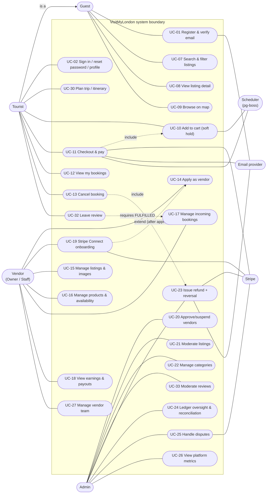
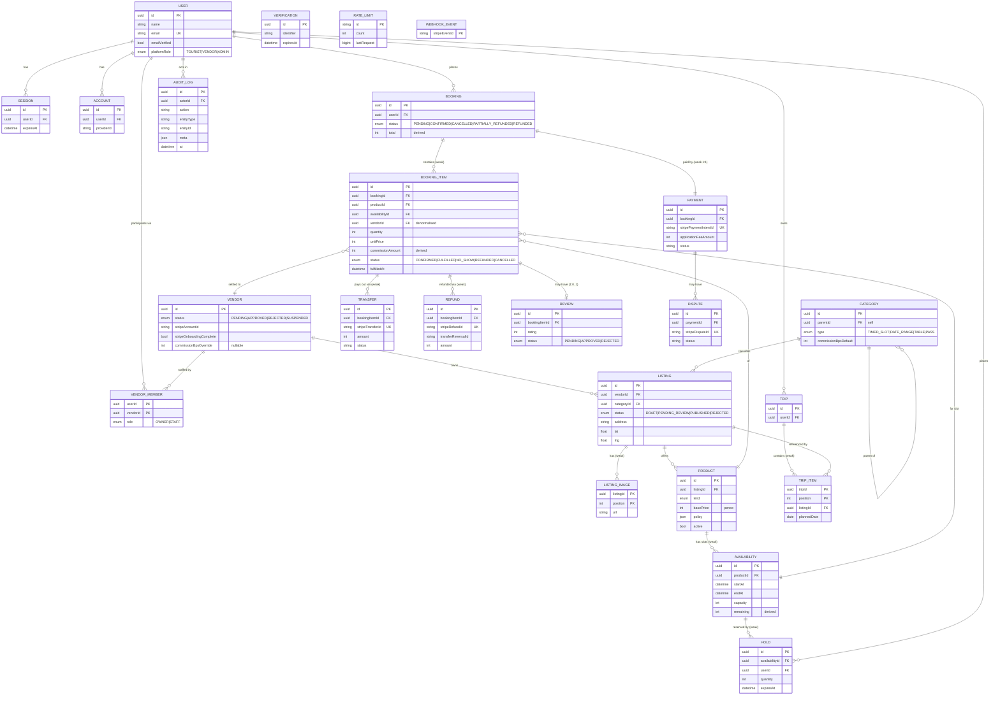
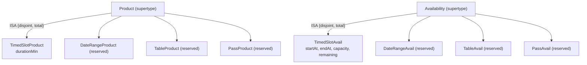

# VisitMyLondon — Agent Task Backlog (Build Runbook)

_A single, ordered, agent-executable backlog for the VML MVP business logic: use case diagram, EER, epics → user stories → tasks → subtasks, the tests for every task, and the git/PR protocol each task follows. It operationalises **VML Business Logic Implementation Plan** (rules, rationale) and sits under the **MVP Implementation Plan** and **Web App Implementation Plan** (architecture, stack)._

**Repo:** `int-vml-core` (`github.com/d4sun/int-vml-core`) · **Integration branch:** `develop` · **Stack:** Next.js 16 (App Router) · React 19 · TypeScript strict · pnpm · Prisma 6 (classic) · Better Auth · Postgres · Stripe Connect · pg-boss · Resend · Vitest · Playwright

---

## 0. How an agent uses this file

1. Read **§1 Task Protocol** once. It applies to every task.
2. Find the **next task**: the first unchecked `[ ]` task in **§8 Execution order** whose dependencies are all `[x]`.
3. Open that task's card in **§9 Backlog** (task ID, deliverables, tests, done-when).
4. Execute the protocol: **branch → implement → write tests → verify → PR to `develop`**.
5. Tick the task's checkbox (in the same PR), record any deviation in **§11 Deviations log**, stop, and report. Do not start the next task unless told to.

Everything an agent needs to decide _what_ to build is in §2–§7 (rules, model, tests). Everything about _how to work_ is in §1 and §10.

**Status legend:** `[ ]` todo · `[~]` in progress / PR open · `[x]` merged to `develop`

---

## 1. Task Protocol (applies to every task, no exceptions)

### 1.1 Branching

- One **task = one branch = one PR**. Never mix tasks.
- Branch name: `feat/<task-id-lowercase>-<slug>`, e.g. `feat/e0-s2-03-password-reset`. Use `fix/`, `chore/`, `test/` prefixes only for non-feature tasks.
- Always branch from an up-to-date `develop`:
  ```bash
  git fetch origin
  git switch develop && git pull --ff-only
  git status --short          # must be clean; if not, STOP and report
  git switch -c feat/<task-id>-<slug>
  ```
- **Stacking:** if the task depends on a task whose PR is not merged yet, branch from that task's branch instead and write `Stacked on #<PR>` in the PR body. The PR still targets `develop`.

### 1.2 Implementation order inside a task

`schema/migration → zod schema → service (all business logic) → route handler / server action → UI → tests`.
Services own logic; UI and routes are thin. Respect cross-cutting rules **CR-1..CR-9** (§3).

### 1.3 Tests are part of the task, not a follow-up

- Every task card lists required tests. Write them **in the same branch**.
- Test layers: **U** unit (pure logic, no DB) · **I** integration (real Postgres) · **E** e2e (Playwright). A task card says which layers apply.
- A task is not done until its listed TC / IT / E2E IDs exist as tests (put the ID in the test title, e.g. `it("TC-E0S2-03: reset token is single-use", …)`).
- Mutation sanity check: for every access/gating rule, confirm the test fails if the rule is removed.

### 1.4 Verify (all must pass before raising the PR)

```bash
pnpm install --frozen-lockfile
pnpm exec prisma generate
pnpm exec prisma migrate status           # when the task touches the schema: run `prisma migrate dev` first, confirm no drift
pnpm exec tsc --noEmit
pnpm exec eslint .
pnpm exec prettier --check <changed files>   # repo-wide check is not green yet (see §11)
pnpm test:unit                               # no external services
TEST_DATABASE_URL=postgresql://…/vml_test pnpm test:integration
pnpm test:e2e                                # only if the task card lists E2E
pnpm build                                   # `next build`
```

Also: no secrets committed; `.env.example` updated if a new env var was added; no `console.log` left; no change to unrelated files.

CI runs the same gates (`.github/workflows/ci.yml`) against a Postgres 17 service, so a task that passes locally should pass there. `TEST_DATABASE_URL` must be a **direct/session** connection whose database name contains `test`; the transaction-mode pooler cannot serve migrations or pg-boss.

### 1.5 Commit, push, PR

- **Commit message:** Conventional Commits, one commit per task (squash locally if needed):
  `feat(<scope>): <summary> (<TASK-ID>)` — e.g. `feat(auth): password reset flow (E0-S2-03)`.
  **Do not append `Co-Authored-By`, `Claude-Session` or any attribution trailer** to commits or PR bodies (owner's instruction).
- Push and open the PR against `develop`:
  ```bash
  git add -A && git commit -m "feat(auth): password reset flow (E0-S2-03)"
  git push -u origin HEAD
  gh pr create --base develop --title "feat(auth): password reset flow (E0-S2-03)" --body-file <(cat <<'EOF'
  <PR template from §1.6>
  EOF
  )
  ```
- If `gh` or push fails (auth, protected branch), stop and report the exact error; do not work around it.

### 1.6 PR template

```markdown
## Task

<TASK-ID> — <title> (Story <story id>, Epic <epic id>)

## What changed

- …

## Tests

- Added: <TC/IT/E2E IDs>
- Results: unit <n>/<n>, integration <n>/<n>, e2e <n>/<n>

## Verification

- [ ] tsc · [ ] eslint · [ ] prettier · [ ] tests · [ ] build · [ ] migrate status (if schema)

## Notes / deviations

- (also logged in docs backlog §11)

## Follow-ups

- …
```

### 1.7 Definition of Done (task)

Branch from fresh `develop` · task deliverables complete · listed tests written and green · all §1.4 checks green · backlog checkbox ticked · deviations logged · PR raised to `develop`.

---

## 2. Use Case Diagram (UCD)

Actors: **Guest** (unauthenticated), **Tourist** (specialises Guest), **Vendor** (Owner/Staff), **Admin**; external systems **Stripe**, **Email provider (Resend)**, **Scheduler (pg-boss)**.



**Use case → story map:** UC-01→E0-S1 · UC-02→E0-S2 · UC-07/08/09→E1-S1 · UC-30→E1-S2 · UC-10→E2-S1 · UC-11→E2-S2/S3 · UC-12→E3-S1 · UC-13→E3-S2 · UC-32→E3-S3 · UC-14→E4-S1 · UC-19→E4-S2 · UC-15→E5-S1 · UC-16→E5-S2 · UC-17→E6-S1 · UC-18→E6-S2 · UC-27→E7-S1 · UC-20→E8-S1 · UC-21→E9-S1 · UC-22→E9-S2 · UC-33→E9-S3 · UC-23→E10-S1 · UC-24/25/26→E10-S2.

---

## 3. Cross-cutting rules (CR-n) — every task inherits these

- **CR-1 Authorization is server-side.** Every service entrypoint calls `requireUser` / `requireRole` / `requireVendorMember`. UI hiding is never a control.
- **CR-2 Vendor data is caller-scoped.** Derive `vendorId` from the caller's `VendorMember`; never trust a client-supplied `vendorId`.
- **CR-3 Inventory mutations are transactional and row-locked** (`SELECT … FOR UPDATE`/advisory lock) for hold, hold→commit, restock.
- **CR-4 Webhooks are authoritative** for booking/payment/transfer/refund state; the browser redirect only shows "processing".
- **CR-5 Money is integer pence**; commission resolves **vendor override → category default → platform default**.
- **CR-6 Time is UTC in storage, Europe/London in rendering**; availability cutoffs computed in UTC.
- **CR-7 Every state transition that needs an email enqueues exactly one** retriable job.
- **CR-8 Rate-limit auth and booking endpoints** (Postgres-backed).
- **CR-9 No account enumeration** on register/reset/sign-in.

---

## 4. EER model

### 4.1 Core diagram (entities, keys, key attributes)



### 4.2 Specialisation hierarchies (the booking spine)

`Product` and `Availability` are **disjoint, total** supertypes discriminated by `Category.type`/`Product.kind`. **Only `TIMED_SLOT` is implemented in the MVP**; the rest are reserved seams.



Booking/checkout/webhook/refund code depends only on the `AvailabilityModule` interface (`check`, `hold`, `commit`, `release`, `restock`). Each subtype implements it. Never branch on `kind` in checkout.

### 4.3 Entity classification

| Entity                                                                                           | Kind                                                                       | Identified by                        |
| ------------------------------------------------------------------------------------------------ | -------------------------------------------------------------------------- | ------------------------------------ |
| User, Vendor, Category, Listing, Product, Booking, Review, Trip, WebhookEvent, AuditLog, Dispute | strong                                                                     | `id` (WebhookEvent: `stripeEventId`) |
| VendorMember                                                                                     | associative (User × Vendor)                                                | (`userId`,`vendorId`)                |
| ListingImage, Availability, Hold, BookingItem, Payment, Transfer, Refund, TripItem               | weak                                                                       | owner + discriminator                |
| Session, Account, Verification, RateLimit; `User.name` NOT NULL                                  | **E0-S1-02** (`20261121120000_better_auth_identity`, backfills null names) |
| Category                                                                                         | recursive                                                                  | `parentId`                           |

### 4.4 Derived attributes (each needs a test)

| Derived                        | Formula                                                                 |
| ------------------------------ | ----------------------------------------------------------------------- |
| `Availability.remaining`       | `capacity − Σ confirmed qty − Σ active hold qty` (inside row-locked TX) |
| `BookingItem.subtotal`         | `unitPrice × quantity`                                                  |
| `BookingItem.commissionAmount` | `round(subtotal × resolvedBps / 10000)`                                 |
| `Booking.total`                | `Σ BookingItem.subtotal`                                                |
| `Payment.applicationFeeAmount` | `Σ commissionAmount` (single-vendor destination charge)                 |
| partial-refund commission      | `commissionAmount × (refundAmount / subtotal)`, rounded                 |

### 4.5 Cross-entity constraints (service-enforced; each has an IT-)

1. `BookingItem.vendorId` = product→listing→vendor, set server-side only.
2. `Transfer` only if vendor `APPROVED && stripeOnboardingComplete`.
3. `Listing → PUBLISHED` only if vendor `APPROVED`; bookable only if also onboarded.
4. `Review` only for a `FULFILLED` item, one per item.
5. `remaining >= 0` always (row-locked decrement).
6. Money = non-negative integer pence; currency `GBP`.
7. No `WebhookEvent.stripeEventId` processed twice; Stripe writes carry idempotency keys.

### 4.6 Schema change ledger (which task introduces what)

| Entity/change                                                            | Introduced by                                                                                  |
| ------------------------------------------------------------------------ | ---------------------------------------------------------------------------------------------- |
| Session, Account, Verification, RateLimit; `User.name` NOT NULL          | **E0-S1-02** (not yet written; migration `20261115040000_better_auth_identity` does not exist) |
| `pgboss` schema (pg-boss v46)                                            | **E0-S0-01** (`20261115120000_pg_boss`)                                                        |
| `AuditLog`                                                               | E8-S1-01 (`20261121180000_audit_log`)                                                          |
| `Vendor.stripeRequirementsDue`, `stripeDisabledReason`, `stripeStatusAt` | **E4-S2-04** (`20261123120000_vendor_stripe_requirements`)                                     |
| `Dispute`                                                                | E10-S2-03                                                                                      |
| FTS `tsvector` + GIN index on Listing                                    | E1-S1-01                                                                                       |
| Everything else                                                          | already in `20261108044754_init`                                                               |

---

## 5. Testing conventions

| Aspect      | Convention                                                                                                                                                                                                                                                                                                                                          |
| ----------- | --------------------------------------------------------------------------------------------------------------------------------------------------------------------------------------------------------------------------------------------------------------------------------------------------------------------------------------------------- |
| Runner      | Vitest 5, projects `unit` and `integration`; Playwright for e2e                                                                                                                                                                                                                                                                                     |
| Layout      | `tests/unit/*.test.ts`, `tests/integration/*.test.ts`, `tests/e2e/*.spec.ts`, helpers in `tests/helpers`, `tests/e2e/support.ts`                                                                                                                                                                                                                    |
| Naming      | test titles start with their ID: `TC-E0S2-03: …`, `IT-08: …`, `E2E-01: …`                                                                                                                                                                                                                                                                           |
| DB          | `TEST_DATABASE_URL` required; the DB name **must contain `test`** (helper refuses otherwise). `tests/helpers/global-setup.ts` runs `prisma migrate deploy` once per integration run; `truncatePublicSchema()` cleans between files, and the `pgboss` schema is deliberately left intact.                                                            |
| Auth/email  | `tests/helpers/email-queue-contract.ts` runs one contract against `InProcessEmailQueue` (unit) and `PgBossEmailQueue` (integration); `RecordingEmailSender` records/fails on demand; e2e reads mail from `EMAIL_OUTBOX_DIR` via `FileEmailSender` (dev/test only, refused in production). The auth harness (`makeHarness()`) arrives with E0-S1-02. |
| Rate limits | each test uses its own `x-forwarded-for` IP (`freshIp()` / `uniqueIp()`) so tests don't throttle each other                                                                                                                                                                                                                                         |
| Time        | use fake timers / injectable clock; never `sleep` for expiry                                                                                                                                                                                                                                                                                        |
| Stripe      | an `StripeAdapter` interface with a **fake** (unit/integration) and **real test-mode** implementation (smoke + e2e). Webhook tests feed signed fixture payloads.                                                                                                                                                                                    |
| Money       | assert exact integer pence; add a property-style test where rounding exists                                                                                                                                                                                                                                                                         |
| Gates       | every authorization/state-gate has a negative test (and is mutation-checked)                                                                                                                                                                                                                                                                        |
| Coverage    | `@vitest/coverage-v8`; target ≥ 85 % on `lib/**/service*` and money code, not enforced on UI                                                                                                                                                                                                                                                        |
| Scripts     | `pnpm test`, `test:unit`, `test:integration`, `test:e2e`                                                                                                                                                                                                                                                                                            |

---

## 6. Epic index

| Epic   | Name                                        | User type | Stories | Depends on                  |
| ------ | ------------------------------------------- | --------- | ------- | --------------------------- |
| BL-E0  | Identity, Auth, RBAC & platform foundations | shared    | S0–S3   | —                           |
| BL-E8  | Vendor governance                           | Admin     | S1      | E0                          |
| BL-E4  | Vendor onboarding & payout readiness        | Vendor    | S1–S2   | E0, E8-S1                   |
| BL-E9  | Moderation & taxonomy                       | Admin     | S1–S3   | E5 (S2 first), E3-S3 for S3 |
| BL-E5  | Catalog, products & availability            | Vendor    | S1–S2   | E4, E9-S2                   |
| BL-E1  | Discovery & trip planning                   | Tourist   | S1–S2   | E5, E9-S1                   |
| BL-E2  | Cart, checkout & payment (flagship)         | Tourist   | S1–S3   | E4, E5                      |
| BL-E6  | Vendor booking ops & payouts                | Vendor    | S1–S2   | E2                          |
| BL-E10 | Financial oversight, refunds & disputes     | Admin     | S1–S2   | E2                          |
| BL-E3  | Bookings, cancellation & reviews            | Tourist   | S1–S3   | E2, E6-S1, E10-S1 (for S2)  |
| BL-E7  | Vendor team (Could)                         | Vendor    | S1      | E0                          |

**Critical path:** E0 → E8-S1 → E4 → E9-S2 → E5 → E2 → E10-S1 → E3-S2.

---

## 7. Integration & E2E test catalogue (referenced by task cards)

### 7.1 Integration tests (real Postgres; Stripe fake or test mode)

| ID    | Scenario                                 | Pass condition                                                |
| ----- | ---------------------------------------- | ------------------------------------------------------------- |
| IT-01 | Two concurrent holds on last unit        | exactly one succeeds; `remaining=0`, never negative           |
| IT-02 | Hold TTL elapses                         | capacity returns; booking can't confirm on it                 |
| IT-03 | Hold→commit TX                           | atomic permanent decrement, no double-count                   |
| IT-04 | Booking+items TX, item insert fails      | full rollback, no orphans                                     |
| IT-05 | Commission resolution                    | override / category / platform chosen correctly               |
| IT-06 | Single-vendor charge confirm             | destination charge, `fee = Σ commission`                      |
| IT-07 | Multi-vendor settle                      | one Payment, one Transfer per vendor, `subtotal − commission` |
| IT-08 | Same `stripeEventId` twice               | processed once                                                |
| IT-09 | `succeeded` before redirect              | state correct regardless                                      |
| IT-10 | PENDING past TTL                         | cancelled, holds released                                     |
| IT-11 | Full refund + reversal webhook           | Refund row, item REFUNDED, reversal recorded, restocked       |
| IT-12 | 50 % partial refund                      | proportional refund/reversal/commission                       |
| IT-13 | One of two transfers fails               | booking paid; failure flagged; reconciliation retries         |
| IT-14 | Publish by non-onboarded vendor          | rejected at service                                           |
| IT-15 | Transfer to non-onboarded vendor         | no transfer created                                           |
| IT-16 | Review on non-fulfilled item / duplicate | rejected; unique per item                                     |
| IT-17 | Suspended vendor / unpublished listing   | excluded from search                                          |
| IT-18 | Vendor A reads vendor B data             | denied                                                        |
| IT-19 | `BookingItem.vendorId` vs product owner  | always equal; client value ignored                            |
| IT-20 | Any amount path                          | integer pence; no float drift                                 |

### 7.2 E2E journeys (Playwright)

| ID     | Journey                                                                                   | Assert                                                              |
| ------ | ----------------------------------------------------------------------------------------- | ------------------------------------------------------------------- |
| E2E-01 | Tourist happy path: register → verify → search → add slot → checkout → pay → confirmation | booking CONFIRMED, email queued, appears in "my bookings"           |
| E2E-02 | Multi-vendor checkout _(flagship)_                                                        | one payment; both vendors have a transfer; fee retained             |
| E2E-03 | Vendor onboarding → publish                                                               | PUBLISHED only after admin approval; publish blocked pre-onboarding |
| E2E-04 | Admin governance: approve vendor → moderate listing → partial refund                      | ledger shows refund + reversal                                      |
| E2E-05 | Cancellation within policy                                                                | refund path runs; capacity restored                                 |
| E2E-06 | Review after fulfilment                                                                   | visible only after admin approval                                   |
| E2E-07 | RBAC negative: tourist opens `/vendor`, `/admin`                                          | redirected/denied; no data                                          |
| E2E-08 | Two tourists race the last slot                                                           | one confirms, other sees "just sold out"                            |
| E2E-09 | Webhook-authoritative confirm (drop redirect)                                             | booking confirms via webhook                                        |

The e2e suite lives in `tests/e2e/` (Playwright, `pnpm test:e2e`, CI job `e2e`). E0-S1-07 added the auth journeys and E2E-07; the other numbered journeys above are built up as their stories land (see task cards), and **X-01** closes any that remain.

---

## 8. Execution order

Pick the first unchecked story whose dependencies are `[x]`; work its tasks top-to-bottom (§9).

| #   | Story  | Name                                         | Status |
| --- | ------ | -------------------------------------------- | ------ |
| 1   | E0-S0  | Platform foundations (jobs, CI, errors)      | [x]    |
| 2   | E0-S1  | Register & verify email                      | [x]    |
| 3   | E0-S2  | Sign in, reset password, profile             | [x]    |
| 4   | E0-S3  | RBAC guards & route protection               | [x]    |
| 5   | E8-S1  | Approve / reject / suspend vendors           | [x]    |
| 6   | E4-S1  | Apply to become a vendor                     | [x]    |
| 7   | E4-S2  | Stripe Connect Express onboarding            | [~]    |
| 8   | E9-S2  | Manage categories / taxonomy                 | [ ]    |
| 9   | E5-S1  | Manage listings & images                     | [ ]    |
| 10  | E5-S2  | Manage products & timed-slot availability    | [ ]    |
| 11  | E9-S1  | Moderate listings                            | [ ]    |
| 12  | E1-S1  | Search, filter & map                         | [ ]    |
| 13  | E2-S1  | Add to cart with soft hold                   | [ ]    |
| 14  | E2-S2  | Checkout, booking & Stripe charge            | [ ]    |
| 15  | E2-S3  | Webhook confirmation & lifecycle             | [ ]    |
| 16  | E1-S2  | Save to trip & itinerary                     | [ ]    |
| 17  | E6-S1  | Manage incoming bookings                     | [ ]    |
| 18  | E3-S1  | View my bookings                             | [ ]    |
| 19  | E10-S1 | Refund + transfer reversal                   | [ ]    |
| 20  | E3-S2  | Cancel within policy                         | [ ]    |
| 21  | E6-S2  | Earnings & payout status                     | [ ]    |
| 22  | E3-S3  | Leave a review                               | [ ]    |
| 23  | E9-S3  | Moderate reviews                             | [ ]    |
| 24  | E10-S2 | Oversight, reconciliation, disputes, metrics | [ ]    |
| 25  | E7-S1  | Vendor team (Could)                          | [ ]    |
| 26  | X      | Remaining e2e journeys & hardening           | [ ]    |

---

## 9. Backlog (epics → stories → tasks)

> Card format: **Task ID** · deliverables · tests · _done-when_. Branch = `feat/<id>-<slug>` (§1.1). Every card implicitly includes the full §1 protocol.

---

### BL-E0 — Identity, Auth, RBAC & platform foundations

#### E0-S0 — Platform foundations _(enabler)_

_As the team, we want shared infrastructure so every later story is built on durable jobs, consistent errors and CI._

| Task                                    | Deliverables                                                                                                                                                                                                                | Tests                                                                                                                           | Done-when                                                              | State              |
| --------------------------------------- | --------------------------------------------------------------------------------------------------------------------------------------------------------------------------------------------------------------------------- | ------------------------------------------------------------------------------------------------------------------------------- | ---------------------------------------------------------------------- | ------------------ |
| **E0-S0-01** pg-boss job infrastructure | `lib/jobs/{boss,config,queues,register,email-queue,logger}.ts`; `scripts/jobs-worker.ts` (`pnpm worker`); pg-boss schema committed as a Prisma migration; `EmailQueue` contract + pg-boss implementation, retries + backoff | U: queue contract tests run against both impls. I: enqueued email job is delivered once, retried on failure, survives a restart | email sends are durable; `InProcessEmailQueue` only used in unit tests | [x] PR #3 (merged) |
| **E0-S0-02** Service conventions        | `lib/errors.ts` (`AppError`, `NotFound`, `Forbidden`, `Conflict`, `ValidationError`), `lib/result.ts`, action wrapper mapping errors → HTTP/UI                                                                              | U: mapping table                                                                                                                | all services throw typed errors                                        | [x] PR #5 (merged) |
| **E0-S0-03** CI workflow                | `.github/workflows/ci.yml`: install, prisma generate, tsc, eslint, prettier, Postgres service, unit+integration, build; e2e job (Playwright) on PR                                                                          | CI run green on a trivial PR                                                                                                    | PRs show required checks                                               | [x] PR #4 (merged) |

> **Order deviation:** E0-S0-03 was implemented before E0-S0-02 so the integration tests merged in PR #3 would run for the first time against a real Postgres. See §11.
> **E0-S0-01 deltas vs. this card:** `lib/email/*` did not exist on `develop` (E0-S1-03 was never merged), so this task defined the `EmailQueue`/`EmailSender` contracts and a minimal Vitest harness itself. Open the E0-S1-03 card with that context.

#### E0-S1 — Register & verify email _(UC-01)_ — **in progress (re-baselined 2026-11-15)**

> **Re-baseline:** this story was marked `[~]` ("implemented") in the first version of this document, but no E0-S1 code, migration or test exists anywhere in the repository history (`git log --all`). The work described below has to be built from scratch; the states are reset to `[ ]`. See §11.

_As a Guest, I want to create an account and confirm my email so that I can book and the platform can trust my identity._

**Acceptance:** valid registration creates `User(TOURIST, emailVerified=false)` + verification token and enqueues one email · valid token verifies + signs in · weak password rejected server-side · duplicate email → generic response, no second row (CR-9) · register/resend rate-limited (CR-8).

| Task                                   | Deliverables                                                                                                                                                                                                                                                                                      | Tests | State               |
| -------------------------------------- | ------------------------------------------------------------------------------------------------------------------------------------------------------------------------------------------------------------------------------------------------------------------------------------------------- | ----- | ------------------- |
| E0-S1-01 Shared validation             | `lib/validation/auth.ts` (`registerSchema`, password policy min 8/max 128, ≥1 letter, ≥1 digit)                                                                                                                                                                                                   | U     | [x] PR #10 (merged) |
| E0-S1-02 Better Auth + Prisma identity | `lib/auth/config.ts`, `lib/auth.ts`, `lib/auth-client.ts`, route `app/api/auth/[...all]`, migration `20261121120000_better_auth_identity`                                                                                                                                                         | I     | [x] PR #12 (merged) |
| E0-S1-03 Email layer                   | `lib/email/templates/*`, **Brevo** + File senders behind the **existing** `EmailSender` contract, transport selection in `lib/email/factory.ts`, `lib/env.ts`; keep the `EmailQueue` interface from E0-S0-01 and drop the `EMAIL_OUTBOX_DIR` requirement from the worker when Brevo is configured | U     | [x] PR #11          |
| E0-S1-04 Verification flow             | verify callback `/verify-email/complete`, resend verification, expiry (1h)                                                                                                                                                                                                                        | I     | [~] PR #13          |
| E0-S1-05 UI                            | `/register`, `/verify-email/complete`, `components/auth/*`                                                                                                                                                                                                                                        | E     | [~] PR #14          |
| E0-S1-06 Rate limits                   | `/sign-up/email` 5/min, `/send-verification-email` 3/min (Postgres-backed)                                                                                                                                                                                                                        | I     | [~] PR #15          |
| E0-S1-07 Tests                         | 77 Vitest (45 unit + 32 integration) + 8 Playwright; **plus** `playwright.config.ts` and `pnpm test:e2e`, which activates the guarded `e2e` CI job                                                                                                                                                | all   | [~] PR #24          |

> **E0-S1-03 complete:** the transport shipped in PR #8 — `BrevoEmailSender` + `createEmailSender()` factory, worker wiring, `BREVO_API_KEY`/`EMAIL_FROM`/`EMAIL_FROM_NAME`. This card now also has `lib/email/templates/*`, typed `lib/env.ts` validation and `createAuthEmailSenders()`; the senders are passed to Better Auth in E0-S1-02.

Test cases: TC-E0S1-01 valid registration (unverified user, email enqueued) · -02 duplicate email (generic, no 2nd user) · -03 weak password rejected server-side · -04 valid token → verified + session · -05 expired/invalid token rejected, resend offered · -06 6 registrations/min from one IP → throttled. Also cover: unverified sign-in 403, `platformRole` not client-settable, input normalisation, provider outage, resend enumeration-safety.

> **Known constraint (see §11):** Better Auth's email-verification token is a stateless JWT, so resending will **not** invalidate the earlier link; it expires after 1 h. If that is unacceptable, relax the AC wording — do not invent stateful tokens.
> **Start here:** branch `feat/e0-s1-register-verify` from `develop`, implement 01→07 in order, run the full gate (§1.4). E0-S0-01/02/03 are the only platform pieces already in place.

#### E0-S2 — Sign in, reset password, manage profile _(UC-02)_

_As any user, I want to sign in, reset my password and edit my profile so that I control my account._
**Acceptance:** correct credentials → rotating session cookie · wrong credentials → generic failure + throttled (CR-9/CR-8) · reset link single-use + expiring · profile update re-validates and never changes `platformRole` or another user's data (CR-1).

| Task                                  | Deliverables                                                                                                                                       | Tests                                                       | Done-when                       | State      |
| ------------------------------------- | -------------------------------------------------------------------------------------------------------------------------------------------------- | ----------------------------------------------------------- | ------------------------------- | ---------- |
| **E0-S2-01** Auth schemas             | `loginSchema`, `forgotPasswordSchema`, `resetPasswordSchema`, `profileSchema` in `lib/validation/auth.ts`                                          | U                                                           | schemas shared client/server    | [x] PR #16 |
| **E0-S2-02** Sign-in + session policy | enable email/password sign-in in config; session expiry/rotation; per-IP + per-account throttling rule for `/sign-in/email`                        | I: TC-E0S2-01, -02                                          | sign-in works; generic failures | [x] PR #17 |
| **E0-S2-03** Forgot/reset password    | `sendResetPassword` via email queue (new `passwordResetEmail` template), single-use token, enumeration-safe `/forgot-password`                     | U (template), I: TC-E0S2-03                                 | reused token rejected           | [x] PR #18 |
| **E0-S2-04** Profile service          | `lib/services/profile.ts` (`getProfile`, `updateProfile`) calling `requireUser`; `platformRole` impossible to set via input                        | I: TC-E0S2-04, -05                                          | cross-user edit denied          | [x] PR #19 |
| **E0-S2-05** UI                       | `/sign-in`, `/forgot-password`, `/reset-password`, `/account/profile`; fix links used in already-registered email (`/sign-in`, `/forgot-password`) | E: sign-in → profile edit → sign-out; reset flow via outbox | links from S1 email resolve     | [x] PR #20 |

Test cases: TC-E0S2-01 correct login → session issued & rotates · -02 wrong password ×N → generic error, throttled · -03 reset token reused → rejected after first use · -04 user A edits user B profile → denied · -05 client sends `platformRole=ADMIN` on profile save → ignored/denied.

#### E0-S3 — RBAC guard & route protection

_As the platform, I want server-side role gates so privileges can't be forged._
**Acceptance:** `requireRole('VENDOR'|'ADMIN')` protects the respective layouts; services re-check (route guard is coarse, service check is real); unauthenticated/mis-role access → 403/redirect, never data.

| Task                           | Deliverables                                                                                                                                       | Tests                                            | Done-when                            | State      |
| ------------------------------ | -------------------------------------------------------------------------------------------------------------------------------------------------- | ------------------------------------------------ | ------------------------------------ | ---------- |
| **E0-S3-01** Guard library     | `lib/auth/guards.ts`: `requireUser`, `requireRole`, `requireVendorMember(vendorId, roles?)`, `requireAdmin`; returns typed `Actor`                 | U (guards with fake session), I: TC-E0S3-02, -03 | single import point for all services | [x] PR #21 |
| **E0-S3-02** Layout protection | `app/(vendor)/layout.tsx`, `app/(admin)/layout.tsx` (or route-group equivalents) redirect on role mismatch; proxy/middleware only coarse           | E: TC-E0S3-01, E2E-07                            | no privileged data rendered          | [x] PR #22 |
| **E0-S3-03** Seed users        | `prisma/seed.ts` (idempotent): admin, approved vendor owner + staff, tourist; documented in README; **test-only credentials, never in production** | I: seed idempotent                               | `pnpm prisma db seed` works          | [x] PR #23 |

Test cases: TC-E0S3-01 tourist hits `/vendor` → denied/redirected · -02 vendor calls admin service action → denied · -03 staff of vendor X reads vendor Y bookings → denied (CR-2).

---

### BL-E8 — Vendor governance (Admin)

#### E8-S1 — Approve / reject / suspend vendors _(UC-20)_

_As an Admin, I want to govern vendor status so that only trusted supply is live._
**Acceptance:** queue of `PENDING` vendors · transitions `PENDING→APPROVED|REJECTED`, `APPROVED→SUSPENDED`, `SUSPENDED→APPROVED` (others illegal) · suspending hides listings from discovery immediately and blocks new bookings · actions audit-logged.

| Task                                  | Deliverables                                                                                                                                                                     | Tests                                                                       | Done-when                             | State      |
| ------------------------------------- | -------------------------------------------------------------------------------------------------------------------------------------------------------------------------------- | --------------------------------------------------------------------------- | ------------------------------------- | ---------- |
| **E8-S1-01** AuditLog + state machine | migration adding `AuditLog`; `lib/services/vendor-governance.ts` with explicit transition table; `audit.record()` helper                                                         | U: transition table (all legal + illegal); I: audit rows written in same TX | illegal transitions throw `Conflict`  | [x] PR #26 |
| **E8-S1-02** Visibility predicate     | `lib/catalog/visibility.ts`: `publiclyVisibleListingWhere()` (PUBLISHED ∧ vendor APPROVED) reused by search/pages; `assertVendorCanSell(vendorId)` helper (APPROVED ∧ onboarded) | I: IT-17 (partial), IT-14 stub                                              | single source of truth for visibility | [x] PR #27 |
| **E8-S1-03** Admin UI                 | `/admin/vendors` queue + detail, approve/reject (reason)/suspend/reinstate actions                                                                                               | E: approve & suspend path                                                   | actions reflect immediately           | [x] PR #28 |
| **E8-S1-04** Email                    | vendor-approved / rejected / suspended templates (CR-7, exactly one each)                                                                                                        | U templates; I enqueue-once                                                 | emails fire once per transition       | [x] PR #29 |

Test cases: TC-E8S1-01 approve pending → APPROVED, onboarding unlockable · -02 suspend → listings drop from discovery, no new bookings · -03 reinstate → APPROVED · -04 non-admin calls approve → denied.

---

### BL-E4 — Vendor onboarding & payout readiness

#### E4-S1 — Apply to become a vendor _(UC-14)_

_As a user, I want to apply with business details so that I can be approved to sell._
**Acceptance:** creates `Vendor(PENDING)` + `VendorMember(OWNER)` for the caller · cannot publish or be paid while PENDING · one open application per owner.

| Task                             | Deliverables                                                                                                                                                                         | Tests                                                          | Done-when                           | State      |
| -------------------------------- | ------------------------------------------------------------------------------------------------------------------------------------------------------------------------------------ | -------------------------------------------------------------- | ----------------------------------- | ---------- |
| **E4-S1-01** Application service | `vendorApplicationSchema`; `lib/services/vendor-application.ts#applyAsVendor` (TX: Vendor + Owner member; sets caller's `platformRole` to VENDOR **only on approval**, not on apply) | U schema; I: one open application per owner, second → Conflict | no privilege change before approval | [x] PR #30 |
| **E4-S1-02** UI                  | `/vendor/apply` (react-hook-form), status page showing PENDING/REJECTED                                                                                                              | E: apply → pending shown                                       | applicant sees status               | [x] PR #31 |
| **E4-S1-03** Admin notification  | enqueue admin email on new application; surfaces in E8-S1 queue                                                                                                                      | I                                                              | queue shows new vendor              | [x] PR #32 |

Test cases: TC-E4S1-01 apply → Vendor PENDING + OWNER member · -02 second application while one open → rejected · -03 PENDING vendor cannot publish (service) · -04 roles unchanged until approval.

#### E4-S2 — Stripe Connect Express onboarding _(UC-19)_

_As a Vendor Owner, I want to complete KYC and bank setup so that I can receive payouts._
**Acceptance:** after approval, owner starts Connect Express (account + hosted link) · `account.updated` sets `stripeOnboardingComplete=true` only when `charges_enabled && payouts_enabled` · publish and payout **hard-gated** server-side on `APPROVED && stripeOnboardingComplete` · incomplete KYC shows "action needed" deep link.

| Task                                   | Deliverables                                                                                                                                                                                                    | Tests                                                | Done-when                         | State      |
| -------------------------------------- | --------------------------------------------------------------------------------------------------------------------------------------------------------------------------------------------------------------- | ---------------------------------------------------- | --------------------------------- | ---------- |
| **E4-S2-01** Stripe adapter            | `lib/stripe/adapter.ts` interface (accounts, account links, later: PaymentIntents, transfers, refunds, reversals), `lib/stripe/real.ts`, `lib/stripe/fake.ts`; env `STRIPE_SECRET_KEY`, `STRIPE_WEBHOOK_SECRET` | U: fake behaves per contract                         | all Stripe access through adapter | [~] PR #33 |
| **E4-S2-02** Start onboarding          | `startOnboarding(vendorId)` (OWNER only, vendor APPROVED) creates/reuses account, returns link; idempotency key                                                                                                 | I: owner ok, staff denied, PENDING vendor denied     | link returned                     | [~] PR #34 |
| **E4-S2-03** Webhook endpoint          | `app/api/webhooks/stripe/route.ts`: raw-body signature verification, `WebhookEvent` dedupe (insert-first unique `stripeEventId`), dispatch table                                                                | I: TC-E2S3-06 (bad signature), IT-08 (dedupe)        | shared with E2/E10                | [~] PR #35 |
| **E4-S2-04** `account.updated` handler | sets/clears `stripeOnboardingComplete`; updates requirement summary                                                                                                                                             | I: TC-E4S2-03                                        | flag follows Stripe               | [~] PR #36 |
| **E4-S2-05** Gate                      | `assertVendorCanSell()` used by publish and payout paths                                                                                                                                                        | I: TC-E4S2-01/-02/-04, IT-14                         | gates enforced in services        | [~] PR #37 |
| **E4-S2-06** UI                        | `/vendor/payouts/setup` status + "continue onboarding"                                                                                                                                                          | E: E2E-03 (onboarding part, test-mode or faked link) | status reflects flag              | [~] PR #38 |

Test cases: TC-E4S2-01 approved + onboarding complete → publish & payout unlocked · -02 approved, onboarding incomplete → publish blocked, "action needed" · -03 `account.updated` charges only, no payouts → flag stays false · -04 publish while vendor PENDING → denied server-side.

---

### BL-E9-S2 — Manage categories / taxonomy _(run before E5)_ _(UC-22)_

_As an Admin, I want to manage categories so the catalog is organised and priced._
**Acceptance:** CRUD with self-referential `parentId`, `type`, `commissionBpsDefault` · cannot delete a category with listings · changing a default affects only new bookings (not settled items).

| Task                          | Deliverables                                                                                      | Tests                                     | Done-when                     |
| ----------------------------- | ------------------------------------------------------------------------------------------------- | ----------------------------------------- | ----------------------------- |
| **E9-S2-01** Category service | `lib/services/category.ts` (CRUD, tree read, cycle prevention, delete guard); bps bounds 0..10000 | U: cycle detection, bounds; I: TC-E9S2-01 | no cycles, no orphan listings |
| **E9-S2-02** Seed taxonomy    | seed top-level categories (Tours, Events, …) with defaults                                        | I                                         | seed idempotent               |
| **E9-S2-03** Admin UI         | `/admin/categories` tree editor                                                                   | E                                         | CRUD works                    |

Test cases: TC-E9S2-01 delete category with listings → blocked · -02 change default → applies to new bookings only · -03 parent cycle → rejected.

---

### BL-E5 — Catalog, products & availability (Vendor)

#### E5-S1 — Manage listings & images _(UC-15)_

_As a Vendor, I want to create/edit listings with images and location so tourists can find them._
**Acceptance:** CRUD scoped to caller's vendor (CR-2) · images to S3 as `ListingImage` rows · new listing `DRAFT`; submit → `PENDING_REVIEW`; major edit of a `PUBLISHED` listing → back to `PENDING_REVIEW` · vendor cannot self-publish.

| Task                                         | Deliverables                                                                                            | Tests                                                   | Done-when                |
| -------------------------------------------- | ------------------------------------------------------------------------------------------------------- | ------------------------------------------------------- | ------------------------ |
| **E5-S1-01** Listing service + state machine | `listingSchema`; `lib/services/listing.ts` (create/update/submit), transition table, "major field" list | U: transitions, major-edit detection; I: TC-E5S1-01..04 | vendor scoping proven    |
| **E5-S1-02** Image storage                   | S3 adapter (presigned upload, MIME/size limits, `ListingImage` position ordering), local fake           | U: validators; I: ordering/reorder                      | images persisted as rows |
| **E5-S1-03** Vendor listing UI               | `/vendor/listings` list/new/edit, image uploader, submit button                                         | E                                                       | create → submit works    |

Test cases: TC-E5S1-01 create → DRAFT owned by caller vendor · -02 submit → PENDING_REVIEW · -03 edit PUBLISHED core fields → PENDING_REVIEW · -04 edit another vendor's listing → denied.

#### E5-S2 — Manage products & timed-slot availability _(UC-16)_

_As a Vendor, I want to define products and generate capacity so slots are bookable._
**Acceptance:** product CRUD (pence, `policy` within platform bounds D4) · single or recurring slot generation (`remaining=capacity`) · future slots editable/closable · slot with bookings **cannot be deleted, only closed** · past slots read-only · optional per-slot price override · recurrence overlap warns/merges.

| Task                                         | Deliverables                                                                                                                                             | Tests                               | Done-when                         |
| -------------------------------------------- | -------------------------------------------------------------------------------------------------------------------------------------------------------- | ----------------------------------- | --------------------------------- |
| **E5-S2-01** Product service + policy bounds | `productSchema`; `lib/services/product.ts`; `policyBounds` validator (platform max refund window etc.)                                                   | U: bounds; I: TC-E5S2-04            | out-of-bounds policy rejected     |
| **E5-S2-02** Timed-slot module               | `lib/availability/module.ts` (`AvailabilityModule` interface) + `lib/availability/timed-slot.ts` generator (single + recurrence, DST-safe via London tz) | U: TC-E5S2-01, DST edge cases       | recurrence correct across BST/GMT |
| **E5-S2-03** Edit/close guard                | `closeSlot`, `deleteSlot` guard, past-slot read-only, price override                                                                                     | I: TC-E5S2-02, -03, -05             | booked slots protected            |
| **E5-S2-04** UI                              | `/vendor/listings/[id]/products`, slot calendar/list, recurrence form                                                                                    | E: create product + recurring slots | slots appear                      |

Test cases: TC-E5S2-01 "every Sat ×8, cap 20" → 8 slots, remaining=20 · -02 delete slot with bookings → blocked, close-only · -03 edit past slot → read-only · -04 policy exceeds platform max → rejected · -05 per-slot price override.

---

### BL-E9-S1 — Moderate listings _(UC-21)_

_As an Admin, I want to approve or reject listings so nothing goes public unvetted._
**Acceptance:** queue of `PENDING_REVIEW`; `→PUBLISHED` or `→REJECTED` (reason, resubmittable) · **no listing is public without admin approval** · publish requires vendor `APPROVED` (and onboarded for bookability).

| Task                            | Deliverables                                                                                               | Tests                    | Done-when              |
| ------------------------------- | ---------------------------------------------------------------------------------------------------------- | ------------------------ | ---------------------- |
| **E9-S1-01** Moderation service | `lib/services/listing-moderation.ts` (`approve`, `reject(reason)`), uses `assertVendorCanSell`, audit-logs | I: TC-E9S1-01/-02, IT-14 | state machine enforced |
| **E9-S1-02** Admin UI + email   | `/admin/listings` queue/detail; approved/rejected emails                                                   | E: E2E-03 final step     | vendor notified        |

Test cases: TC-E9S1-01 approve → PUBLISHED (searchable) · -02 reject with reason → REJECTED, resubmittable · -03 approve when vendor not eligible → blocked.

---

### BL-E1 — Discovery & trip planning (Tourist)

#### E1-S1 — Search, filter & map _(UC-07/08/09)_

_As a Guest/Tourist, I want to search and filter listings and see them on a map so I can find things to book._
**Acceptance:** only `PUBLISHED` listings of `APPROVED` vendors · FTS over title/description · category/area/date/price filters compose (AND) · date filter only surfaces products with a bookable future slot (remaining > 0, before cutoff) · map via lat/lng bounding box · SSR for SEO.

| Task                                        | Deliverables                                                                                                                             | Tests                                           | Done-when                                |
| ------------------------------------------- | ---------------------------------------------------------------------------------------------------------------------------------------- | ----------------------------------------------- | ---------------------------------------- |
| **E1-S1-01** FTS + filter builder           | migration: `tsvector` generated column + GIN index; `lib/search/service.ts` (uses `publiclyVisibleListingWhere`), pagination             | U: filter builder; I: TC-E1S1-01/-02/-04, IT-17 | scoped results only                      |
| **E1-S1-02** Availability-aware date filter | join to future `Availability` (remaining>0, cutoff in UTC)                                                                               | I: TC-E1S1-03                                   | past-cutoff slots ignored                |
| **E1-S1-03** Bounding-box geo               | `bbox` query + haversine ordering helper                                                                                                 | U: haversine; I: TC-E1S1-05                     | only in-viewport listings                |
| **E1-S1-04** SSR pages                      | `/explore`, `/listings/[slug]` (metadata + schema.org JSON-LD), London-time rendering; **retire `lib/mock-data.ts`** — pages read Prisma | E: page renders, meta present                   | indexable; no mock data left in app code |
| **E1-S1-05** Filter UI + map island         | URL-driven filters, map component                                                                                                        | E                                               | filters reflected in URL                 |

Test cases: TC-E1S1-01 draft/pending listing never in results · -02 suspended vendor's listing excluded · -03 all slots past cutoff → not returned for that date · -04 price + category → both applied · -05 map viewport → only inside bbox.

#### E1-S2 — Save to trip & itinerary _(UC-30)_

_As a Tourist, I want to save listings to a trip and order them with optional dates so I can plan before booking._
**Acceptance:** Tourist owns their trips (CR-1) · `TripItem` has `position` and optional `plannedDate` · reorder persists atomically · item can be taken to cart · deleting a trip cascades.

| Task                          | Deliverables                                                 | Tests              | Done-when                |
| ----------------------------- | ------------------------------------------------------------ | ------------------ | ------------------------ |
| **E1-S2-01** Trip service     | create/rename/delete trip, add/remove item, ownership checks | I: TC-E1S2-01, -03 | next-position assignment |
| **E1-S2-02** Reorder          | atomic position update (single TX, no gaps/dupes)            | I: TC-E1S2-02      | stable ordering          |
| **E1-S2-03** UI               | `/trips`, `/trips/[id]`, "save to trip" on listing page      | E                  | plan → saved             |
| **E1-S2-04** Add-to-cart hook | pre-fill product/slot into cart (after E2-S1)                | I: TC-E1S2-04      | cart pre-filled          |

Test cases: TC-E1S2-01 add listing → TripItem at next position · -02 reorder → atomic · -03 user A edits user B's trip → denied · -04 add-to-cart from trip item → pre-filled.

---

### BL-E2 — Cart, checkout & payment _(flagship; governed by CR-3/4/5)_

#### E2-S1 — Add to cart with soft hold _(UC-10)_

_As a Tourist, I want adding an item to reserve capacity briefly so it isn't sold while I check out._
**Acceptance:** `add(product, availability, qty)` in a row-locked TX: if `remaining ≥ qty` write `Hold(TTL≈10 min)` + schedule expiry; else "not enough left" · cart groups by vendor with per-item price and total · expired holds release capacity.

| Task                              | Deliverables                                                                                                                                  | Tests                                                        | Done-when              |
| --------------------------------- | --------------------------------------------------------------------------------------------------------------------------------------------- | ------------------------------------------------------------ | ---------------------- |
| **E2-S1-01** Commission resolver  | `lib/money/commission.ts`: `resolveBps(vendor, category, platform)`, `commissionAmount()` (integer rounding, banker-safe), `money.ts` helpers | U: TC-E2S1-04/-05 + rounding property tests; I: IT-05, IT-20 | no float arithmetic    |
| **E2-S1-02** Hold on availability | `TimedSlotModule.hold()` with `FOR UPDATE`; `remaining` derivation                                                                            | I: IT-01 (concurrent), TC-E2S1-01/-02                        | never negative         |
| **E2-S1-03** Hold expiry job      | pg-boss `hold.expire` scheduled at hold creation; idempotent release                                                                          | I: IT-02, TC-E2S1-03 (fake timers)                           | capacity returns       |
| **E2-S1-04** Cart service         | `cartSchema`; `lib/services/cart.ts` (add/update/remove/get, group by vendor, per-user cart = active holds); rate limited (CR-8)              | I: TC-E2S1-06                                                | server-computed totals |
| **E2-S1-05** Cart UI              | cart island/page, countdown to hold expiry                                                                                                    | E: add → cart shows grouped totals                           | UX shows expiry        |

Test cases: TC-E2S1-01 qty ≤ remaining → hold created · -02 qty > remaining → rejected, no hold · -03 TTL elapses → expiry job releases · -04 vendor override wins · -05 no override → category, else platform default · -06 two vendors → grouped per vendor.

#### E2-S2 — Checkout, booking creation & Stripe charge _(UC-11)_

_As a Tourist, I want to pay once for a cart that may span vendors so each vendor is paid their share minus commission._
**Acceptance:** at checkout re-validate every hold; compute commission per item; create `Booking(PENDING)` + `BookingItem`s (`vendorId`, `unitPrice`, `commissionAmount`) in one TX · single-vendor → destination charge + `application_fee_amount` · multi-vendor → platform charge, transfers on confirmation · all Stripe writes carry idempotency keys · no card data touches VML · non-payout-ready vendor's item is blocked · client totals ignored.

| Task                                          | Deliverables                                                                                                                           | Tests                                 | Done-when                     |
| --------------------------------------------- | -------------------------------------------------------------------------------------------------------------------------------------- | ------------------------------------- | ----------------------------- |
| **E2-S2-01** Checkout validation + booking TX | `lib/services/checkout.ts`: revalidate holds, recompute prices server-side, `vendorId` from product, create booking + items atomically | I: IT-04, IT-19, TC-E2S2-03/-04/-06   | tampered totals ignored       |
| **E2-S2-02** Stripe charges                   | adapter: destination charge (single vendor), platform PaymentIntent (multi-vendor)                                                     | I (fake): IT-06 setup, TC-E2S2-01/-02 | correct fee & transfer plan   |
| **E2-S2-03** Idempotency strategy             | deterministic keys (`checkout:<bookingId>:<attempt>`), duplicate-submit guard                                                          | I: TC-E2S2-05                         | one PaymentIntent per booking |
| **E2-S2-04** Checkout action + redirect       | Stripe Checkout/Payment Element redirect, success/cancel URLs                                                                          | E: reach Stripe test page             | session created               |
| **E2-S2-05** Processing page                  | `/checkout/processing` polls booking status (optimistic only; CR-4)                                                                    | E: E2E-09 (part)                      | never marks confirmed itself  |

Test cases: TC-E2S2-01 single-vendor → destination charge, fee = Σ commission · -02 two-vendor → one PaymentIntent, two transfers planned · -03 vendor not onboarded → item blocked · -04 hold expired before pay → re-hold; if gone "just sold out" · -05 duplicate submit → one PaymentIntent · -06 tampered client total → server recomputes.

#### E2-S3 — Webhook confirmation & lifecycle _(UC-11 cont.)_

_As the platform, I want payment webhooks to drive booking state so confirmation is correct even if the browser never returns._
**Acceptance:** verified + deduped handler · on `payment_intent.succeeded`: Payment=succeeded, Booking=CONFIRMED, holds→permanent decrement (TX), create `Transfer` rows + Stripe transfers (multi-vendor), enqueue tourist + vendor emails · PENDING past TTL cancelled with holds released · delayed/duplicate/out-of-order never double-process · partial transfer failure leaves booking paid and flags the transfer.

| Task                             | Deliverables                                                                                             | Tests                              | Done-when                            |
| -------------------------------- | -------------------------------------------------------------------------------------------------------- | ---------------------------------- | ------------------------------------ |
| **E2-S3-01** `succeeded` handler | confirm booking, set Payment, commit holds in TX (`TimedSlotModule.commit`)                              | I: IT-03, IT-09, TC-E2S3-01/-03    | exactly-once effect                  |
| **E2-S3-02** Transfers           | create `Transfer` rows + Stripe transfers (guarded by `assertVendorCanSell`), per-transfer error capture | I: IT-07, IT-13, IT-15, TC-E2S3-05 | failures flagged, booking stays paid |
| **E2-S3-03** Emails              | booking-confirmed (tourist) + new-booking (vendor) templates, once each                                  | U, I: enqueue-once                 | CR-7 met                             |
| **E2-S3-04** Pending cleanup job | pg-boss cron: cancel unpaid bookings past TTL, release holds                                             | I: IT-10, TC-E2S3-04               | no stuck capacity                    |
| **E2-S3-05** Replay safety       | out-of-order/duplicate event matrix (failed→succeeded, succeeded twice)                                  | I: IT-08, TC-E2S3-02               | idempotent                           |
| **E2-S3-06** E2E journeys        | E2E-01, E2E-02, E2E-08, E2E-09 against Stripe test mode/CLI                                              | E                                  | flagship loop green                  |

Test cases: TC-E2S3-01 first `succeeded` → confirmed, decrement committed · -02 same event twice → no-op · -03 webhook after redirect timeout → still confirms · -04 PENDING past TTL → cancelled, holds released · -05 one of two transfers fails → booking paid, flagged · -06 bad signature → rejected.

---

### BL-E6 — Vendor booking ops & payouts

#### E6-S1 — Manage incoming bookings _(UC-17)_

_As a Vendor, I want to see and progress my bookings so I can fulfil them._
**Acceptance:** lists only items settled to caller's vendor (CR-2) · transitions `CONFIRMED → FULFILLED | NO_SHOW`; fulfil sets `fulfilledAt` · cannot fulfil refunded/cancelled items.

| Task                                 | Deliverables                                                                            | Tests                                    | Done-when        |
| ------------------------------------ | --------------------------------------------------------------------------------------- | ---------------------------------------- | ---------------- |
| **E6-S1-01** Vendor bookings service | list/filter by date; `markFulfilled`, `markNoShow` with transition table; STAFF allowed | U: transitions; I: TC-E6S1-01/-02, IT-18 | scoped to vendor |
| **E6-S1-02** UI + e2e                | `/vendor/bookings` list/detail, action buttons                                          | E: fulfil flow (feeds E2E-06)            | status updates   |

Test cases: TC-E6S1-01 fulfil confirmed → FULFILLED, `fulfilledAt` set · -02 fulfil refunded item → blocked · -03 vendor A sees vendor B booking → denied.

#### E6-S2 — View earnings & payout status _(UC-18)_

_As a Vendor, I want to see earnings, fees and payout status so I trust I'm paid._
**Acceptance:** read-only mirror of `Transfer`/`Refund` for caller's vendor; amounts as gross, commission, net.

| Task                          | Deliverables                                              | Tests                            | Done-when              |
| ----------------------------- | --------------------------------------------------------- | -------------------------------- | ---------------------- |
| **E6-S2-01** Earnings service | aggregate by period; `net = gross − commission − refunds` | U: arithmetic; I: TC-E6S2-01/-02 | integer pence          |
| **E6-S2-02** UI               | `/vendor/earnings`                                        | E                                | numbers match fixtures |

Test cases: TC-E6S2-01 payout view net = gross − commission − refunds · -02 vendor sees another vendor's payouts → denied.

---

### BL-E3 — Bookings, cancellation & reviews (Tourist)

#### E3-S1 — View my bookings _(UC-12)_

**Acceptance:** lists only caller's bookings with per-item status and London-rendered slot time; never another user's (CR-1).

| Task                      | Deliverables                                                | Tests                                                                   | Done-when        |
| ------------------------- | ----------------------------------------------------------- | ----------------------------------------------------------------------- | ---------------- |
| **E3-S1-01** Service + UI | `lib/services/my-bookings.ts`; `/account/bookings` + detail | I: TC-E3S1-01 (only own), TC-E3S1-02 (London rendering); E: E2E-01 tail | scoped to caller |

#### E3-S2 — Cancel within policy _(UC-13)_

_As a Tourist, I want to cancel within the allowed window so I can get the appropriate refund._
**Acceptance:** allowed only if `now < slotStart − cancelWindow` and item not fulfilled · triggers the refund path (E10-S1) per product policy within platform bounds (D4) · inventory restocked (CR-3).

| Task                             | Deliverables                                                                           | Tests                            | Done-when                  |
| -------------------------------- | -------------------------------------------------------------------------------------- | -------------------------------- | -------------------------- |
| **E3-S2-01** Policy evaluator    | `lib/policy/cancellation.ts` (pure: window, refundable %, edge at exact cutoff in UTC) | U: boundary cases, DST           | pure & exhaustive          |
| **E3-S2-02** Cancel service + UI | calls refund service, restocks; button on booking detail                               | I: TC-E3S2-01/-02/-03; E: E2E-05 | refund + capacity restored |

Test cases: TC-E3S2-01 cancel inside window, refundable → refund + reversal + restock · -02 cancel outside window → blocked (or non-refundable per policy) · -03 cancel fulfilled item → blocked.

#### E3-S3 — Leave a review (verified purchase) _(UC-32)_

**Acceptance:** only for a `FULFILLED` item owned by caller, one per item · rating 1–5 + text · created `PENDING` · displayed only once approved.

| Task                        | Deliverables                                                                          | Tests                                      | Done-when             |
| --------------------------- | ------------------------------------------------------------------------------------- | ------------------------------------------ | --------------------- |
| **E3-S3-01** Review service | `reviewSchema`; create with gates; unique per item                                    | U: rating bounds; I: TC-E3S3-01..04, IT-16 | gate enforced         |
| **E3-S3-02** UI + display   | review form on booking detail; approved reviews on listing page with aggregate rating | E: E2E-06 (tourist part)                   | hidden until approved |

Test cases: TC-E3S3-01 review fulfilled item → PENDING · -02 review non-purchased listing → denied · -03 second review on same item → denied · -04 rating outside 1–5 → rejected.

---

### BL-E10 — Financial oversight, refunds & disputes (Admin)

#### E10-S1 — Refund + transfer reversal _(UC-23)_

_As an Admin, I want to refund a tourist and claw back the vendor's share so money settles correctly._
**Acceptance:** full/partial refund on a `BookingItem` · Stripe refund (idempotent) **and** transfer reversal · on refund/reversal webhooks write `Refund` (+ `transferReversalId`), set item `REFUNDED`, booking `PARTIALLY_REFUNDED|REFUNDED`, restock (CR-3) · partial refund recomputes commission proportionally · insufficient vendor balance → negative-balance path + admin flag.

| Task                                    | Deliverables                                                                                   | Tests                                    | Done-when                   |
| --------------------------------------- | ---------------------------------------------------------------------------------------------- | ---------------------------------------- | --------------------------- |
| **E10-S1-01** Refund service            | `refundSchema` (full/partial, reason, amount ≤ remaining refundable); `lib/services/refund.ts` | U: amount bounds; I: TC-E10S1-01/-03/-04 | cannot over-refund          |
| **E10-S1-02** Stripe refund + reversal  | adapter methods, idempotency keys                                                              | I (fake): IT-11 setup                    | both calls issued once      |
| **E10-S1-03** Webhook handlers          | `charge.refunded`/`refund.*`, `transfer.reversed` → state updates                              | I: IT-11, TC-E10S1-05                    | deduped                     |
| **E10-S1-04** Proportional commission   | `commissionAmount × refund/subtotal` rounding rules                                            | U: property tests; I: IT-12, TC-E10S1-02 | sums reconcile to the penny |
| **E10-S1-05** Restock                   | `TimedSlotModule.restock` in TX                                                                | I: IT-03-style                           | capacity returned once      |
| **E10-S1-06** Emails                    | refund-issued (tourist), refund-reversal (vendor)                                              | I enqueue-once                           | CR-7                        |
| **E10-S1-07** Admin UI + e2e            | refund dialog on booking detail; E2E-04                                                        | E                                        | ledger reflects refund      |
| **E10-S1-08** Insufficient balance path | flag + admin surface                                                                           | I: TC-E10S1-06                           | no silent failure           |

Test cases: TC-E10S1-01 full refund → refund + full reversal, item REFUNDED, restock · -02 50 % partial → proportional refund/reversal/commission · -03 all items refunded → booking REFUNDED · -04 one of three → PARTIALLY_REFUNDED · -05 duplicate refund webhook → single Refund row · -06 vendor balance insufficient → negative-balance path, admin flagged.

#### E10-S2 — Oversight, reconciliation, disputes & metrics _(UC-24/25/26)_

_As an Admin, I want ledger oversight and reconciliation so VML's books match Stripe._

| Task                             | Deliverables                                                                   | Tests                         | Done-when                     |
| -------------------------------- | ------------------------------------------------------------------------------ | ----------------------------- | ----------------------------- |
| **E10-S2-01** Ledger views       | `/admin/ledger` read-only unified list of Payment/Transfer/Refund with filters | I: totals; E                  | single reconciliation surface |
| **E10-S2-02** Reconciliation job | pg-boss job retries failed transfers (bounded), flags unresolved               | I: TC-E10S2-01                | flagged items visible         |
| **E10-S2-03** Disputes           | migration `Dispute`; webhook `charge.dispute.*` recorder; admin list           | I: TC-E10S2-03                | disputes recorded             |
| **E10-S2-04** Metrics            | GMV, fee revenue, counts by range                                              | U: arithmetic; I: TC-E10S2-02 | equals Σ confirmed totals     |

Test cases: TC-E10S2-01 failed transfer → retried; flagged if still failing · -02 GMV = Σ confirmed booking totals in range · -03 dispute webhook → recorded and surfaced.

---

### BL-E9-S3 — Moderate reviews _(UC-33; after E3-S3)_

**Acceptance:** PENDING reviews hidden until approved · reject/hide removes from listing · only verified-purchase reviews exist.

| Task                           | Deliverables                                                                    | Tests             | Done-when              |
| ------------------------------ | ------------------------------------------------------------------------------- | ----------------- | ---------------------- |
| **E9-S3-01** Review moderation | service (`approve`, `reject`, `hide`), audit-logged, aggregate rating recompute | I: TC-E9S3-01..03 | only approved counted  |
| **E9-S3-02** Admin UI          | `/admin/reviews` queue; completes E2E-06                                        | E                 | visible after approval |

Test cases: TC-E9S3-01 approve → visible, rating aggregate updated · -02 reject → never visible · -03 non-admin → denied.

---

### BL-E7 — Vendor team _(Could)_

#### E7-S1 — Manage team members _(UC-27)_

**Acceptance:** only OWNER manages members · STAFF may manage listings/availability/bookings but not team, payout config or onboarding · invite links an existing user as `VendorMember(STAFF)`.

| Task                      | Deliverables                                                                        | Tests                            | Done-when                  |
| ------------------------- | ----------------------------------------------------------------------------------- | -------------------------------- | -------------------------- |
| **E7-S1-01** Team service | add/remove staff, permission matrix in one table (`lib/auth/vendor-permissions.ts`) | U: matrix; I: TC-E7S1-01/-02/-03 | matrix enforced at service |
| **E7-S1-02** UI           | `/vendor/team`                                                                      | E                                | owner-only                 |

Test cases: TC-E7S1-01 owner adds staff → `VendorMember(STAFF)` · -02 staff adds member → denied · -03 staff edits availability → allowed.

---

### X — Remaining e2e journeys & hardening

| Task                              | Deliverables                                                                                                                    | Tests              | Done-when                |
| --------------------------------- | ------------------------------------------------------------------------------------------------------------------------------- | ------------------ | ------------------------ |
| **X-01** Close journey gaps       | implement any of E2E-01..09 not yet covered by their stories                                                                    | E                  | all nine pass in CI      |
| **X-02** Security pass            | review CR-1/2/8/9 across routes; check rate-limit header handling behind proxy (Coolify/Traefik `x-forwarded-for`); CSP/headers | I/E negative tests | findings fixed or logged |
| **X-03** Observability & ops docs | structured logging, Sentry hook, runbook for webhook replay and reconciliation                                                  | —                  | docs merged              |

---

## 10. Environment & operational notes for the agent

- **Env vars** (see `.env.example`): `DATABASE_URL`, `DIRECT_URL`, `JOBS_DATABASE_URL` (optional, defaults to `DIRECT_URL`), `BETTER_AUTH_SECRET`, `BETTER_AUTH_URL`, `BREVO_API_KEY`, `EMAIL_FROM`, `EMAIL_FROM_NAME`, `EMAIL_OUTBOX_DIR` (dev/test only), `TEST_DATABASE_URL`; added by later tasks: `STRIPE_SECRET_KEY`, `STRIPE_WEBHOOK_SECRET`, S3 settings. Update `.env.example` in the task that introduces them. Never commit real secrets.
- **Connection modes matter.** `DATABASE_URL` may be a transaction-mode pooler for the app, but migrations, `TEST_DATABASE_URL` and `JOBS_DATABASE_URL` must be **direct/session** connections: pg-boss needs advisory locks, `LISTEN/NOTIFY` and session state, none of which survive a transaction pooler. `TEST_DATABASE_URL` must also name a database containing `test` (the harness refuses otherwise).
- **Prisma:** classic generator; `lib/prisma.ts` is the single client — don't modify casually. Schema changes → `prisma migrate dev --name <slug>`, commit the generated migration, and confirm `prisma migrate status` is clean. The pg-boss schema is committed as `prisma/migrations/*_pg_boss` and applied by `migrate deploy`; runtime uses `migrate: false`, so the DB role needs no `CREATE` privilege.
- **Background jobs:** `pnpm worker` runs the pg-boss worker (`scripts/jobs-worker.ts`); `pnpm jobs:plans` prints the pg-boss schema SQL for regeneration after a pg-boss bump. Delivery is **at-least-once** — handlers must be idempotent; "exactly one email" is enforced at enqueue time.
- **Toolchain:** Node 26, pnpm 12.16.1 (pinned in CI, not via `packageManager` — that injects pnpm self-management entries into the lockfile), Postgres 17 in CI, Next.js 16 (App Router). Node is not on `PATH` in some sandboxes; `nvm use` first.
- **Next.js 16:** read `node_modules/next/dist/docs/` (per `AGENTS.md`) before using route handlers/server actions; `searchParams` is async.
- **Money & time:** integer pence, UTC storage, London rendering (CR-5/6). No floats in money paths.
- **Role-restricted pages:** a layout guard is only the coarse gate, because Next.js renders a layout and its page in parallel (a redirected visitor still receives the page's output). Every page under `/admin` and `/vendor/(portal)` must call `enforceSurface()` (`lib/auth/enforce-surface.ts`), and every service must re-check with `requireRole` / `requireVendorMember` (CR-1, CR-2). Layouts call it without a path (the proxy supplies the real request path for the sign-in return); pages pass their own.
- **Catalog visibility:** every public listing query (search, pages, map, sitemap) must build its `where` from `publiclyVisibleListingWhere()` (`lib/catalog/visibility.ts`), and every publish, bookability or payout path must call `assertVendorCanSell()`, so suspending a vendor takes effect everywhere at once.
- **Sell gate:** any module that publishes a listing (a `listing.update/create/upsert` writing `"PUBLISHED"`) or pays a vendor (`transfer.create`, `createTransfer`, `transfers.create`) must call `assertVendorCanSell` (inside the same transaction where there is one). `tests/unit/sell-gate-usage.test.ts` scans `lib`, `app` and `components` and fails the build if one does not: a tripwire, not a proof, so the story that adds the path still needs its own test (IT-14, IT-15).
- **Don't expand scope:** `DATE_RANGE | TABLE | PASS` modules stay unimplemented; PostGIS deferred.
- **Blocked?** If a dependency task isn't merged, stack (§1.1) or stop and report. If auth to GitHub fails, stop and report the exact error.

---

## 11. Deviations log (append as you go)

| Date       | Task          | Deviation                                                                                                                                                                                                                                                                                                                                                                                                                                                                                                                                                                                                                                                                                                                                                                                                                                                                                                                                                          | Reason                                                                                                                                                                       | Follow-up                                                                                                                                                                                                                                                                                                       |
| ---------- | ------------- | ------------------------------------------------------------------------------------------------------------------------------------------------------------------------------------------------------------------------------------------------------------------------------------------------------------------------------------------------------------------------------------------------------------------------------------------------------------------------------------------------------------------------------------------------------------------------------------------------------------------------------------------------------------------------------------------------------------------------------------------------------------------------------------------------------------------------------------------------------------------------------------------------------------------------------------------------------------------ | ---------------------------------------------------------------------------------------------------------------------------------------------------------------------------- | --------------------------------------------------------------------------------------------------------------------------------------------------------------------------------------------------------------------------------------------------------------------------------------------------------------- |
| 2026-11-15 | E0-S1         | Story re-baselined from `[~]` to `[ ]`; earlier §11 rows for E0-S1 kept for history but describe work that never landed                                                                                                                                                                                                                                                                                                                                                                                                                                                                                                                                                                                                                                                                                                                                                                                                                                            | No E0-S1 code, migration or test exists in any branch or commit (`git log --all`)                                                                                            | implement E0-S1-01..07 from scratch                                                                                                                                                                                                                                                                             |
| 2026-11-15 | E0-S1         | ~~Resending a verification email does not invalidate earlier links~~ (design constraint, not yet implemented)                                                                                                                                                                                                                                                                                                                                                                                                                                                                                                                                                                                                                                                                                                                                                                                                                                                      | Better Auth tokens are stateless JWTs; expiry 1 h                                                                                                                            | relax AC wording or accept                                                                                                                                                                                                                                                                                      |
| 2026-11-15 | E0-S1         | ~~Interim in-process email queue (non-durable)~~                                                                                                                                                                                                                                                                                                                                                                                                                                                                                                                                                                                                                                                                                                                                                                                                                                                                                                                   | superseded: E0-S0-01 shipped the durable queue                                                                                                                               | none                                                                                                                                                                                                                                                                                                            |
| 2026-11-15 | E0-S0-01      | `EmailQueue`/`EmailSender` contracts defined in this task, although the card assigns `lib/email/*` to E0-S1-03                                                                                                                                                                                                                                                                                                                                                                                                                                                                                                                                                                                                                                                                                                                                                                                                                                                     | E0-S1-03 was not on `develop`; the card could not be implemented against a missing interface                                                                                 | E0-S1-03 consumes these contracts instead of adding a second one                                                                                                                                                                                                                                                |
| 2026-11-15 | E0-S0-01      | Minimal Vitest harness (`vitest.config.ts`, unit+integration projects, helpers) bootstrapped inside this task                                                                                                                                                                                                                                                                                                                                                                                                                                                                                                                                                                                                                                                                                                                                                                                                                                                      | The card requires U + I tests and no test runner existed                                                                                                                     | E0-S0-03 wires it into CI; coverage thresholds still owned by E0-S1-07                                                                                                                                                                                                                                          |
| 2026-11-15 | E0-S0-01      | pg-boss schema committed as a Prisma migration instead of being installed at runtime                                                                                                                                                                                                                                                                                                                                                                                                                                                                                                                                                                                                                                                                                                                                                                                                                                                                               | DDL in `prisma migrate deploy` keeps environments reproducible; runtime role needs no `CREATE`                                                                               | regenerate with `pnpm jobs:plans` on a pg-boss bump                                                                                                                                                                                                                                                             |
| 2026-11-15 | E0-S0-01      | Jobs connect via `JOBS_DATABASE_URL ?? DIRECT_URL ?? DATABASE_URL`                                                                                                                                                                                                                                                                                                                                                                                                                                                                                                                                                                                                                                                                                                                                                                                                                                                                                                 | pg-boss cannot use a transaction-mode pooler                                                                                                                                 | keep the direct URL in every environment                                                                                                                                                                                                                                                                        |
| 2026-11-15 | E0-S0-01      | Delivery is **at-least-once**, so CR-7 "exactly one email" is enforced at enqueue, not delivery                                                                                                                                                                                                                                                                                                                                                                                                                                                                                                                                                                                                                                                                                                                                                                                                                                                                    | pg-boss semantics; no dedupe table in scope                                                                                                                                  | handlers idempotent; revisit if a duplicate send is observed                                                                                                                                                                                                                                                    |
| 2026-11-15 | E0-S0-01      | PR #3 merged before `IT-E0S0-01..06` had ever executed (no reachable Postgres; migration and retry/restart semantics verified against embedded PGlite only)                                                                                                                                                                                                                                                                                                                                                                                                                                                                                                                                                                                                                                                                                                                                                                                                        | sandbox had no Postgres and the configured Supabase host does not resolve                                                                                                    | **resolved:** all 6 ITs passed in CI on PR #4 (2026-11-15)                                                                                                                                                                                                                                                      |
| 2026-11-15 | E0-S0-03      | Executed before E0-S0-02                                                                                                                                                                                                                                                                                                                                                                                                                                                                                                                                                                                                                                                                                                                                                                                                                                                                                                                                           | Its CI run is the first real execution of PR #3's integration tests                                                                                                          | none                                                                                                                                                                                                                                                                                                            |
| 2026-11-15 | E0-S0-03      | Prettier gate checks **only files changed in the PR**                                                                                                                                                                                                                                                                                                                                                                                                                                                                                                                                                                                                                                                                                                                                                                                                                                                                                                              | 34 pre-existing files (components, docs, configs, seed) fail `prettier --check .`                                                                                            | one-time repo-wide `prettier --write .` PR, then switch the gate to the whole repo                                                                                                                                                                                                                              |
| 2026-11-15 | E0-S0-03      | pnpm pinned in `pnpm/action-setup` rather than a `packageManager` field                                                                                                                                                                                                                                                                                                                                                                                                                                                                                                                                                                                                                                                                                                                                                                                                                                                                                            | `packageManager` made pnpm 12 inject ~158 lockfile lines of its own dependencies                                                                                             | revisit when pnpm stops doing that                                                                                                                                                                                                                                                                              |
| 2026-11-15 | E0-S0-03      | e2e job is conditional on a `playwright.config.*` existing                                                                                                                                                                                                                                                                                                                                                                                                                                                                                                                                                                                                                                                                                                                                                                                                                                                                                                         | no Playwright setup exists; a permanent red required check would block every PR                                                                                              | E0-S1-07 adds the config and activates the job                                                                                                                                                                                                                                                                  |
| 2026-11-15 | E1-S1         | `lib/mock-data.ts` still backs `/[category]` and `/listing/[slug]`                                                                                                                                                                                                                                                                                                                                                                                                                                                                                                                                                                                                                                                                                                                                                                                                                                                                                                 | pre-backend placeholder UI                                                                                                                                                   | E1-S1-04 replaces it with Prisma queries and deletes the file                                                                                                                                                                                                                                                   |
| 2026-11-15 | E0-S1-03      | Transactional email sends through **Brevo** instead of Resend for now (`lib/email/brevo-sender.ts`, `lib/email/factory.ts`); `EmailSender` stays provider-agnostic                                                                                                                                                                                                                                                                                                                                                                                                                                                                                                                                                                                                                                                                                                                                                                                                 | Brevo account available now; Resend has no key/verified domain yet                                                                                                           | add a `ResendEmailSender` and switch the factory if the provider changes; templates still pending                                                                                                                                                                                                               |
| 2026-11-15 | All           | Repo-wide Prettier debt: `lib/mock-data.ts`, `lib/prisma.ts`, `README.md`, `CONTRIBUTING.md`, `docs/*`, `components/ui/*`, `eslint.config.mjs`, `tsconfig.json`, `prisma/seed.ts` and others are unformatted                                                                                                                                                                                                                                                                                                                                                                                                                                                                                                                                                                                                                                                                                                                                                       | formatting them in feature PRs would bury real diffs                                                                                                                         | one standalone `chore(format): apply prettier repo-wide` PR                                                                                                                                                                                                                                                     |
| 2026-11-21 | E0-S1-03      | `lib/env.ts` validates the current surface; `BETTER_AUTH_SECRET` stays optional until E0-S1-02 tightens it, and the "production requires Brevo" rule stays in `createEmailSender()`                                                                                                                                                                                                                                                                                                                                                                                                                                                                                                                                                                                                                                                                                                                                                                                | `next build` runs with `NODE_ENV=production`; enforcing the transport in the env schema would fail CI builds that have no provider key                                       | split build-time and runtime env validation if the rule needs to move                                                                                                                                                                                                                                           |
| 2026-11-21 | E0-S1-03      | Auth email senders ship as `createAuthEmailSenders(queue)` factories; the `betterAuth()` wiring lands with E0-S1-02                                                                                                                                                                                                                                                                                                                                                                                                                                                                                                                                                                                                                                                                                                                                                                                                                                                | The callbacks live in the auth config, which is E0-S1-02; factories keep this card independently testable                                                                    | pass them to `emailVerification.sendVerificationEmail` and `emailAndPassword.sendResetPassword` in E0-S1-02                                                                                                                                                                                                     |
| 2026-11-21 | E0-S1-03      | Password-reset template ships here; its `sendResetPassword` wiring completes in E0-S2-03                                                                                                                                                                                                                                                                                                                                                                                                                                                                                                                                                                                                                                                                                                                                                                                                                                                                           | The card asks for the template; the reset flow is a separate story                                                                                                           | wire the sender in E0-S2-03                                                                                                                                                                                                                                                                                     |
| 2026-11-21 | E0-S1-02      | Migration is `20261121120000_better_auth_identity`, not `20261115040000_…`; it backfills `User.name` from the email local part before `SET NOT NULL`                                                                                                                                                                                                                                                                                                                                                                                                                                                                                                                                                                                                                                                                                                                                                                                                               | A 20261115040000 timestamp would sort before the already-applied `20261115120000_pg_boss` migration and break ordering; the column was nullable, so existing rows could fail | none                                                                                                                                                                                                                                                                                                            |
| 2026-11-21 | E0-S1-02      | `createAuth()` takes a Better Auth `database` adapter (`prismaAuthDatabase(prisma)` in production) instead of a Prisma client; `lib/auth.ts` exposes lazy `getAuth()` rather than a top-level `auth`                                                                                                                                                                                                                                                                                                                                                                                                                                                                                                                                                                                                                                                                                                                                                               | Lets the 12 flow tests run on Better Auth's memory adapter, and keeps `next build` free of auth secrets and a DB                                                             | E0-S3 guards call `getAuth()`                                                                                                                                                                                                                                                                                   |
| 2026-11-21 | E0-S1-02      | `BETTER_AUTH_SECRET` (>= 32 chars) is enforced in `createAuth()` via `requireAuthSecret()`, not in `lib/env.ts`                                                                                                                                                                                                                                                                                                                                                                                                                                                                                                                                                                                                                                                                                                                                                                                                                                                    | Closes the E0-S1-03 follow-up without failing builds/tooling that never touch auth                                                                                           | none                                                                                                                                                                                                                                                                                                            |
| 2026-11-21 | E0-S1-02      | `tests/integration/auth-identity.test.ts` (TC-E0S1-12..16) was written but **not executed locally**                                                                                                                                                                                                                                                                                                                                                                                                                                                                                                                                                                                                                                                                                                                                                                                                                                                                | Sandbox had no Postgres, no Docker access and no npm registry TLS access for an embedded one; the same flows pass on the memory adapter (`tests/unit/auth-config.test.ts`)   | confirm green in CI on this PR                                                                                                                                                                                                                                                                                  |
| 2026-11-21 | E0-S1-02      | Rate limiting is not configured here (the `RateLimit` table exists); `onExistingUserSignUp` is unset (no already-registered template)                                                                                                                                                                                                                                                                                                                                                                                                                                                                                                                                                                                                                                                                                                                                                                                                                              | Owned by E0-S1-06 and E0-S2 respectively                                                                                                                                     | E0-S1-06; E0-S2-05                                                                                                                                                                                                                                                                                              |
| 2026-11-21 | E0-S1-04      | The auth hook forces `callbackURL=/verify-email/complete` on `/sign-up/email`, `/send-verification-email` and `/verify-email`, ignoring client or link values                                                                                                                                                                                                                                                                                                                                                                                                                                                                                                                                                                                                                                                                                                                                                                                                      | Better Auth defaults the callback to `/` and only origin-checks it; a single enforced landing page is what the UI has to interpret                                           | none                                                                                                                                                                                                                                                                                                            |
| 2026-11-21 | E0-S1-04      | The `/verify-email/complete` page itself ships in E0-S1-05; until then the redirect lands on a 404. `describeVerificationOutcome()` is the contract the page must use                                                                                                                                                                                                                                                                                                                                                                                                                                                                                                                                                                                                                                                                                                                                                                                              | The card's UI is E0-S1-05; this task owns the server behaviour                                                                                                               | E0-S1-05 builds the page and must not treat "no `error` param" as success on its own                                                                                                                                                                                                                            |
| 2026-11-21 | E0-S1-04      | Sign-up during an email-queue outage returns 200 with the account created but **no email** (Better Auth runs that send as a background task and only logs failures); resend recovers it. Resend awaits the send, so an outage there returns 5xx for unverified accounts only                                                                                                                                                                                                                                                                                                                                                                                                                                                                                                                                                                                                                                                                                       | Better Auth behaviour, covered by TC-E0S1-27; making sign-up fail would need a transactional enqueue                                                                         | revisit if pg-boss and the app DB can fail independently; resend outage requires a pg-boss outage, so it is not attacker-triggerable                                                                                                                                                                            |
| 2026-11-21 | E0-S1-04      | `tests/integration/auth-identity.test.ts` additions (TC-E0S1-29, -30) were not executed locally                                                                                                                                                                                                                                                                                                                                                                                                                                                                                                                                                                                                                                                                                                                                                                                                                                                                    | No Postgres in the sandbox; the same flows pass on the memory adapter                                                                                                        | confirm green in CI                                                                                                                                                                                                                                                                                             |
| 2026-11-21 | E0-S1-05      | Forms use the shared zod schemas plus `lib/validation/form.ts#fieldErrors()` instead of react-hook-form + `@hookform/resolvers`                                                                                                                                                                                                                                                                                                                                                                                                                                                                                                                                                                                                                                                                                                                                                                                                                                    | The npm registry is unreachable from the sandbox (TLS `UnknownIssuer`), so no new dependency could be installed                                                              | adopt react-hook-form later if wanted; the schemas are unchanged either way                                                                                                                                                                                                                                     |
| 2026-11-21 | E0-S1-05      | No Playwright spec for the card's `E` layer; the UI was checked by hand in the browser (validation errors, server-failure message, expired / invalid / no-param verify states). The "verified" screen and the post-sign-up panel were **not** exercised (they need a database and a session)                                                                                                                                                                                                                                                                                                                                                                                                                                                                                                                                                                                                                                                                       | Playwright is not installable here (see E0-S1-07) and there is no Postgres in the sandbox                                                                                    | E0-S1-07 adds Playwright; its e2e journeys cover both screens                                                                                                                                                                                                                                                   |
| 2026-11-21 | E0-S1-05      | `/register` links to `/sign-in`, which 404s until E0-S2-05                                                                                                                                                                                                                                                                                                                                                                                                                                                                                                                                                                                                                                                                                                                                                                                                                                                                                                         | Sign-in UI belongs to E0-S2                                                                                                                                                  | E0-S2-05                                                                                                                                                                                                                                                                                                        |
| 2026-11-21 | E0-S1-06      | Limits are per client IP and per path. Resend is not limited per email address, so one address can still be mailed up to 3 times a minute from each of many IPs. In production, a request with no trusted client-IP header falls into one shared per-path bucket (a global limit)                                                                                                                                                                                                                                                                                                                                                                                                                                                                                                                                                                                                                                                                                  | Matches the card (per-IP, Postgres-backed); Better Auth's key is IP + path                                                                                                   | X-02: confirm Coolify/Traefik forwards `x-forwarded-for`, set `advanced.ipAddress` trust settings, consider a per-email limit                                                                                                                                                                                   |
| 2026-11-21 | E0-S1-06      | The explicit `/sign-up/email` rule (5 / 60 s) replaces Better Auth's built-in 3 / 10 s rule, so short bursts are now allowed up to 5                                                                                                                                                                                                                                                                                                                                                                                                                                                                                                                                                                                                                                                                                                                                                                                                                               | The card specifies 5/min                                                                                                                                                     | none                                                                                                                                                                                                                                                                                                            |
| 2026-11-21 | E0-S1-06      | `tests/integration/auth-rate-limit.test.ts` (TC-E0S1-42..44, including the concurrent-request case) was not executed locally                                                                                                                                                                                                                                                                                                                                                                                                                                                                                                                                                                                                                                                                                                                                                                                                                                       | No Postgres in the sandbox; the sequential behaviour passes on the memory adapter (`tests/unit/auth-rate-limit.test.ts`)                                                     | confirm green in CI                                                                                                                                                                                                                                                                                             |
| 2026-11-21 | E0-S1-07      | **Blocked, not started (resolved: see the next E0-S1-07 row).** `@playwright/test` (and its browsers) cannot be installed: the npm registry is unreachable from the sandbox (TLS `UnknownIssuer`). Adding the dependency to `package.json` without a matching lockfile would break CI's `--frozen-lockfile` install. The task's Playwright config, `pnpm test:e2e`, the 8 e2e specs and the e2e CI job activation are all pending                                                                                                                                                                                                                                                                                                                                                                                                                                                                                                                                  | Environment limitation, not a design choice; no Playwright-free substitute meets the card                                                                                    | Run this task where the registry is reachable. Every later task's `E` layer (E0-S2-05, E0-S3-02, E2E-07) waits on it                                                                                                                                                                                            |
| 2026-11-21 | E0-S2 / E0-S3 | Added a `State` column to the E0-S2 and E0-S3 task tables                                                                                                                                                                                                                                                                                                                                                                                                                                                                                                                                                                                                                                                                                                                                                                                                                                                                                                          | These tables had no per-task state, unlike E0-S0 and E0-S1, so PR progress could not be recorded                                                                             | none                                                                                                                                                                                                                                                                                                            |
| 2026-11-21 | E0-S2-02      | Throttle values were not specified, so these are **defaults to confirm**: `/sign-in/email` 10 per minute per IP (replacing Better Auth's built-in 3 per 10 s), and 10 attempts per 15 minutes per account (any IP), reset by a successful sign-in                                                                                                                                                                                                                                                                                                                                                                                                                                                                                                                                                                                                                                                                                                                  | The card asks for "per-IP + per-account throttling" without numbers                                                                                                          | confirm or adjust `AUTH_RATE_LIMITS.signIn` and `SIGN_IN_ACCOUNT_LIMIT`                                                                                                                                                                                                                                         |
| 2026-11-21 | E0-S2-02      | Per-account attempts are stored as short-lived `Verification` rows (hashed email in `identifier`), not in `RateLimit`                                                                                                                                                                                                                                                                                                                                                                                                                                                                                                                                                                                                                                                                                                                                                                                                                                              | Better Auth prunes `RateLimit` rows by its own, shorter windows, which would cut a 15 minute window to about a minute                                                        | none                                                                                                                                                                                                                                                                                                            |
| 2026-11-21 | E0-S2-02      | A per-account lockout lets anyone who knows an email address lock that account out for up to 15 minutes (even the right password is refused). The per-IP limit bounds how fast one source can do this                                                                                                                                                                                                                                                                                                                                                                                                                                                                                                                                                                                                                                                                                                                                                              | Inherent to account throttling; the alternative (IP-only) leaves distributed guessing unthrottled                                                                            | revisit with CAPTCHA or step-up if abuse is seen (X-02)                                                                                                                                                                                                                                                         |
| 2026-11-21 | E0-S2-02      | "Rotating session cookie" is implemented as a new session token on every sign-in plus a sliding 7 day expiry refreshed at most daily. Better Auth does not re-issue the token mid-session                                                                                                                                                                                                                                                                                                                                                                                                                                                                                                                                                                                                                                                                                                                                                                          | Better Auth behaviour; password reset revokes all sessions                                                                                                                   | none                                                                                                                                                                                                                                                                                                            |
| 2026-11-21 | E0-S2-02      | `tests/integration/auth-sign-in.test.ts` (TC-E0S2-25..27, including 15 concurrent guesses) was not executed locally                                                                                                                                                                                                                                                                                                                                                                                                                                                                                                                                                                                                                                                                                                                                                                                                                                                | No Postgres in the sandbox; the same logic passes on the memory adapter (`tests/unit/auth-sign-in.test.ts`)                                                                  | confirm green in CI                                                                                                                                                                                                                                                                                             |
| 2026-11-21 | E0-S2-03      | The `passwordResetEmail` template and the `sendResetPassword` wiring were already delivered by E0-S1-03 and E0-S1-02, so this task adds the flow's guarantees and tests rather than new senders                                                                                                                                                                                                                                                                                                                                                                                                                                                                                                                                                                                                                                                                                                                                                                    | Those cards pre-shipped them (see their rows above)                                                                                                                          | none                                                                                                                                                                                                                                                                                                            |
| 2026-11-21 | E0-S2-03      | Added hardening beyond the card: using one reset link retires every other outstanding link for the account (Better Auth only consumes the one used), and a reset clears the account's sign-in lockout so a locked-out user can use the new password immediately                                                                                                                                                                                                                                                                                                                                                                                                                                                                                                                                                                                                                                                                                                    | Without the first, an older email could be replayed; without the second, E0-S2-02's lockout would block the user right after a successful reset                              | none                                                                                                                                                                                                                                                                                                            |
| 2026-11-21 | E0-S2-03      | Better Auth reports an expired and an unknown reset token identically (`INVALID_TOKEN`), so the reset page can only say "invalid or expired"; a successful reset does not sign the user in                                                                                                                                                                                                                                                                                                                                                                                                                                                                                                                                                                                                                                                                                                                                                                         | Better Auth behaviour                                                                                                                                                        | E0-S2-05 copy; the reset page must also send `Referrer-Policy: no-referrer` because the token is in its URL                                                                                                                                                                                                     |
| 2026-11-21 | E0-S2-03      | Reset requests are limited per IP only (3 per minute), not per email address, so one address can still be mailed from many IPs                                                                                                                                                                                                                                                                                                                                                                                                                                                                                                                                                                                                                                                                                                                                                                                                                                     | Same trade-off as resend verification                                                                                                                                        | X-02                                                                                                                                                                                                                                                                                                            |
| 2026-11-21 | E0-S2-03      | `tests/integration/auth-password-reset.test.ts` (TC-E0S2-43..45, including the concurrent single-use race) was not executed locally                                                                                                                                                                                                                                                                                                                                                                                                                                                                                                                                                                                                                                                                                                                                                                                                                                | No Postgres in the sandbox; the same logic passes on the memory adapter (`tests/unit/auth-password-reset.test.ts`)                                                           | confirm green in CI                                                                                                                                                                                                                                                                                             |
| 2026-11-21 | E0-S2-04      | `requireUser` and the `Actor` type were pulled forward from E0-S3-01 into `lib/auth/guards.ts`, with a new `UnauthenticatedError` (code `UNAUTHENTICATED`, 401) in `lib/errors.ts`. E0-S3-01 extends this file (`requireRole`, `requireVendorMember`, `requireAdmin`) instead of creating it                                                                                                                                                                                                                                                                                                                                                                                                                                                                                                                                                                                                                                                                       | The card says the profile service calls `requireUser`, but the guard library is scheduled after E0-S2                                                                        | E0-S3-01                                                                                                                                                                                                                                                                                                        |
| 2026-11-21 | E0-S2-04      | A client-supplied `platformRole` (or `id`, `email`, `emailVerified`) is **rejected** with a `ValidationError` rather than silently ignored                                                                                                                                                                                                                                                                                                                                                                                                                                                                                                                                                                                                                                                                                                                                                                                                                         | The card allows "ignored/denied"; denying makes tampering visible and keeps the input from ever reaching a write                                                             | none                                                                                                                                                                                                                                                                                                            |
| 2026-11-21 | E0-S2-04      | Profile editing covers the name only. Changing the email address is out of scope because it needs re-verification; `image` is not editable yet                                                                                                                                                                                                                                                                                                                                                                                                                                                                                                                                                                                                                                                                                                                                                                                                                     | Keeps the service surface minimal                                                                                                                                            | revisit with the account UI if needed                                                                                                                                                                                                                                                                           |
| 2026-11-21 | E0-S2-04      | `getProfile` / `updateProfile` take optional `{ session, store }` dependencies; production resolves the session from the request and the store from Prisma                                                                                                                                                                                                                                                                                                                                                                                                                                                                                                                                                                                                                                                                                                                                                                                                         | Lets unit tests use a fake session and store while integration tests use real sessions                                                                                       | none                                                                                                                                                                                                                                                                                                            |
| 2026-11-21 | E0-S2-04      | `tests/integration/profile-service.test.ts` (TC-E0S2-54..57) was not executed locally                                                                                                                                                                                                                                                                                                                                                                                                                                                                                                                                                                                                                                                                                                                                                                                                                                                                              | No Postgres in the sandbox; the same rules pass against an in-memory store (`tests/unit/profile-service.test.ts`)                                                            | confirm green in CI                                                                                                                                                                                                                                                                                             |
| 2026-11-21 | E0-S2-05      | No Playwright spec for the card's `E` layer (sign-in → profile edit → sign-out; reset flow via outbox). The pages were checked by hand in the browser: sign-in validation and the generic failure message, the unauthenticated `/account/profile` redirect with `next`, the reset page's ready / invalid / missing states, the confirmation-mismatch error, and the no-referrer and noindex meta tags. **Not exercised:** a successful sign-in and redirect, the profile form and its success state, sign-out, and the forgot-password confirmation (they need a database and a session)                                                                                                                                                                                                                                                                                                                                                                           | Playwright is not installable here (see E0-S1-07) and there is no Postgres in the sandbox                                                                                    | E0-S1-07 adds Playwright; its journeys must cover these                                                                                                                                                                                                                                                         |
| 2026-11-21 | E0-S2-05      | The "fix links used in already-registered email" part has nothing to fix: that email was never built (no template, `onExistingUserSignUp` unset). `/sign-in` and `/forgot-password` now exist, so those links will resolve when it is added                                                                                                                                                                                                                                                                                                                                                                                                                                                                                                                                                                                                                                                                                                                        | The email is out of scope for E0-S1/E0-S2 as written                                                                                                                         | add the already-registered email in a later task                                                                                                                                                                                                                                                                |
| 2026-11-21 | E0-S2-05      | `/account/profile` is guarded in the page itself (redirect to `/sign-in?next=…`); layout-level protection arrives with E0-S3-02. The site header has no sign-in or account link yet, so these pages are reachable only by URL                                                                                                                                                                                                                                                                                                                                                                                                                                                                                                                                                                                                                                                                                                                                      | Header chrome is outside this card                                                                                                                                           | add the header entry points with the layout work                                                                                                                                                                                                                                                                |
| 2026-11-21 | E0-S2-05      | Sign-in, forgot and reset use the Better Auth client directly; only the profile edit is a server action (it goes through the profile service)                                                                                                                                                                                                                                                                                                                                                                                                                                                                                                                                                                                                                                                                                                                                                                                                                      | Auth flows are Better Auth endpoints; the plan's server-action rule applies to our own services                                                                              | none                                                                                                                                                                                                                                                                                                            |
| 2026-11-21 | E0-S2-05      | Fixed a build-time bug in E0-S1-05's `/verify-email/complete` page and the new session source: `getAuth()` ran before `headers()`, so a missing auth secret threw before Next saw a dynamic API and tried to prerender the page. `headers()` is now called first                                                                                                                                                                                                                                                                                                                                                                                                                                                                                                                                                                                                                                                                                                   | Found by `next build` while adding `/account/profile`                                                                                                                        | none                                                                                                                                                                                                                                                                                                            |
| 2026-11-21 | E0-S3-01      | `requireUser`, `Actor` and `UnauthenticatedError` already existed (pulled forward by E0-S2-04); this task adds `requireRole`, `requireAdmin` and `requireVendorMember` to the same file. Signature is `requireVendorMember(vendorId, roles?, { session?, memberships? })`; omitting `roles` means any member                                                                                                                                                                                                                                                                                                                                                                                                                                                                                                                                                                                                                                                       | Matches the card's `requireVendorMember(vendorId, roles?)`, with injectable dependencies for tests                                                                           | none                                                                                                                                                                                                                                                                                                            |
| 2026-11-21 | E0-S3-01      | `requireVendorMember` proves **membership only**. It does not check vendor status (APPROVED) or Stripe onboarding, and does not require `platformRole = VENDOR` (an applicant is an OWNER member while still PENDING). A platform ADMIN who is not a member is denied; `requireRole` matches roles exactly, so ADMIN does not satisfy VENDOR                                                                                                                                                                                                                                                                                                                                                                                                                                                                                                                                                                                                                       | Status gates belong where publishing and payouts happen; admin access to vendor data should go through admin services                                                        | E8-S1-02 `assertVendorCanSell`; every vendor-scoped service must use both rules                                                                                                                                                                                                                                 |
| 2026-11-21 | E0-S3-01      | The card's TC-E0S3-02 ("vendor calls admin service action") and TC-E0S3-03 ("staff of vendor X reads vendor Y bookings") are tested against the guards with real sessions and `VendorMember` rows, because no admin action or bookings service exists yet                                                                                                                                                                                                                                                                                                                                                                                                                                                                                                                                                                                                                                                                                                          | Those services arrive in later epics                                                                                                                                         | re-assert at the service level when E6-S1 and E8-S1 land                                                                                                                                                                                                                                                        |
| 2026-11-21 | E0-S3-01      | `tests/integration/guards.test.ts` (TC-E0S3-17..22) was not executed locally                                                                                                                                                                                                                                                                                                                                                                                                                                                                                                                                                                                                                                                                                                                                                                                                                                                                                       | No Postgres in the sandbox; the same rules pass against a fake session and membership store (`tests/unit/guards.test.ts`)                                                    | confirm green in CI                                                                                                                                                                                                                                                                                             |
| 2026-11-21 | E0-S3-02      | **Finding:** a layout-only guard is not enough. Next.js renders a layout and its page in parallel, so a visitor who is about to be redirected still received the page's rendered content in the response body (verified with `curl`). Every page in `/admin` and `/vendor` must therefore call `enforceSurface()` itself, and services re-check as before. With the page-level call the body contains no page content                                                                                                                                                                                                                                                                                                                                                                                                                                                                                                                                              | Next.js rendering model; found while verifying "no privileged data rendered"                                                                                                 | Convention recorded in §10; every future page under these areas must follow it (E4-S2-06, E6, E8, E9, E10 UIs)                                                                                                                                                                                                  |
| 2026-11-21 | E0-S3-02      | Routes are `/admin` (`app/admin`) and `/vendor` (`app/vendor/(portal)`), not `app/(admin)` / `app/(vendor)` route groups, which would not create those URL segments. The `(portal)` group keeps `/vendor/apply` (E4-S1) outside the VENDOR-only layout, since applicants are not VENDOR until approved. `/admin` and `/vendor` are minimal placeholder dashboards                                                                                                                                                                                                                                                                                                                                                                                                                                                                                                                                                                                                  | Matches the implementation plan's `vendor/` and `admin/` surfaces                                                                                                            | E4-S1 adds `/vendor/apply` beside `(portal)`                                                                                                                                                                                                                                                                    |
| 2026-11-21 | E0-S3-02      | Signed-out visitors are redirected to `/sign-in?next=<surface root>`; a signed-in user with the wrong role gets a **404** (no data, no hint that the area exists), not a 403, because `forbidden()` is experimental and needs `experimental.authInterrupts`. The return path is the surface root, not the deep link                                                                                                                                                                                                                                                                                                                                                                                                                                                                                                                                                                                                                                                | Stable APIs only                                                                                                                                                             | switch to `forbidden()` if that flag is adopted                                                                                                                                                                                                                                                                 |
| 2026-11-21 | E0-S3-02      | No `proxy.ts` (middleware) was added; the card says it should be coarse only, and a cookie-presence redirect would add no protection beyond the layout and page checks                                                                                                                                                                                                                                                                                                                                                                                                                                                                                                                                                                                                                                                                                                                                                                                             | Avoids a second, weaker gate to keep in sync                                                                                                                                 | none                                                                                                                                                                                                                                                                                                            |
| 2026-11-21 | E0-S3-02      | No Playwright spec (TC-E0S3-01 end to end, E2E-07). Checked by hand with `curl` and the browser: signed-out `/admin` and `/vendor` redirect to sign-in with `next`; forged or malformed session cookies are treated as signed out; unknown nested paths 404; no page copy in the redirect body. **Not exercised:** a signed-in tourist being denied and a signed-in vendor or admin being admitted (needs a database and real sessions); the decision logic itself is covered by unit tests                                                                                                                                                                                                                                                                                                                                                                                                                                                                        | Playwright is not installable here (see E0-S1-07) and there is no Postgres                                                                                                   | E0-S1-07; E2E-07 must cover both signed-in cases                                                                                                                                                                                                                                                                |
| 2026-11-21 | E0-S3-03      | The existing seed was **not idempotent**: `product.create` and `availability.create` ran unconditionally, so every re-run added a duplicate product and slot. Fixed: the product is looked up first, and a new slot is added only when no future slot exists. The logic moved to `prisma/seed-core.ts` (`seedDatabase(prisma, options)`) so it can be tested; `prisma/seed.ts` is a thin CLI                                                                                                                                                                                                                                                                                                                                                                                                                                                                                                                                                                       | The card requires an idempotent seed                                                                                                                                         | none                                                                                                                                                                                                                                                                                                            |
| 2026-11-21 | E0-S3-03      | The seed has a **publicly known password** (`Seed-password-1`, documented in the README; `SEED_PASSWORD` overrides it) on privileged accounts (admin, vendor owner and staff). Safeguards: addresses are on the reserved `.test` TLD; the CLI refuses when `NODE_ENV=production` (checked by running the real command in a test); the README warns never to seed a shared database. The production check cannot know which database `DATABASE_URL` points at                                                                                                                                                                                                                                                                                                                                                                                                                                                                                                       | The card requires documented test-only credentials                                                                                                                           | none                                                                                                                                                                                                                                                                                                            |
| 2026-11-21 | E0-S3-03      | Re-seeding re-asserts the seeded roles and the vendor's `APPROVED` status, and rewrites a credential hash only when the password no longer matches it (so re-runs with the same password leave hashes unchanged)                                                                                                                                                                                                                                                                                                                                                                                                                                                                                                                                                                                                                                                                                                                                                   | Keeps the seeded state predictable for tests and local work                                                                                                                  | none                                                                                                                                                                                                                                                                                                            |
| 2026-11-21 | E0-S3-03      | The README's status paragraph ("Authentication, vendor/admin surfaces … are not wired up yet") is out of date across this epic; it was left alone because most of the work is still in unmerged PRs                                                                                                                                                                                                                                                                                                                                                                                                                                                                                                                                                                                                                                                                                                                                                                | Avoids a stale claim being replaced by another before the PRs land                                                                                                           | refresh the README status once E0 is merged                                                                                                                                                                                                                                                                     |
| 2026-11-21 | E0-S3-03      | `tests/integration/seed.test.ts` (TC-E0S3-37..42) was not executed locally                                                                                                                                                                                                                                                                                                                                                                                                                                                                                                                                                                                                                                                                                                                                                                                                                                                                                         | No Postgres in the sandbox; the safety rules are covered by unit tests, including the real CLI                                                                               | confirm green in CI                                                                                                                                                                                                                                                                                             |
| 2026-11-21 | E0-S1-07      | **Unblocked and done.** The npm registry became reachable, so `@playwright/test` 1.65 was added (lockfile updated), with `playwright.config.ts`, `pnpm test:e2e` and 11 tests in 8 spec files under `tests/e2e/` (E2E-S1-01..03, E2E-S2-01..05, and three E2E-07 tests). The "77 Vitest + 8 Playwright" figures on the card are superseded: there are now 165 unit and 33 integration tests plus these 11                                                                                                                                                                                                                                                                                                                                                                                                                                                                                                                                                          | Replaces the "Blocked, not started" row above                                                                                                                                | none                                                                                                                                                                                                                                                                                                            |
| 2026-11-21 | E0-S1-07      | The earlier "not exercised" notes for E0-S1-05, E0-S2-05 and E0-S3-02 are resolved by the e2e suite: the verified page, the post-sign-up confirmation, the profile form and its success state, sign-out, the forgot-password confirmation, a successful sign-in with `next`, a signed-in tourist being denied `/vendor` and `/admin`, and the seeded owner and admin each being admitted to their own area only. The role check was mutation-tested end to end (removing it from the admin layout and page fails all three E2E-07 tests)                                                                                                                                                                                                                                                                                                                                                                                                                           | Covered by the new Playwright specs                                                                                                                                          | none                                                                                                                                                                                                                                                                                                            |
| 2026-11-21 | E0-S1-07      | The `e2e` CI job is now real: its own Postgres 17 service (`vml_e2e`), Prisma client generation, `playwright install --with-deps chromium`, and a failure-only artifact of the report and traces. Playwright's global setup migrates and seeds the database and starts the pg-boss worker, which writes email to a file outbox; in CI the app is built and served in production mode. Specs run serially (`workers: 1`) against one shared outbox, and each test uses its own client IP (via `x-forwarded-for`, also on API calls) so rate limits never couple tests. They do not exercise the Brevo transport                                                                                                                                                                                                                                                                                                                                                     | Keeps the suite deterministic and independent of any email provider                                                                                                          | none                                                                                                                                                                                                                                                                                                            |
| 2026-11-21 | E0-S1-07      | The "coverage thresholds still owned by E0-S1-07" note from E0-S0-01 is **not** done. Unit-only coverage of `lib/services` is 68% (the production session and Prisma paths are covered by the integration tests), so an 85% threshold would fail for the wrong reason, and a combined threshold needs a database inside the coverage run                                                                                                                                                                                                                                                                                                                                                                                                                                                                                                                                                                                                                           | A threshold that cannot be justified is worse than none                                                                                                                      | add one when the money code exists and a combined coverage run is practical                                                                                                                                                                                                                                     |
| 2026-11-21 | E0-S1-07      | The integration tests from E0-S1-02 to E0-S3-03 were first run locally against an embedded Postgres (PGlite) with a single Prisma connection, and 33 of 33 passed; CI on each PR also ran them on Postgres 17 and was green. The local run serialises database operations, so the true concurrency races (atomic rate limits, single-use reset token, per-account budget) are proven by CI, not by the local run                                                                                                                                                                                                                                                                                                                                                                                                                                                                                                                                                   | PGlite shares one session across connections                                                                                                                                 | none                                                                                                                                                                                                                                                                                                            |
| 2026-11-21 | All           | **Dependency advisory:** `pnpm audit` reports moderate advisories on `next` 16.4.4 (information disclosure and cache leaks involving `use cache` / `unstable_cache`; patched in 16.4.5). The app does not use `use cache` or `unstable_cache`. When run from an agent session, local `next dev` and `next build` intermittently exit 1 with a security notice; GitHub CI is unaffected and green. No upgrade was made                                                                                                                                                                                                                                                                                                                                                                                                                                                                                                                                              | A dependency bump is outside this task and is the owner's call                                                                                                               | bump `next` to >= 16.4.5 in its own PR                                                                                                                                                                                                                                                                          |
| 2026-11-21 | E8-S1-01      | `AuditLog.actorId` is optional and `ON DELETE SET NULL` (the ERD shows a plain FK); the log is append-only and indexed by `(entityType, entityId, at)`, `actorId` and `at`                                                                                                                                                                                                                                                                                                                                                                                                                                                                                                                                                                                                                                                                                                                                                                                         | Deleting a user must never delete the record of what they did; a cascade would erase the trail                                                                               | none                                                                                                                                                                                                                                                                                                            |
| 2026-11-21 | E8-S1-01      | A reason is **required to reject and to suspend** (and optional for approve and reinstate), max 500 characters, stored in the audit row's `meta` with `from` and `to`. The card only says "reject (reason)"                                                                                                                                                                                                                                                                                                                                                                                                                                                                                                                                                                                                                                                                                                                                                        | A suspension is as consequential as a rejection and should be explained                                                                                                      | confirm; the UI (E8-S1-03) shows the reason field accordingly                                                                                                                                                                                                                                                   |
| 2026-11-21 | E8-S1-01      | `REJECTED` is a final state: nothing may leave it (the card lists no transition from it). A rejected applicant applies again as a new vendor                                                                                                                                                                                                                                                                                                                                                                                                                                                                                                                                                                                                                                                                                                                                                                                                                       | Keeps the machine to exactly the four legal moves on the card                                                                                                                | E4-S1 must allow a fresh application after a rejection ("one open application per owner")                                                                                                                                                                                                                       |
| 2026-11-21 | E8-S1-01      | `approvedByAdminId` is set on approve and kept on reinstate, so it records who first approved the vendor. The audit log records every later actor                                                                                                                                                                                                                                                                                                                                                                                                                                                                                                                                                                                                                                                                                                                                                                                                                  | Avoids overwriting the original approver                                                                                                                                     | none                                                                                                                                                                                                                                                                                                            |
| 2026-11-21 | E8-S1-01      | The caller names an action, never a target status: the input schema is strict and rejects `status`, `approvedByAdminId` or an `id`. The admin check runs before validation, so a non-admin learns nothing about the input                                                                                                                                                                                                                                                                                                                                                                                                                                                                                                                                                                                                                                                                                                                                          | Same pattern as the profile service                                                                                                                                          | none                                                                                                                                                                                                                                                                                                            |
| 2026-11-21 | E8-S1-01      | The change is a status-guarded `updateMany` plus the audit insert in one transaction, so two admins acting at once cannot both succeed (the loser gets a Conflict and no audit row). The integration run here used one database connection (embedded Postgres), so the concurrent case was exercised serially; the real race is proven by CI on Postgres 17                                                                                                                                                                                                                                                                                                                                                                                                                                                                                                                                                                                                        | PGlite shares one session across connections                                                                                                                                 | confirm green in CI                                                                                                                                                                                                                                                                                             |
| 2026-11-21 | E8-S1-01      | Added a `State` column to the E8-S1 task table, and ticked the E0 stories in the §8 summary table, which had been left unticked after BL-E0 merged                                                                                                                                                                                                                                                                                                                                                                                                                                                                                                                                                                                                                                                                                                                                                                                                                 | Documentation only                                                                                                                                                           | other tables get a `State` column when their story starts                                                                                                                                                                                                                                                       |
| 2026-11-21 | E8-S1-02      | `publiclyVisibleListingWhere(extra?)` takes an optional filter and combines it with the rule using `AND` (it is never spread over it), so a caller cannot override `status` or `vendor`, even by asking for drafts or a suspended vendor (proved on Postgres). Every call returns a fresh object. ARCHIVED, REJECTED, DRAFT and PENDING_REVIEW listings are all non-public                                                                                                                                                                                                                                                                                                                                                                                                                                                                                                                                                                                         | The card gives the no-argument form; the optional filter is what search (E1-S1) needs, and AND-composition keeps the rule from being weakened                                | none                                                                                                                                                                                                                                                                                                            |
| 2026-11-21 | E8-S1-02      | **Nothing consumes the predicate yet.** The public pages and search still read `lib/mock-data.ts` (E1-S1-04 retires it), so no existing query was changed, and nothing but the tests currently forces E1-S1 to use it. A convention was added to §10: public listing queries must build their `where` from `publiclyVisibleListingWhere()`, and publish, bookability and payout paths must call `assertVendorCanSell()`                                                                                                                                                                                                                                                                                                                                                                                                                                                                                                                                            | The card describes the predicate as the single source of truth                                                                                                               | E1-S1-01 and E5/E9 must follow the convention                                                                                                                                                                                                                                                                   |
| 2026-11-21 | E8-S1-02      | `assertVendorCanSell(vendorId, db?)` throws `NotFoundError` for an unknown vendor and `ForbiddenError` for one that may not sell, with `details.reason` of `NOT_APPROVED` or `NOT_ONBOARDED` (approval is reported first); the pure `sellBlockReason()` / `vendorCanSell()` hold the rule, and a transaction client can be passed so the check and the write it guards see the same row. Bookability (visible **and** onboarded) has no predicate of its own yet                                                                                                                                                                                                                                                                                                                                                                                                                                                                                                   | The UI needs the reason ("action needed", E4-S2); the booking path is E2's to define                                                                                         | decide the bookable-listing query in E1-S1/E2                                                                                                                                                                                                                                                                   |
| 2026-11-21 | E8-S1-02      | IT-14 is a stub as the card says: "publish by a non-onboarded vendor is rejected at the service" cannot be tested until a publish service exists (E5-S1, E9-S1), so the stub covers the assertion that service will call. TC-E8S1-02 (suspend hides listings) is covered end to end with the real `transitionVendor` from E8-S1-01                                                                                                                                                                                                                                                                                                                                                                                                                                                                                                                                                                                                                                 | The publish service does not exist yet                                                                                                                                       | re-assert at the service level in E9-S1-01                                                                                                                                                                                                                                                                      |
| 2026-11-21 | E8-S1-02      | The integration run here used one database connection (embedded Postgres); CI runs the same tests on Postgres 17                                                                                                                                                                                                                                                                                                                                                                                                                                                                                                                                                                                                                                                                                                                                                                                                                                                   | PGlite shares one session across connections                                                                                                                                 | confirm green in CI                                                                                                                                                                                                                                                                                             |
| 2026-11-21 | E8-S1-03      | Scope as built: `/admin/vendors` (queue: Pending by default, status tabs with counts, oldest first, capped at 100 with a notice, no search or pagination yet; the applicant is the OWNER member, or "—" when there is none) and `/admin/vendors/[id]` (details, team, history from the audit log with actors and reasons, and only the legal actions with a reason box). Actions go through `transitionVendor` as a server action, which revalidates both pages. The admin home gains a Vendors card (no counts)                                                                                                                                                                                                                                                                                                                                                                                                                                                   | Matches the card; the cap and the lack of search keep it small                                                                                                               | add search and pagination when the queue outgrows 100                                                                                                                                                                                                                                                           |
| 2026-11-21 | E8-S1-03      | **Approving, rejecting and suspending currently send no email.** The vendor is not told until E8-S1-04 lands, so these actions are silent for now                                                                                                                                                                                                                                                                                                                                                                                                                                                                                                                                                                                                                                                                                                                                                                                                                  | The emails are their own task                                                                                                                                                | E8-S1-04                                                                                                                                                                                                                                                                                                        |
| 2026-11-21 | E8-S1-03      | **A `proxy.ts` was added**, superseding the E0-S3-02 note that there is none and that the return path is the surface root. It sets `x-vml-request-path` (always overwritten, never trusted from the client) on `/admin/*` and `/vendor/*`, and layouts read it, so a signed-out visitor is sent to sign-in with their real deep link (query string included) as a proper 307 before anything streams. The e2e tests found the problem: the layout's redirect to the surface root beat the page's more precise one. Making the layout stop redirecting avoided that but turned the 307 into a client-side redirect with a 200, so the proxy was used instead. It is not an access check; layouts, pages and services still authorise                                                                                                                                                                                                                                | Deep links matter for an admin working a queue                                                                                                                               | none                                                                                                                                                                                                                                                                                                            |
| 2026-11-21 | E8-S1-03      | Six e2e tests (E2E-S8-01..06) cover the card's approve and suspend path, reject with a reason and its finality, the access matrix (signed out, tourist and vendor owner get a redirect or a 404 with no vendor data), the deep link with a query string, and a spoofed header being ignored. They create vendors directly through Prisma in the test process (`tests/e2e/db.ts`), so e2e needs `DATABASE_URL` in the test environment as well as the app's; CI already sets it. The suite is now 17 tests                                                                                                                                                                                                                                                                                                                                                                                                                                                          | Seed data has only one approved vendor and no pending one                                                                                                                    | none                                                                                                                                                                                                                                                                                                            |
| 2026-11-21 | E8-S1-03      | Checked by hand in the browser: signing in lands on the deep link, the queue and detail render in the brand style with correct counts, and at phone width the page has no horizontal overflow while the table scrolls inside its own container                                                                                                                                                                                                                                                                                                                                                                                                                                                                                                                                                                                                                                                                                                                     | Visual and responsive check                                                                                                                                                  | none                                                                                                                                                                                                                                                                                                            |
| 2026-11-21 | E8-S1-03      | The integration run here used one database connection (embedded Postgres); CI runs the same tests on Postgres 17                                                                                                                                                                                                                                                                                                                                                                                                                                                                                                                                                                                                                                                                                                                                                                                                                                                   | PGlite shares one session across connections                                                                                                                                 | confirm green in CI                                                                                                                                                                                                                                                                                             |
| 2026-11-22 | E8-S1-04      | The email job is inserted **in the same database transaction** as the status change and its audit row: pg-boss accepts a `db` option on `send`, and a small adapter (`lib/jobs/prisma-db.ts`) runs its SQL through the Prisma transaction (the app tables and the `pgboss` schema are one database). The job id is deterministic (derived from the audit row id and the recipient), so replaying the same notification inserts nothing. So a transition cannot be saved without its email, nor email a change that was rolled back, and "exactly one" holds per transition and recipient. **Consequence:** if the email cannot be queued, the whole transition fails (the admin sees an error and can retry); there is no silent approval that nobody was told about                                                                                                                                                                                               | CR-7 asks for exactly one retriable job per transition; an after-commit enqueue could lose the email on a crash                                                              | none                                                                                                                                                                                                                                                                                                            |
| 2026-11-22 | E8-S1-04      | Four templates, not three: a **reinstated** email was added, because reinstating is also a transition the vendor should hear about. The shared email layout's button is now optional, since a rejection and a suspension have nothing to click                                                                                                                                                                                                                                                                                                                                                                                                                                                                                                                                                                                                                                                                                                                     | The card lists approved, rejected and suspended                                                                                                                              | confirm the wording of all four with the product owner                                                                                                                                                                                                                                                          |
| 2026-11-22 | E8-S1-04      | Recipients are the vendor's **OWNER** members, at their account email; staff are not notified. A vendor with no owner falls back to its contact email if that is valid; with neither, nothing is sent and an error is logged, but the decision still stands                                                                                                                                                                                                                                                                                                                                                                                                                                                                                                                                                                                                                                                                                                        | Governance decisions concern the account holder                                                                                                                              | none                                                                                                                                                                                                                                                                                                            |
| 2026-11-22 | E8-S1-04      | Email copy is a first draft and has two gaps: the rejection and suspension emails carry no link (there is no apply page and no support address yet), and the suspension email promises that listings are hidden and new bookings paused, which becomes fully true only once the booking path uses `assertVendorCanSell` (E2). The approval email links to `/vendor` and mentions payout setup (E4-S2)                                                                                                                                                                                                                                                                                                                                                                                                                                                                                                                                                              | Those pages and rules arrive in later epics                                                                                                                                  | add a support address and an apply link when they exist                                                                                                                                                                                                                                                         |
| 2026-11-22 | E8-S1-04      | `audit.record()` now returns the new row's id (the job id is derived from it), and the existing integration tests that call `transitionVendor` inject a recording queue (`tests/helpers/recording-transactional-queue.ts`). `getTransactionalEmailQueue()` starts pg-boss in the web process on the first governance action, as the auth emails already do                                                                                                                                                                                                                                                                                                                                                                                                                                                                                                                                                                                                         | Needed for the transactional enqueue                                                                                                                                         | none                                                                                                                                                                                                                                                                                                            |
| 2026-11-22 | E8-S1-04      | Tests: 14 unit (templates incl. escaping, recipients, ids, the notification flow), 5 unit for the transactional queue wiring (these prove the job goes through the given transaction and carries the id without needing a database), 9 integration against a real pg-boss (one job per transition and kind, nothing on an illegal move or a refused non-admin, a rollback leaving no job, an unqueueable email leaving the status unchanged, replay-safe ids, a two-admin race giving one email, and real worker delivery), and e2e assertions that the owner receives exactly one email per action and none when an action is refused. The local integration run used one database connection (embedded Postgres), so the real transaction coupling is also proven by CI on Postgres 17                                                                                                                                                                           | PGlite shares one session across connections                                                                                                                                 | confirm green in CI                                                                                                                                                                                                                                                                                             |
| 2026-11-22 | E4-S1-01      | `applyAsVendor` creates a PENDING vendor with the caller as its OWNER and writes a `vendor.applied` audit row (shown as "Applied" in the vendor's history). It never changes the caller's platform role. **Approval does:** `transitionVendor` now promotes the vendor's OWNER members from TOURIST to VENDOR in the same transaction, never touches an admin, never demotes anyone (suspend, reinstate and reject change no role), and records who was promoted in the audit row (`promotedUserIds`). Access follows at once: the role is read fresh on every request, so the vendor area opens without a re-login                                                                                                                                                                                                                                                                                                                                                | The card says the role changes only on approval, which needed the approval half too                                                                                          | none                                                                                                                                                                                                                                                                                                            |
| 2026-11-22 | E4-S1-01      | "One open application per owner" is: at most one PENDING vendor owned by the applicant. Concurrent requests are serialised by locking the applicant's user row (`FOR UPDATE`) before the check, so a double click cannot create two. A rejected applicant may apply again, as a new vendor. The lock is guarded by a unit test of its SQL and its position before the check; the real race is proven by CI on Postgres 17, since the embedded Postgres used locally serialises everything                                                                                                                                                                                                                                                                                                                                                                                                                                                                          | Matches the acceptance criteria; a partial unique index cannot span the vendor and member tables                                                                             | none                                                                                                                                                                                                                                                                                                            |
| 2026-11-22 | E4-S1-01      | **Open product decision (D6):** whether someone who already owns an APPROVED or SUSPENDED vendor may apply for another is not specified. Only a PENDING vendor blocks an application today, so they may (an admin still reviews it). A suspended owner starting a fresh vendor is the obvious way around a suspension                                                                                                                                                                                                                                                                                                                                                                                                                                                                                                                                                                                                                                              | The card only limits open applications                                                                                                                                       | decide before launch; it may need "one vendor per owner" or a block while a vendor is suspended                                                                                                                                                                                                                 |
| 2026-11-22 | E4-S1-01      | Administrators cannot apply (ForbiddenError): approval promotes only tourists, so an admin owner would be a vendor in name only. The contact email defaults to the account email; business names are not unique (the slug carries a random six-character suffix, retried on a collision); description and contact email are optional, and there are no website or phone fields because the model has none                                                                                                                                                                                                                                                                                                                                                                                                                                                                                                                                                          | Keeps the first version small                                                                                                                                                | none                                                                                                                                                                                                                                                                                                            |
| 2026-11-22 | E4-S1-01      | **Not in this PR:** the `/vendor/apply` page (E4-S1-02) and the admin notification email (E4-S1-03). Until they land nobody can apply from the UI, and admins are not told of an application (they see it in the review queue). The applicant is not emailed on applying (the card only asks for the admin notification)                                                                                                                                                                                                                                                                                                                                                                                                                                                                                                                                                                                                                                           | Separate tasks                                                                                                                                                               | E4-S1-02, E4-S1-03                                                                                                                                                                                                                                                                                              |
| 2026-11-22 | E4-S1-01      | Applying is not rate-limited beyond the one-open-application rule and the verified-email requirement                                                                                                                                                                                                                                                                                                                                                                                                                                                                                                                                                                                                                                                                                                                                                                                                                                                               | CR-8 names auth and booking endpoints                                                                                                                                        | add a limit if abuse appears (X-02)                                                                                                                                                                                                                                                                             |
| 2026-11-22 | E4-S1-01      | Tests: 13 unit (schema, slugs, guard order, the lock's SQL and position), 15 integration on Postgres (TC-E4S1-01, 02, 03 and 04 and more: roles across the whole lifecycle, the double submit, slug collisions, atomicity, access following approval, the admin queue), and mutation checks including promoting on apply or promoting admins. The local integration run used one database connection                                                                                                                                                                                                                                                                                                                                                                                                                                                                                                                                                               | PGlite shares one session across connections                                                                                                                                 | confirm green in CI                                                                                                                                                                                                                                                                                             |
| 2026-11-22 | E4-S1-02      | `/vendor/apply` (outside the VENDOR-only `(portal)` group, so applicants can reach it) shows the caller's own application status: signed out → sign-in with the return path kept; none → the form; **PENDING** → "under review" with the name, status and applied date and no form; **REJECTED** → the admin's reason plus the form to apply again; **APPROVED** → a link to the vendor dashboard; **SUSPENDED** → a notice and the reason; an administrator → "can't apply". It is linked from `/account/profile` only; there is no header or navigation link yet. If someone owns several vendors, an open application is shown first, otherwise the most recent                                                                                                                                                                                                                                                                                                 | Matches the card ("status page showing PENDING/REJECTED") and the states the service already has                                                                             | add a header entry point                                                                                                                                                                                                                                                                                        |
| 2026-11-22 | E4-S1-02      | The form uses a server action, `useActionState` and the server-side zod schema, not react-hook-form (as for the other forms). It is controlled so a rejected submission keeps what was typed, and has `noValidate` so the app's own messages show instead of the browser's native bubble (the e2e test found the bubble blocking the submit)                                                                                                                                                                                                                                                                                                                                                                                                                                                                                                                                                                                                                       | Same pattern as the auth forms; keeps one validation source                                                                                                                  | none                                                                                                                                                                                                                                                                                                            |
| 2026-11-22 | E4-S1-02      | **The rejection and suspension reasons an admin writes are shown to the applicant** on this page (and are emailed to them already). Admins should write them with that in mind                                                                                                                                                                                                                                                                                                                                                                                                                                                                                                                                                                                                                                                                                                                                                                                     | The applicant needs to know what to fix                                                                                                                                      | add guidance text to the admin reason box if wanted                                                                                                                                                                                                                                                             |
| 2026-11-22 | E4-S1-02      | An approved owner sees only the dashboard link here, not a second form, although the service would still accept another application (open decision D6 above)                                                                                                                                                                                                                                                                                                                                                                                                                                                                                                                                                                                                                                                                                                                                                                                                       | Avoids encouraging a second vendor before the product rule is decided                                                                                                        | revisit with D6                                                                                                                                                                                                                                                                                                 |
| 2026-11-22 | E4-S1-02      | Applying still sends no email to the applicant or to admins; the admin notification is E4-S1-03                                                                                                                                                                                                                                                                                                                                                                                                                                                                                                                                                                                                                                                                                                                                                                                                                                                                    | Separate task                                                                                                                                                                | E4-S1-03                                                                                                                                                                                                                                                                                                        |
| 2026-11-22 | E4-S1-02      | Tests: 9 unit (which vendor the page shows, the ownership filter, the reason lookup, all with a recording fake database) and 7 integration on Postgres (status across the whole lifecycle, the latest suspension's reason, only your own vendors, staff membership is not an application, administrators). Playwright adds E2E-S4-01 to 05 (apply from the profile and see it pending, approval gives the dashboard and one email, rejection shows the reason and allows reapplying, the signed-out return path and the admin notice, and a rejected submission keeping what was typed); the suite is now 22 tests. Checked by hand in the browser at desktop and phone width (no horizontal overflow). The local integration run used one database connection                                                                                                                                                                                                     | CI re-runs it all on Postgres 17                                                                                                                                             | confirm green in CI                                                                                                                                                                                                                                                                                             |
| 2026-11-22 | E4-S1-03      | Every administrator (every user whose platform role is ADMIN) gets exactly one email when someone applies: "New vendor application: <name>", with who applied (name and account email), what they say they offer (cut at about 300 characters at a word boundary), and a link to `/admin/vendors/<id>`. The decision is made on that page, never from the email. All text the applicant wrote is escaped. The application already appears in the E8-S1 review queue, and its history shows "Applied"                                                                                                                                                                                                                                                                                                                                                                                                                                                               | Matches the card                                                                                                                                                             | none                                                                                                                                                                                                                                                                                                            |
| 2026-11-22 | E4-S1-03      | Same delivery design as E8-S1-04: the jobs are inserted **in the applicant's own transaction**, with a deterministic job id from the application and the admin, so an application cannot be saved without its notification, a rolled-back one announces nothing, and a replay inserts nothing. **If the email cannot be queued the application itself fails** and nothing is created, so a queue problem blocks applications until it clears. A double submit still gives one application and one set of emails                                                                                                                                                                                                                                                                                                                                                                                                                                                    | Consistency with the status emails and CR-7                                                                                                                                  | none                                                                                                                                                                                                                                                                                                            |
| 2026-11-22 | E4-S1-03      | With **no administrator** the application still succeeds (it shows in the queue) and an error is logged, rather than failing                                                                                                                                                                                                                                                                                                                                                                                                                                                                                                                                                                                                                                                                                                                                                                                                                                       | An empty admin list is a setup problem, not the applicant's                                                                                                                  | alert on that log line in X-03                                                                                                                                                                                                                                                                                  |
| 2026-11-22 | E4-S1-03      | The applicant is **not** emailed a confirmation when applying (the card asks only for the admin notification); they see the "under review" page and are emailed the decision. Admin emails are not batched or rate-limited, which is fine for a handful of admins                                                                                                                                                                                                                                                                                                                                                                                                                                                                                                                                                                                                                                                                                                  | Keeps to the card                                                                                                                                                            | add a confirmation email if wanted                                                                                                                                                                                                                                                                              |
| 2026-11-22 | E4-S1-03      | Tests: 10 unit (template, escaping, truncation, the notification flow, and `applyAsVendor` with a faked transaction proving the order and that a failing queue fails the application), 9 integration against a real pg-boss on Postgres (only admins are emailed, one per admin, a refused second application sends nothing, a rollback after the insert leaves nothing, an unqueueable email creates no application, no admin still succeeds, double submit, reapplying emails again, and real worker delivery) and two Playwright journeys (the admin receives exactly one email, and its link opens the application ready to decide). The suite is now 23 tests. The local integration run used one database connection                                                                                                                                                                                                                                         | PGlite shares one session across connections                                                                                                                                 | confirm green in CI                                                                                                                                                                                                                                                                                             |
| 2026-11-22 | E4-S1         | **E4-S1 is complete** (tasks 01 to 03, PRs #30, #31 and this one). Remaining product decision: D6, whether an owner of an approved or suspended vendor may apply for another                                                                                                                                                                                                                                                                                                                                                                                                                                                                                                                                                                                                                                                                                                                                                                                       | All three cards are built                                                                                                                                                    | decide D6 before launch                                                                                                                                                                                                                                                                                         |
| 2026-11-22 | E4-S2-01      | `lib/stripe/adapter.ts` defines the interface (`createConnectAccount`, `retrieveConnectAccount`, `createAccountLink`, `constructWebhookEvent`) in the app's own types, so no SDK type leaks into services. **Payment intents, transfers, refunds and reversals are not in it yet:** the card lists them as "later", and each is added with the checkout and refund story that first uses it, so no method exists without a caller and a test.                                                                                                                                                                                                                                                                                                                                                                                                                                                                                                                      |
| 2026-11-22 | E4-S2-01      | `lib/stripe/index.ts` picks the adapter like the email transport does: `STRIPE_SECRET_KEY` (with `STRIPE_WEBHOOK_SECRET`) → the real SDK; no key in **production** → startup error, never the fake; no key elsewhere → the in-memory fake. Env validation rejects a key without a webhook secret and values that look swapped (`sk_`/`rk_` vs `whsec_`), without echoing them. The fake is a per-process singleton, so a dev-server restart forgets its accounts.                                                                                                                                                                                                                                                                                                                                                                                                                                                                                                  |
| 2026-11-22 | E4-S2-01      | New dependency: `stripe` 23.2.0 (pinned API version `2026-11-18`). The real adapter has **never been run against Stripe**: no test keys were available, so its calls are proven only against a stubbed client (exact parameters, mapping, error translation), and its webhook verification against the SDK's own signer, offline. A smoke test with a test-mode key is still owed before E4-S2-02 is trusted in production.                                                                                                                                                                                                                                                                                                                                                                                                                                                                                                                                        |
| 2026-11-22 | E4-S2-01      | Express accounts are created for country **GB** with `card_payments` and `transfers` requested, the vendor id in metadata, and `account_onboarding` links. Country is fixed because the platform is UK-only; revisit if vendors outside the UK are allowed.                                                                                                                                                                                                                                                                                                                                                                                                                                                                                                                                                                                                                                                                                                        |
| 2026-11-22 | E4-S2-01      | The fake enforces idempotency (same key replays, same key with different parameters is an error), five-minute webhook tolerance either way, and Stripe's signature scheme; `signedAccountUpdated` builds events later tasks post to the webhook route. Webhook errors never carry the SDK's message.                                                                                                                                                                                                                                                                                                                                                                                                                                                                                                                                                                                                                                                               |
| 2026-11-22 | E4-S2-01      | Tests: 52 unit across `stripe-fake`, `stripe-real`, `stripe-factory` and `env` (TC-E4S2-01, TC-E4S2-03 and TC-E2S3-06 at adapter level). Mutation-checked: tolerance, signature check, production fallback, idempotency conflict, capability mapping (charges and payouts independently) and error masking each make a test fail.                                                                                                                                                                                                                                                                                                                                                                                                                                                                                                                                                                                                                                  |
| 2026-11-22 | E4-S2-02      | `startOnboarding({ vendorId })` (`lib/services/vendor-onboarding.ts`): signed out → 401; strict input; then the caller must be an **OWNER** member of that vendor (staff, other vendors' owners, admins who are not members, and unknown vendor ids all get the same ForbiddenError); then the vendor must be **APPROVED** (else ForbiddenError with reason `NOT_APPROVED`), so a pending, rejected or suspended vendor never gets a Stripe account. A vendor whose onboarding is already complete gets `{ status: "complete" }` and no link.                                                                                                                                                                                                                                                                                                                                                                                                                      |
| 2026-11-22 | E4-S2-02      | The Stripe account is created once. The create call carries the idempotency key `vendor-onboarding-account:<vendorId>` (Stripe replays the same account for a repeat or a concurrent request) and the id is saved with `WHERE stripeAccountId IS NULL`; if another request saved first, its account is used and never overwritten. No database transaction is held open while Stripe is called. Stripe keeps idempotency keys for about 24 hours, so a save that failed and is retried a day later could create a second account; the guard still keeps only one, and the orphan would show in the Stripe dashboard.                                                                                                                                                                                                                                                                                                                                               |
| 2026-11-22 | E4-S2-02      | **Each start returns a fresh link and the link call has no idempotency key**: Stripe links are single use and short lived, so replaying a stored one would hand the owner a dead page. The account email is the vendor's contact email, else the owner's account email. Return and refresh URLs are built from `BETTER_AUTH_URL` and point at `/vendor/payouts/setup?stripe=return` and `?stripe=refresh`, a page that arrives with E4-S2-06; they are never taken from the client.                                                                                                                                                                                                                                                                                                                                                                                                                                                                                |
| 2026-11-22 | E4-S2-02      | No server action or route calls this yet (the setup page, E4-S2-06, does), and no audit row is written for starting onboarding (it is the owner's own action, not a privileged one). With the in-memory fake, a dev-server restart forgets accounts while the database keeps their ids, so a vendor started before a restart cannot get a new link until the dev database is reset. The real adapter does not have this problem.                                                                                                                                                                                                                                                                                                                                                                                                                                                                                                                                   |
| 2026-11-22 | E4-S2-02      | Tests: 18 unit (access order, every refused case, the exact Stripe calls and their idempotency key, reuse, the lost race, a Stripe failure) and 13 integration on Postgres (TC-E4S2-04 and -05 plus cross-vendor, simultaneous starts, a lost race and a Stripe failure). The simultaneous-start test cannot prove a real race on the local single-session database; CI on Postgres 17 does. Mutation-checked: removing the OWNER restriction, the APPROVED check, the `IS NULL` guard, the idempotency key, the complete short-circuit or the reuse of a saved account each fails a test (two survivors were found and fixed: the unit fake ignored the `WHERE` clause, and the key was only asserted in one layer). `FakeStripe.calls` now records the request options as well.                                                                                                                                                                                  |
| 2026-11-22 | E4-S2-03      | `POST /api/webhooks/stripe` (`app/api/webhooks/stripe/route.ts`) holds no logic: `lib/webhooks/stripe-request.ts` reads the **raw** body (`request.text()`, as the Next.js docs show) and the `Stripe-Signature` header, and `lib/webhooks/stripe.ts#handleStripeWebhook` does the work. Verified on a running Next 16 dev server: no signature → 400, a valid signature over a body with odd whitespace → 200, a one-character change → 400, GET → 405. Bodies carry only a short code (`invalid_signature`, `invalid_payload`, `processing_failed`, `payload_too_large`) and responses are `no-store`. Bodies over 1 MB are refused (413) before and after reading.                                                                                                                                                                                                                                                                                              |
| 2026-11-22 | E4-S2-03      | **Dedupe is insert-first and atomic with the handler.** The event id is inserted (`createMany … skipDuplicates`, i.e. `ON CONFLICT DO NOTHING`, unique on `stripeEventId`) in the **same transaction** as the handler: a repeat finds the row and answers 200 `duplicate` without running anything, and two deliveries at once serialise on the unique index. If the handler throws, the transaction rolls back **including the event row and the handler's writes**, the response is a 500 and Stripe's retry is processed afresh, so an event is never lost or half applied. Handlers therefore must write only through the `tx` they are given and make no network calls.                                                                                                                                                                                                                                                                                       |
| 2026-11-22 | E4-S2-03      | Dispatch table: `lib/webhooks/handlers.ts#stripeHandlers`, **empty for now**; E4-S2-04 registers `account.updated` and the payment and refund stories add theirs, so the endpoint never changes. Event types with no handler are answered 200 `ignored` and **not stored** (so Stripe does not retry them and the table does not fill with events nobody handles); the lookup uses `Object.hasOwn`, so a type named `constructor` or `__proto__` cannot reach the prototype. Until E4-S2-04 lands every real event is ignored.                                                                                                                                                                                                                                                                                                                                                                                                                                     |
| 2026-11-22 | E4-S2-03      | Not done here: the endpoint is not rate limited (a request must carry a valid HMAC to reach the database, and verification is cheap), and no Stripe endpoint is registered in the Stripe dashboard yet because there are no keys. With no `STRIPE_WEBHOOK_SECRET` outside production the **fake's public secret** is accepted, so the dev endpoint trusts anyone who knows it; production refuses to start without a real secret.                                                                                                                                                                                                                                                                                                                                                                                                                                                                                                                                  |
| 2026-11-22 | E4-S2-03      | Tests: 20 unit (signature failures and tampering, malformed and incomplete payloads, order of insert and handler, dedupe, prototype-named types, the 500 path and its logging, raw-byte verification, size limits) and 8 integration on Postgres (IT-08 repeat and simultaneous deliveries, TC-E2S3-06, atomic rollback when a handler writes then fails, then a successful retry, the HTTP layer). The simultaneous-delivery test cannot prove a true race on the local single-session database; CI on Postgres 17 does. Mutation-checked: removing the duplicate check, `skipDuplicates`, the `await` on the handler, the transaction's rollback behaviour, the unhandled-type guard, the prototype guard, the signature mapping or either size check each fails a test.                                                                                                                                                                                         |
| 2026-11-23 | E4-S2-04      | **Schema change (not in the original ledger, now added to §4.6):** three nullable or defaulted columns on `Vendor` (`stripeRequirementsDue text[]`, `stripeDisabledReason`, `stripeStatusAt`), migration `20261123120000_vendor_stripe_requirements`. The card asks the handler to "update the requirement summary" but nothing stored one; keeping it on the vendor lets the payout setup page (E4-S2-06) show what Stripe needs without calling Stripe on every view. The migration applies cleanly and `prisma migrate diff` reports no drift.                                                                                                                                                                                                                                                                                                                                                                                                                  |
| 2026-11-23 | E4-S2-04      | `handleAccountUpdated` (`lib/webhooks/account-updated.ts`, registered for `account.updated` in the dispatch table): `stripeOnboardingComplete` = `charges_enabled && payouts_enabled`, both, never `details_submitted`; the flag follows Stripe in **both** directions, so a vendor restricted later stops being able to sell. The summary is `currently_due` plus `past_due`, merged and deduplicated, capped at 100 entries of 200 characters, with Stripe's `disabled_reason`. An unreadable payload throws (500, logged, retried) rather than being guessed at.                                                                                                                                                                                                                                                                                                                                                                                                |
| 2026-11-23 | E4-S2-04      | **Ordering:** Stripe does not promise delivery order, so the vendor row is locked (`SELECT … FOR UPDATE` on the Stripe account id) and an event older than the last one applied (by Stripe's event timestamp, kept in `stripeStatusAt`) is ignored; an event in the same second is applied. Without this a late old event could switch a ready vendor off, or the reverse. An account no vendor owns (including one whose id we have not saved yet) is acknowledged and ignored; the next event carries the full state, so nothing is lost for good.                                                                                                                                                                                                                                                                                                                                                                                                               |
| 2026-11-23 | E4-S2-04      | A change in readiness writes an audit row in the same transaction (`vendor.payouts_enabled` or `vendor.payouts_disabled`, no actor, with the Stripe event id and, when disabled, what is due), shown in the vendor's history as "Payouts enabled" and "Payouts disabled". No row is written when readiness did not change. **No email is sent** to the owner when payouts are enabled or disabled (not on the card); that would be a small follow-up on the E8-S1-04 design. The flag does not depend on the vendor's status: a suspended vendor with a ready account keeps the flag but cannot sell, because the sell gate checks both.                                                                                                                                                                                                                                                                                                                           |
| 2026-11-23 | E4-S2-04      | **Open risk to verify with Stripe test keys:** Stripe sends events about connected accounts (`account.updated` for the vendors' Express accounts) to a **Connect** webhook endpoint, which has its own signing secret, separate from an endpoint for the platform's own events (payments). The app has one `STRIPE_WEBHOOK_SECRET` and one URL. If Stripe requires two endpoints, the adapter needs to accept a second secret (for example `STRIPE_CONNECT_WEBHOOK_SECRET`); the handler code would not change. The fake cannot show this.                                                                                                                                                                                                                                                                                                                                                                                                                         |
| 2026-11-23 | E4-S2-04      | Tests: 22 unit (the readiness rule for each capability combination, summary merging and caps, rejected payloads, the lock before the write, stale and same-second events, audit on and off) and 11 integration on Postgres (TC-E4S2-01, -02 and -03 through the real webhook path, a later restriction, a late old event, a repeat delivery, other vendors untouched, an unknown account, a suspended vendor, two events at once, and a journey from `startOnboarding` through Stripe completing to `assertVendorCanSell`). Mutation-checked: `&&` to `                                                                                                                                                                                                                                                                                                                                                                                                            |                                                                                                                                                                              | `, one capability only, the stale check, the lock, always-true flag, dropped `WHERE`, and the audit condition each fail a test. The two-events-at-once test cannot prove the lock on the local single-session database; CI on Postgres 17 does. `FakeStripe.signedAccountUpdated` takes an optional event time. |
| 2026-11-23 | E4-S2-05      | **There is no publish or payout service yet** (they arrive with E5-S1, E9-S1 and E2-S3), so this task cannot wire `assertVendorCanSell` into them. It delivers what can be proven now: (1) lifecycle tests of the gate through the real services, (2) a **tripwire** (`tests/unit/sell-gate-usage.test.ts`, with `tests/helpers/sell-gate-scan.ts`) that fails if any module under `lib`, `app` or `components` writes a listing as PUBLISHED or creates a transfer without mentioning `assertVendorCanSell`, and (3) a convention in §10. The tripwire is textual: it catches a forgotten gate, not a wrong one. IT-14 (publish by a non-onboarded vendor) and IT-15 (transfer to a non-onboarded vendor) stay stubs until those services exist; the stories that add them must test the real call.                                                                                                                                                               |
| 2026-11-23 | E4-S2-05      | The gate itself (`lib/catalog/visibility.ts`, from E8-S1-02) is unchanged: APPROVED **and** onboarded, the reason says which is missing, and a ready Stripe flag never lets an unapproved vendor through. Lifecycle tests: apply → blocked (TC-E4S2-04); approve → still blocked, `NOT_ONBOARDED`; start onboarding and Stripe reports charges only → still blocked (TC-E4S2-02); Stripe reports both → unlocked (TC-E4S2-01); suspend → blocked; reinstate → unlocked; a later Stripe restriction → blocked. Mutation-checked: dropping either condition, or narrowing the status check to PENDING only, fails a test; adding an ungated publish or payout module fails the tripwire (both verified). The gate does not lock the vendor row, so a suspension racing a publish is decided by the order they commit; a listing of a suspended vendor is hidden by `publiclyVisibleListingWhere` either way, and a transfer to a restricted account fails at Stripe. |
| 2026-11-23 | E4-S2-05      | **Test ID corrections.** Earlier E4-S2 tests used `TC-E4S2-04` and `TC-E4S2-05` for onboarding behaviour and `TC-E4S2-01` and `-03` for adapter and env checks, but the backlog defines TC-E4S2-01 to -04 as publish and payout gating, the `account.updated` rule and the pending-vendor case (there is no -05). Those tests are renamed `E4-S2-01:` and `E4-S2-02:` after their tasks; the TC IDs now appear only on tests that exercise the behaviour they name (the handler tests and these lifecycle tests). The descriptions and commits of #33 and #34 still use the old IDs; the rename lands with this PR because those branches are stacked beneath it.                                                                                                                                                                                                                                                                                                  |
| 2026-11-23 | E4-S2-06      | `/vendor/payouts/setup` (inside the VENDOR-only portal, calling `enforceSurface` itself) shows the caller's own vendor's payout state, from `getPayoutSetup` (`lib/services/payout-setup.ts`): **NOT_APPROVED** (pending, rejected or suspended: nothing to do yet), **NOT_STARTED** ("Set up payouts"), **ACTION_NEEDED** (what Stripe still needs in plain words, "Continue onboarding") and **READY** (the same flag the sell gate reads). The vendor is found through the caller's memberships, never by an id alone: a vendor id in the URL that is not the caller's is ignored, and the Stripe account id is never sent to the page. Staff see the status and a note that only the owner can set up payouts; only an OWNER of an APPROVED vendor that is not ready gets the button, and the server action re-checks all of that in `startOnboarding`. A link on the vendor dashboard leads here.                                                             |
| 2026-11-23 | E4-S2-06      | The page reads the **database**, not Stripe: READY appears when the webhook has set the flag. When the owner comes back from Stripe before the webhook has arrived, the page says "Action needed" with a note to refresh shortly (`?stripe=return`); an expired or used link lands on `?stripe=refresh` with a "start again" notice. Requirement keys from Stripe are shown as plain lines (`describeRequirement`: bank account, identity verification, personal, company or business details, terms), deduplicated; unknown keys are humanised and capped.                                                                                                                                                                                                                                                                                                                                                                                                        |
| 2026-11-23 | E4-S2-06      | **The "faked link" for e2e is a dev-only stand-in for Stripe's hosted page**: while the in-memory fake is the adapter, `createAccountLink` points at `/api/dev/stripe-fake/onboard` (this app), a small page with three buttons (complete, submit with something outstanding, leave). Pressing one updates the fake account and delivers the signed `account.updated` through the **real webhook handler** (`handleStripeWebhook`), then redirects back. It returns 404 unless the fake is in use (the factory never selects it in production), only redirects to this app's own payout setup page (no open redirect), and escapes everything it prints. It is not a substitute for a test-mode run against real Stripe, which is still owed.                                                                                                                                                                                                                      |
| 2026-11-23 | E4-S2-06      | **Found by the e2e run:** Next.js bundles server code per route, so the same class can exist twice and `instanceof` is unreliable between a route and a singleton another route created. The dev page now finds the fake by the mode recorded when the adapter was chosen (`getFakeStripe`), and the webhook and the dev page recognise `StripeSignatureError` and `StripeAccountNotFoundError` by name (`isStripeSignatureError`, `isStripeAccountNotFoundError`). Before this, a bad signature could have been reported as `invalid_payload` (still a 400, nothing processed); it is now always `invalid_signature`. Unit tests cover an error from another copy of the class.                                                                                                                                                                                                                                                                                   |
| 2026-11-23 | E4-S2-06      | Tests: 39 unit (the state rules for every status, flag and account combination, requirement wording, caller scoping, who can start, the fake page's return-URL and escaping rules), 6 integration on Postgres (the state through the whole onboarding, staff, suspended and pending, CR-2 scoping, no vendor, two vendors) and 7 Playwright (E2E-S4-07 to -12 plus the redirect check): the full journey in a browser to READY, incomplete then continue, leave without finishing and reuse of the account, staff, suspended, non-vendor and signed-out. Mutation-checked: dropping the approval rule, the flag rule, the caller filter, the own-vendor fallback, the owner rule, the READY exclusion, the needs rule, the origin or path checks of the return URL, the escaping and name-based error matching each fails a test. **E2E-03's onboarding part is covered with the fake page, not Stripe's test mode.**                                              |
| 2026-11-23 | E4-S2         | **E4-S2 is complete** (tasks 01 to 06, PRs #33 to #38). Open items before real use: a test-mode smoke test of the real adapter (never run against Stripe), whether connected-account events need a second Connect webhook endpoint and secret (E4-S2-04 note), and no email to owners when payouts become ready or are restricted. Next on the critical path: E9-S2 (categories), then E5.                                                                                                                                                                                                                                                                                                                                                                                                                                                                                                                                                                         |

---

## 12. Traceability

- **Epics ↔ original EPICs:** BL-E0↔EPIC-1 · BL-E4↔EPIC-2 · BL-E5↔EPIC-3/4 · BL-E8/E9↔EPIC-5 · BL-E1↔EPIC-6/11 · BL-E2/E3↔EPIC-7/8/12 · BL-E10↔EPIC-10.
- **Decisions:** D2 reviews (E3-S3, E9-S3) · D3 multi-vendor (E2) · D4 hybrid refund policy (E5-S2, E3-S2, E10-S1) · D5 commission order (CR-5, E2-S1-01).
- **Invariants → tests:** §4.5 constraints 1–7 map to IT-19, IT-15/14, IT-14/17, IT-16, IT-01, IT-20, IT-08 respectively.
- **User types → surfaces:** Tourist `(www)`, Vendor `vendor/`, Admin `admin/`.

### 12.1 Decisions that must be fixed before their tasks start

The constants below are **not decided**. They are listed so nobody invents a value inside a feature branch; record the answer here (and in the task PR) before implementing. "Current repo" says what the code implies today — it is a default, not a decision.

| ID     | Needed by            | Question                                                                                                                                                                    | Current repo                                                                                                                                                                      | Status                                                       |
| ------ | -------------------- | --------------------------------------------------------------------------------------------------------------------------------------------------------------------------- | --------------------------------------------------------------------------------------------------------------------------------------------------------------------------------- | ------------------------------------------------------------ |
| **D2** | E3-S3, E9-S3         | May anyone review, or only tourists with a completed booking? Is moderation pre-publication or retroactive? Edit/delete window? One review per booking item or per listing? | `Review.bookingItemId @unique` → verified purchase, one review per item; `ReviewStatus.PENDING` → moderated before appearing                                                      | **open** — confirm pre-moderation and the edit window        |
| **D3** | E2-S1/S2             | Multi-vendor checkout: fan-out to one PaymentIntent per vendor, or one platform charge + transfers?                                                                         | Card says multi-vendor → platform charge, transfers on confirmation; single-vendor → destination charge with `application_fee_amount`                                             | **partly decided** in E2-S2 card; confirm before E2-S1 holds |
| **D4** | E5-S2, E3-S2, E10-S1 | Refund/cancellation policy bounds: default cancel window (hours), booking cutoff (hours), what percentage is refundable per window, who may override per product            | `Product.policy` JSON `{ cancelWindowHours, bookingCutoffHours }`; no values, no refundable-percentage field                                                                      | **open** — needs a platform default + validated bounds       |
| **D5** | CR-5, E2-S1-01       | Commission resolution and rounding: platform default bps, category default, rounding of partial refunds                                                                     | `Category.commissionBpsDefault @default(1000)` (10%); `Vendor.commissionBpsOverride`; `BookingItem.commissionAmount = round(subtotal × bps / 10000)`, partial refund proportional | **open** — confirm platform default bps and rounding rule    |

### 12.2 Events are not modelled

There is no `Event` entity in `prisma/schema.prisma`; `/events` is currently a seeded **category** rendered from `lib/mock-data.ts`. Decide before E1-S1 whether "Events" means:

1. a normal category of `Listing` (no schema change — recommended, cheapest, no new booking semantics), or
2. a distinct entity with its own date/venue model (new `Event` table, new discovery and booking paths).

Until that is decided, no task may add an `Event` model.

### 12.3 Deferred / out of scope (reconfirmed)

- `DATE_RANGE`, `TABLE`, `PASS` product kinds stay in the enum but have no UI or availability logic.
- PostGIS stays deferred; bounding-box maths is done in SQL/JS.
- Vendor team (E7) stays "Could".
